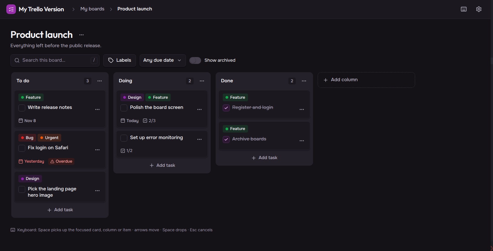

# my-trello-version

[](https://github.com/rafaelcsilvadev/my-trello-version/actions/workflows/ci.yml)

**English** | [Português](README.PT.md)

> 🚧 **Work in progress.** The back-end API is feature-complete (features 0 to 6). The web front-end has sign-up, log-in, the boards list, the board view, drag and drop, board filters, the card detail, its checklist, with items reordered by mouse or keyboard, and its labels; the labels page, with usage, create, edit and delete; and the settings screen, with language, theme and the keyboard shortcuts. The web front-end is feature-complete. The mobile app has not started yet.

A personal take on Trello: each user signs up and manages only their own boards, lists and cards.



The project has two goals:

1. Build an API with production-grade practices: modular architecture, three test levels, standardized errors, structured logs, and everything running on Docker.
2. Show a **disciplined** way of building software with AI: spec before code, TDD, small commits, independent verification, and human review of every Pull Request.

---

## Status

| # | Feature | What it delivers | Status |
|---|---------|------------------|--------|
| 0 | `foundation` | NestJS + pnpm setup, Docker, health check, validated config, TypeORM + migrations, RFC 9457 errors, structured logs with request id, Swagger, test infrastructure | ✅ Done |
| 1 | `auth` | Sign-up, JWT login, `GET /me`, global guard, per-IP rate limit | ✅ Done |
| 2 | `boards` | CRUD of the user's boards, archive | ✅ Done |
| 3 | `lists` | CRUD of lists inside a board, reorder | ✅ Done |
| 4 | `cards` | Title, description, due date, done flag, archive, move and reorder | ✅ Done |
| 5 | `labels` | Board labels applied to cards | ✅ Done |
| 6 | `checklists` | Checklist items on a card | ✅ Done |

MVP = features 0 to 4. Full roadmap in [`back-end/.specs/ROADMAP.md`](back-end/.specs/ROADMAP.md).

Web front-end: `foundation` (app shell, routes and auth guard, typed API client, theme, PT-BR/EN i18n, toasts, Docker service, CI) `auth` (sign-up, log-in, rate-limit notice, log-out) `boards` (active/archived tabs, create, edit, archive, restore, delete) and `board` (columns and cards, done flag, archived items, read-only archived board, phone layout) `board-dnd` (move cards and columns with the mouse or the keyboard, live region, "Move to…") `board-filters` (search, label and due-date filters, `/` shortcut, drag off while filtering) and `card-detail` (title, done flag, due date, description, move, archive, restore, delete, read-only modes, discard dialog) and `card-checklist` (add, tick, rename and delete items, progress bar, read-only modes) and `card-checklist-dnd` (reorder items with the mouse or the keyboard, live region) and `card-labels` (apply, remove and create labels from the card detail) and `labels` (the board's labels page: list with usage, create, edit, delete) and `settings` (language, theme, keyboard shortcuts panel and dialog) are done. Roadmap in [`front-end/.specs/ROADMAP.md`](front-end/.specs/ROADMAP.md).

---

## Stack

- **Runtime:** Node.js 24, TypeScript 6, pnpm workspace (monorepo)
- **API:** NestJS 12, class-validator, Zod (environment variable validation)
- **Database:** PostgreSQL 18, TypeORM with migrations (`synchronize` disabled)
- **Auth:** JWT (`@nestjs/jwt`), passwords hashed with native argon2id from `node:crypto`, rate limiting with `@nestjs/throttler`
- **Observability:** Pino (JSON logs with request id and password redaction at any depth)
- **Docs:** Swagger / OpenAPI at `/api/docs`
- **Web:** React 19 + Vite 8, React Router 8, TanStack Query, `openapi-fetch`, Tailwind CSS v4, i18next, served by nginx in Docker
- **Tests:** Jest, Supertest, Testcontainers (real PostgreSQL in integration and e2e tests); Vitest, Testing Library, MSW and Playwright on the web app
- **Quality:** oxlint (type-aware), Prettier
- **Infra:** multi-stage Docker build + Docker Compose

## Technical highlights

- **Modular architecture.** One NestJS module per feature (`auth`, `users`, ...), layered as entity → repository → service → controller.
- **Standardized errors.** Every error leaves through a single global filter as [RFC 9457 Problem Details](https://www.rfc-editor.org/rfc/rfc9457), with a `requestId`. Domain errors are mapped to HTTP status codes in one place.
- **Secure by default.** Every route requires a token. Public routes must opt out explicitly with `@Public()`. Login and sign-up are rate-limited per IP (10 requests per minute by default, set with `AUTH_RATE_LIMIT`). The app refuses to boot without a valid `JWT_SECRET`. Security headers via `helmet`, CORS limited to the origins in `CORS_ORIGINS`, and JSON bodies capped at 100kb (`413` Problem Details).
- **Three test levels.** Unit (no I/O), integration (repositories against a real PostgreSQL) and e2e (HTTP against the whole app). More than 1,000 tests so far.
- **Shared API contract.** `packages/api-contract` holds TypeScript types generated from the OpenAPI document. CI regenerates them and fails if the committed contract is out of date.
- **One-command run.** `docker compose up` starts the web app, the API and the database, with no local Node or PostgreSQL install.

---

## How AI is used in this project

The code is written in pair with **[Claude Code](https://claude.com/claude-code)**, Anthropic's AI coding agent that runs in the terminal. The AI does not generate the project in one shot. It follows a fixed process, and **I make the decisions and review every Pull Request before it is merged**.

### 1. Spec before code (Spec-Driven Development)

Each feature goes through four phases, driven by the `tlc-spec-driven` skill:

| Phase | Output | File |
|-------|--------|------|
| **Specify** | Testable requirements in **EARS** notation (`WHEN ... THEN the system SHALL ...`), each with an ID (`AUTH-01`, `FND-07`, ...) | `spec.md` |
| **Context** | Product decisions discussed with me (e.g. access token only, no refresh token in this phase) | `context.md` |
| **Design** | Technical design: modules, contracts, error flow | `design.md` |
| **Tasks** | Atomic tasks, each with "Done when" criteria and linked to the requirements it covers | `tasks.md` |

Everything is versioned in [`back-end/.specs/features/`](back-end/.specs/features/). The `auth` feature, for example, has 20 acceptance criteria and 12 tasks.

### 2. Architecture decision log

Important decisions become numbered entries in `STATE.md`, with **decision, reason, trade-off and status**. Examples:

- `GL-AD-001`: pnpm monorepo with a single lockfile ([`.specs/STATE.md`](.specs/STATE.md))
- `BE-AD-004`: every error leaves as Problem Details through one global filter ([`back-end/.specs/STATE.md`](back-end/.specs/STATE.md))
- `BE-AD-006`: global JWT guard with explicit opt-out via `@Public()`

This way the AI (and any human) understands *why* the code is the way it is in future sessions, without relying on memory.

### 3. TDD and small commits

During execution, the `pair-programming` skill takes over:

- Every task follows **TDD**: failing test → minimal code → refactor.
- **One commit per task**, using Conventional Commits (`feat(auth): add login endpoint`), small enough to review in minutes.
- Tests ship in the same commit as the code they cover. Every commit builds and passes the tests.
- A feature becomes a **Pull Request** that I review before merging.

Commits made in pair with the AI carry a `Co-Authored-By: Claude` trailer, so the history shows transparently where it took part.

### 4. Independent verification (author ≠ verifier)

When a feature is done, a **separate sub-agent** that did not write the code validates the work:

- **Traceability:** every acceptance criterion must point to a real test (`file:line` + assertion). No evidence, no pass.
- **Discrimination sensor (lightweight mutation testing):** the verifier injects bugs on purpose and checks that the tests catch them. In `foundation`, 10 of 10 mutants were killed. In `auth`, 14 of 16 (the 2 survivors do not change observable behavior).
- **Report:** verdict, gaps found and a fix plan are written to `validation.md`.

Gaps become their own tasks and PRs. For example, PR #29 added edge-case tests flagged by the `auth` validation (a 254-character email, a token sent with the `Basic` scheme, etc.).

### 5. Lessons that learn from the project

Problems found during validation become **lessons**, recorded by a script in [`back-end/.specs/LESSONS.md`](back-end/.specs/LESSONS.md). Examples:

- "For every length limit, test both the largest accepted value and the first rejected one."
- "Redact sensitive keys at any nesting depth, not only at fixed paths."

A lesson only becomes a confirmed rule after it shows up in more than one feature. The process improves every cycle without piling up useless rules.

### 6. Supporting tools

- **CodeGraph (MCP):** a graph index of the codebase that the AI uses to find symbols, calls and the impact of a change without reading files blindly.
- **Custom skills:** reusable instructions that pin down the process (spec, TDD, review, commits), so the AI works the same way in every session.

### My role

- Define the scope and priorities of each feature.
- Answer product questions and approve the spec, design and tasks.
- Review and approve every Pull Request.
- Challenge and correct the AI's decisions when they don't make sense.

---

## Running the project

### With Docker (recommended)

```bash
git clone https://github.com/rafaelcsilvadev/my-trello-version.git
cd my-trello-version
docker compose up --build
```

- API: http://localhost:3000/api/v1
- Health check: http://localhost:3000/api/v1/health
- Swagger: http://localhost:3000/api/docs
- Web app: http://localhost:5173

The web image bakes `VITE_API_URL` (default `http://localhost:3000`) into the bundle at build time. To point it at another API origin, change the `VITE_API_URL` build arg of the `web` service in `docker-compose.yml` and rebuild.

To load the demo data (a user with boards, lists, cards, labels and checklists), run in another terminal:

```bash
docker compose exec api node dist/seed/seed.js
```

Then log in as `demo@example.com` / `demo1234`. Every run resets the demo account to the same data; other users are not touched.

In the web app:

1. Open http://localhost:5173. Without a session you land on `/login`.
2. Log in with the demo user above, or follow **Create account** to sign up with your own e-mail (name, e-mail, password of 8 to 72 characters). Both take you to `/boards`.
3. Open **Settings** (gear icon in the top bar) to pick the language and the theme, read the keyboard shortcuts and **Sign out** (see below).

Managing boards on `/boards`:

- **Create board** opens a form with a name (up to 100 characters) and an optional description (up to 1000). Saving takes you to the new board at `/b/{id}`.
- Each board card has a **Board actions** menu. On the **Active** tab it offers **Edit** (same form, pre-filled) and **Archive**.
- Archived boards move to the **Archived** tab, where the menu offers **Restore** (back to **Active**) and **Delete permanently**.
- **Delete permanently** removes the board with all its columns, tasks and labels. It cannot be undone, so the button only unlocks after you type the board's name.

Using a board on `/b/{id}`:

- A new board has no columns, so it opens with **Add the first column**. Type a name (up to 100 characters) and press Enter; the field stays open for the next one. **Add column** after the last column does the same later.
- Click a column name (or pick **Rename** in its **Column actions** menu) to rename it; Enter or leaving the field saves, Esc cancels. **Archive** in the same menu hides the column.
- **Add task** in a column footer opens a title field (up to 100 characters); Enter adds the task at the end and keeps the field open, Esc closes it. Press `n` anywhere outside a text field to open it in the first column (it also clears any search or filter).
- Tick **Completed** on a task to mark it done; it shows struck through.
- Drag a task with the mouse to another spot or column: a dashed placeholder shows where it lands. Drag a column by its header to reorder the columns.
- With the keyboard, focus a task (or a column header) and press Space to pick it up. ↑ ↓ change the position, ← → change the column (for a column, ← → change its position), and Space or Enter drops it; Esc puts it back. A banner above the columns shows where it is, and a screen reader hears every step. A help line under the board recalls the keys.
- Every task has a **Move to…** menu that lists the columns; picking one moves the task to the end of that column. On a phone, this is the way to move a task.
- Turn on **Show archived** in the toolbar to see, after the active columns, an **Archived** column with every archived task (with the date and the column it came from) and the **Archived columns** section. There, **Restore** puts a column back at the end and **Delete permanently** removes it with all its tasks after a confirmation that says how many tasks go with it. The switch is off every time a board opens.
- An archived board (opened from the **Archived** tab) is read-only: a banner reads "Board archived · read-only", the add controls and column menus are hidden and the checkboxes are disabled. **Restore** in the banner makes it editable again.
- On a phone, the board shows one column per screen. Swipe between them, or tap a dot under the header; the text next to the dots reads "{column} · 1 of 3". The back arrow returns to `/boards`.

Searching and filtering a board:

- **Search this board…** is the first control of the toolbar. It keeps the tasks whose title or description contains the text, ignoring case and accents ("reuniao" finds "Reunião"). Press `/` outside a text field to jump to it; the × button (**Clear search**) or Esc empties it.
- **Labels** opens a menu with the board's labels; tick one or more to keep the tasks that carry at least one of them. The button then reads "Labels · 2".
- **Due date** offers **Any due date**, **Overdue** (not done and due before today), **Due today**, **No due date** and **Completed**.
- Search, labels and due date combine. While any of them is on, each column header shows how many tasks match, the toolbar shows the total, and **Clear filters** resets all three. When nothing matches, the columns give way to "No tasks found" with the same button.
- While filtering, dragging is off and a notice says so: moving a task inside a partial list would put it in the wrong spot. **Move to…** still works, and so does **Add task**. Archived tasks and columns (with **Show archived** on) are never filtered.
- Filters are not saved: every board opens with an empty search, no label and **Any due date**.

Opening a task:

- Click a task (or focus it and press Enter) to open its detail at `/b/{id}/t/{taskId}`: a dialog over the board on a desktop, a full screen with a **Back** arrow on a phone. The link works on its own too: reload it or share it and the board loads behind the task. The header shows the task's column; a task that no longer exists shows "This task no longer exists" with **Close**.
- Tick **Completed** to mark the task done; a "Completed" badge shows next to the title ("Overdue" shows instead when it is not done and its due date has passed).
- Edit the title in place: Enter or leaving the field saves, Esc puts the saved title back. An empty title ("Give the task a title") or one over 100 characters is not saved.
- Pick a date in **Due date** to set it, and **Remove due date** to clear it. Both save at once.
- **Description** holds up to 5000 characters, with a counter under the field. **Save** and **Cancel** show only while the text differs from the saved one.
- **Checklist**, below the description, lists the task's items. With at least one item, the heading shows the count ("2/3") and a progress bar, green once every item is done. If the items fail to load, **Try again** loads them again; the rest of the detail still works.
- Type in "Add an item and press Enter" and press Enter to add an item at the end; the field clears and keeps the focus. An empty item ("Write the item") or one over 200 characters is not added.
- Tick an item's checkbox to mark it done (its text is struck through) or not done; the count updates at once.
- Edit an item's text in place: Enter or leaving the field saves, Esc puts the saved text back. An empty text or one over 200 characters is not saved.
- The X next to an item deletes it at once, with no confirmation, and moves the focus to the add field.
- Each item starts with a grip (⋮⋮). Drag an item by its grip to reorder it: the item turns dashed and a dashed placeholder shows where it will land. Dragging from the text, the checkbox or the X does not move it, so you can still select text.
- With the keyboard, focus an item's grip and press Space to pick it up. ↑ ↓ move it one position, Space or Enter drops it, and Esc puts it back without closing the detail. A banner above the items shows "Moving “Buy milk”: position 2 of 3", and a screen reader hears every step.
- An item that is still saving can't be moved until it finishes. On a phone or tablet there is no reorder by touch: items keep their saved order.
- **Labels** show as chips. The **+** button next to them opens a popover with a search field ("Search labels…"), the board's labels and the links below. Tick a label to apply it, untick it to remove it: the chip changes on the detail and on the board tile at once, and the popover stays open. If a change fails, the tick goes back and a toast tells you.
- Type in the search field to narrow the list (case and accents are ignored); "No labels found" shows when nothing matches.
- **Create label** opens a form with a name and one of 10 colors. **Create** (or Enter) adds the label to the board and applies it to the task. An empty name, one over 50 characters or one that already exists on the board is not created.
- **Manage labels** goes to the board's labels page (see below). Esc, a click outside or the **+** button closes the popover and returns the focus to **+**.
- In both read-only modes below the labels still show, but there is no **+** button.
- The footer shows when the task was created, **Move to…** (the same dialog as on the board; the detail stays open on the new column) and **Archive**.
- An archived task opens read-only with the notice "Archived task · read-only"; open it from the **Archived** column (**Show archived**). **Restore** makes it editable again and puts it at the end of its column. **Delete permanently** asks for confirmation and then removes the task with its checklist. If the task's column is archived, both buttons are off until you restore the column.
- A task of an archived board shows "Archived board · read-only", with every field off and no footer action.
- In both read-only modes the checklist still shows the count and the progress bar, but the checkboxes and texts are off and there is no add field, no X and no grip.
- Close the detail with X, Esc, a click outside it or the browser's Back button; focus returns to the task on the board. If the title, the description or a checklist item has unsaved edits, "Discard changes?" asks first: **Keep editing** keeps your text, **Discard** closes without saving.
- While the detail is open, the `n` and `/` shortcuts are off.

Managing a board's labels on `/b/{id}/labels`:

- Open it with **Board labels** in the board header, or with **Manage labels** in a task's label popover. The breadcrumb reads Boards › board › Labels, and **Back to the board** returns to the board. Labels belong to one board only.
- The page lists every label of the board with its color and how many tasks use it: "unused", "used in 1 task" or "used in 3 tasks". A board without labels shows "No labels yet" with **New label**.
- **New label** opens a form with a name (up to 50 characters) and one of 10 colors. **Create label** (or Enter) adds it to the list. An empty name, one over 50 characters or one already used on the board is not saved.
- **Edit label** (pencil on a row) opens the same form pre-filled. **Save** changes the name, the color or both, and the change shows on every task that carries the label.
- **Delete label** (bin on a row) asks "Delete the label …?" and says how many tasks lose it ("No task uses this label.", "It will be removed from 1 task.", "It will be removed from 3 tasks."). **Delete** removes the label from the board and from those tasks. It cannot be undone.
- On an archived board the page is read-only: a notice reads "Archived board · read-only", the list still shows, but **New label** and the edit and delete buttons are hidden.

Settings on `/settings`:

- **Language** offers Português (Brasil) and English. The choice applies at once, without a reload, and is kept in `my-trello.language` for the next visit. A stored value the app does not know falls back to English.
- **Theme** offers Light, Dark and System ("System follows your device."). The app repaints at once and keeps the choice in `my-trello.theme`. With System, it follows the device's dark-mode setting. Arrow keys move between the options of each group.
- If the browser blocks `localStorage`, the choice still holds until you close the tab.
- **Keyboard shortcuts** (desktop only, 768 px or wider) lists the five shortcuts: `N` new task in the first column, `/` search the board, `Esc` close the innermost layer, `Space` pick up and drop the focused card, column or item, and `?` show shortcuts. The panel is not rendered on a phone.
- On desktop, the keyboard icon in the top bar, before the gear, opens the same list in a dialog. The `?` key opens it too, unless you are typing in a field, hold Ctrl, Meta or Alt, or have another dialog (such as the card detail) open. Esc or **Close** closes it and returns the focus to where it was. Resizing below 768 px closes it.
- **Session** shows who is signed in and **Sign out**.

Changes show at once and are saved in the background. If saving fails, the change is undone and a toast offers **Try again**.

A page opened without a session sends you to `/login` and back to it after logging in. The API limits log-in attempts per IP; when the limit is hit, the form asks you to wait a minute.

To stop everything (add `-v` to also delete the database volume):

```bash
docker compose down
```

### Locally

Requirements: Node.js 24.17.0, pnpm 11, a reachable PostgreSQL, and Docker (for the Testcontainers-based tests).

```bash
pnpm install
cd back-end
cp .env.example .env    # set DATABASE_URL and JWT_SECRET
pnpm start:dev          # migrations run automatically on boot
```

Demo data (the seed reads the environment, not `.env`):

```bash
set -a && . ./.env && set +a && pnpm seed
```

Web app, from the repository root, with the API running (Docker or `pnpm start:dev`):

```bash
cd front-end
pnpm dev                # http://localhost:5173
```

- `VITE_API_URL` sets the API origin (default `http://localhost:3000`), e.g. `VITE_API_URL=http://localhost:4000 pnpm dev`.
- Keep port 5173: the API only accepts browser calls from the origins in `CORS_ORIGINS` (`http://localhost:5173` in `docker-compose.yml`).

### Tests

Back-end, from the repository root:

```bash
cd back-end
pnpm test               # unit
pnpm test:integration   # integration (starts PostgreSQL via Testcontainers)
pnpm test:e2e           # HTTP e2e
pnpm lint
```

Web app, from the repository root:

```bash
cd front-end
pnpm test               # unit and component (Vitest + MSW)
pnpm typecheck
pnpm lint
pnpm build
pnpm exec playwright install chromium   # once, downloads the browser
pnpm test:e2e           # Playwright; starts postgres and api with docker compose
```

`test:e2e` leaves the `postgres` and `api` containers running, so the next run is faster. Stop them from the repository root with `docker compose down`.

---

## Project structure

```
my-trello-version/
├── .specs/                # monorepo-wide decisions
├── back-end/
│   ├── .specs/            # roadmap, decisions, lessons and per-feature specs
│   ├── src/               # NestJS modules (auth, users, health, errors, logging, ...)
│   ├── test/              # unit/, integration/, e2e/
│   └── Dockerfile
├── front-end/
│   ├── .specs/            # roadmap, decisions and per-feature specs
│   ├── src/               # app/, pages/, shared/, styles/
│   ├── test/              # unit/, e2e/, support/
│   ├── Dockerfile
│   └── nginx.conf
├── packages/
│   └── api-contract/      # API types generated from OpenAPI
└── docker-compose.yml
```
