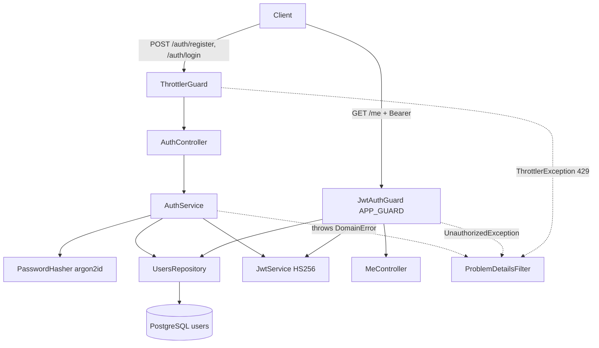

# Auth Design

**Spec**: `.specs/features/auth/spec.md`
**Status**: Approved

---

## Architecture Overview

Two modules, following BE-AD-005 (entity → repository → service → controller):

- `users` owns the `users` table: entity, repository and `GET /me`.
- `auth` owns credentials and tokens: register/login controller, `AuthService`, password hashing, the global `JwtAuthGuard` and the rate limit.

Every route is protected by default: `JwtAuthGuard` is registered as `APP_GUARD` and lets through only handlers marked `@Public()`. `ThrottlerGuard` is applied only on `AuthController`.



---

## Code Reuse Analysis

### Existing Components to Leverage

| Component | Location | How to Use |
| --------- | -------- | ---------- |
| `validateEnv` / `envSchema` | `src/config/env.schema.ts` | Add `JWT_SECRET`, `JWT_EXPIRES_IN`; startup failure already covers AUTH-12 |
| `ProblemDetailsFilter` + `buildProblem` | `src/errors/problem-details.filter.ts`, `src/errors/problem-details.ts` | `buildProblem` already accepts `type`; the filter gains a `DomainError` branch |
| Global `ValidationPipe` (`whitelist`, `forbidNonWhitelisted`, `transform`) | `src/app.setup.ts:36` | DTO validation gives AUTH-03/04/05/10 and FND-09 for free |
| `DatabaseModule` (`autoLoadEntities`, `migrationsRun`) | `src/database/database.module.ts` | New entity registered via `TypeOrmModule.forFeature`; migration runs on boot |
| Log redaction of `Authorization` and `password` | `src/logging/logging.module.ts`, `src/logging/redact-passwords.ts` | Covers token/password leakage in logs, nothing to add |
| `createTestApp` | `test/support/create-test-app.ts` | Gains an option to keep the real throttler storage; default replaces it with a no-limit storage |
| Testcontainers global setup | `test/support/postgres.global-setup.ts` | Also sets `JWT_SECRET` for the test process |

### Integration Points

| System | Integration Method |
| ------ | ------------------ |
| `HealthController` | Marked `@Public()` so the Docker healthcheck keeps working (AUTH-16) |
| Swagger | `.addBearerAuth()` in `setupSwagger`; protected controllers use `@ApiBearerAuth()`; `/api/docs*` are Express routes outside Nest guards, so they stay public |
| Docker compose | `api` service gets `JWT_SECRET` (dev-only value, commented) and `JWT_EXPIRES_IN` |
| Future features (boards, lists, cards) | Use `@CurrentUser()` to get the caller's id; protected without extra code |

---

## Components

### User entity

- **Purpose**: TypeORM entity for table `users`.
- **Location**: `src/users/user.entity.ts`
- **Interfaces**: `class User { id; name; email; passwordHash; createdAt }`
- **Dependencies**: TypeORM
- **Reuses**: `autoLoadEntities`

### CreateUsers migration

- **Purpose**: Creates table `users` with the unique email constraint.
- **Location**: `src/database/migrations/<timestamp>-CreateUsers.ts`
- **Interfaces**: `up` / `down` (hand-written SQL, see Data Models)
- **Dependencies**: `MIGRATIONS_GLOB`
- **Reuses**: foundation migration setup

### UsersRepository

- **Purpose**: All queries on `users`.
- **Location**: `src/users/users.repository.ts`
- **Interfaces**:
  - `create(input: { name: string; email: string; passwordHash: string }): Promise<User>` - throws `EmailAlreadyRegisteredError` when PostgreSQL reports `23505` on constraint `UQ_users_email` (AUTH-02, AUTH-20)
  - `findByEmail(email: string): Promise<User | null>`
  - `findById(id: string): Promise<User | null>`
- **Dependencies**: injected TypeORM `Repository<User>`
- **Reuses**: BE-AD-005 layering

### MeController (`users` module)

- **Purpose**: `GET /api/v1/me` returns the caller's profile (AUTH-13).
- **Location**: `src/users/me.controller.ts`, `src/users/dto/user-response.dto.ts`
- **Interfaces**: `get(@CurrentUser() user: User): UserResponseDto`
- **Dependencies**: `JwtAuthGuard` has already loaded the user
- **Reuses**: `toUserResponse(user)` mapper shared with `AuthController`

### PasswordHasher

- **Purpose**: Hash and verify passwords with argon2id using Node's built-in `crypto.argon2` (AUTH-07).
- **Location**: `src/auth/password-hasher.ts`
- **Interfaces**:
  - `hash(password: string): Promise<string>` - returns a self-describing string `argon2id$m=19456,t=2,p=1$<salt b64>$<hash b64>`
  - `verify(password: string, stored: string): Promise<boolean>` - recomputes with the stored parameters, compares with `crypto.timingSafeEqual`
  - `verifyAgainstDummy(password: string): Promise<false>` - burns the same time for an unknown email (timing assumption)
- **Dependencies**: `node:crypto`
- **Reuses**: none

### AuthService

- **Purpose**: Register and login rules; issues tokens.
- **Location**: `src/auth/auth.service.ts`
- **Interfaces**:
  - `register(input: RegisterDto): Promise<AuthResult>` - hash → `usersRepository.create` → token (AUTH-01, AUTH-02)
  - `login(input: LoginDto): Promise<AuthResult>` - `findByEmail` → `verify` (or `verifyAgainstDummy`) → token, else `InvalidCredentialsError` (AUTH-08, AUTH-09)
  - `AuthResult = { accessToken: string; user: User }`
- **Dependencies**: `UsersRepository`, `PasswordHasher`, `JwtService`
- **Reuses**: none

### AuthController + DTOs

- **Purpose**: HTTP contract for `POST /api/v1/auth/register` (`201`) and `POST /api/v1/auth/login` (`200`).
- **Location**: `src/auth/auth.controller.ts`, `src/auth/dto/register.dto.ts`, `src/auth/dto/login.dto.ts`, `src/auth/dto/auth-response.dto.ts`
- **Interfaces**:
  - `RegisterDto { name: @Transform(trim) @IsString @Length(1, 100); email: @Transform(trim+lowercase) @IsEmail @MaxLength(254); password: @IsString @Length(8, 72) }`
  - `LoginDto { email: @Transform(trim+lowercase) @IsString @IsNotEmpty; password: @IsString @IsNotEmpty }` - no length rules on login, so rules are not leaked and old passwords keep working
  - `AuthResponseDto { accessToken; user: UserResponseDto }`
- **Dependencies**: `AuthService`, `ThrottlerGuard`
- **Reuses**: global `ValidationPipe`; `@Public()`
- Transforms only touch string values, so a non-string still fails `@IsString`.

### JwtAuthGuard, `@Public()`, `@CurrentUser()`

- **Purpose**: Default-deny authentication for every route (AUTH-14, AUTH-15, AUTH-16).
- **Location**: `src/auth/jwt-auth.guard.ts`, `src/auth/public.decorator.ts`, `src/auth/current-user.decorator.ts`
- **Interfaces**:
  - `canActivate(ctx)`: `@Public()` → `true`; else parse `Authorization: Bearer <token>`, `jwtService.verifyAsync` (algorithm pinned to `HS256`), `usersRepository.findById(sub)`, attach to `req.user`; any failure → `UnauthorizedException('Missing or invalid access token.')`
  - `@Public()` = `SetMetadata(IS_PUBLIC, true)`
  - `@CurrentUser()` = param decorator returning `req.user as User`
- **Dependencies**: `Reflector`, `JwtService`, `UsersRepository`
- **Reuses**: filter maps `UnauthorizedException` to `401` `about:blank`

### Domain error mapping

- **Purpose**: Turn framework-free domain errors into Problem Details in one place (BE-AD-004).
- **Location**: `src/errors/domain-error.ts`, `src/errors/domain-error-mappings.ts`, filter branch in `src/errors/problem-details.filter.ts`; auth errors in `src/auth/auth.errors.ts`
- **Interfaces**:
  - `abstract class DomainError extends Error`
  - `DOMAIN_ERROR_MAPPINGS: ReadonlyArray<{ error: Constructor<DomainError>; status: number; type: string }>`
  - `EmailAlreadyRegisteredError` → `409`, `/problems/email-already-registered`, detail `"Email is already registered."`
  - `InvalidCredentialsError` → `401`, `/problems/invalid-credentials`, detail `"Invalid email or password."`
  - An unmapped `DomainError` falls through to `500` (programming error, logged).
- **Dependencies**: none
- **Reuses**: `buildProblem({ type })`

### Rate limit

- **Purpose**: 10 requests / 60 s per IP on each auth route (AUTH-17, AUTH-18, AUTH-19).
- **Location**: `ThrottlerModule.forRoot` in `src/auth/auth.module.ts`; `@UseGuards(ThrottlerGuard)` on `AuthController`
- **Interfaces**: `forRoot({ throttlers: [{ ttl: 60_000, limit: 10 }], errorMessage: 'Too many requests. Try again later.' })`
- **Dependencies**: `@nestjs/throttler` 6.7.1 (in-memory storage)
- **Reuses**: filter maps `ThrottlerException` (an `HttpException` 429) to Problem Details
- Separate counts come from the default key, which hashes controller class + handler name + throttler name; the `default` throttler sets a plain `Retry-After` header (verified in `throttler.guard.js` of 6.7.1).

### Config

- **Location**: `src/config/env.schema.ts`, `back-end/.env.example`, `docker-compose.yml`, `test/support/postgres.global-setup.ts`
- `JWT_SECRET: z.string().min(32)` (required); `JWT_EXPIRES_IN: z.string().regex(/^\d+[smhd]$/).default('1h')`
- `JwtModule.registerAsync` reads both: `{ secret, signOptions: { algorithm: 'HS256', expiresIn }, verifyOptions: { algorithms: ['HS256'] } }`

---

## Data Models

### users

```sql
CREATE TABLE "users" (
  "id" uuid PRIMARY KEY DEFAULT gen_random_uuid(),
  "name" varchar(100) NOT NULL,
  "email" varchar(254) NOT NULL CONSTRAINT "UQ_users_email" UNIQUE,
  "password_hash" text NOT NULL,
  "created_at" timestamptz NOT NULL DEFAULT now()
);
```

```typescript
@Entity('users')
class User {
  @PrimaryGeneratedColumn('uuid') id: string
  @Column({ length: 100 }) name: string
  @Column({ length: 254, unique: true }) email: string // stored normalized (AUTH-06)
  @Column({ name: 'password_hash', type: 'text' }) passwordHash: string
  @CreateDateColumn({ name: 'created_at', type: 'timestamptz' }) createdAt: Date
}
```

**Relationships**: none yet; `boards.owner_id` will reference `users.id`.

Response shape (`UserResponseDto`): `{ id, name, email, createdAt }` - `createdAt` as ISO 8601 string. `passwordHash` never leaves the service layer (AUTH-07).

---

## Error Handling Strategy

| Error Scenario | Handling | User Impact |
| -------------- | -------- | ----------- |
| Invalid register/login body | `ValidationPipe` → `RequestValidationException` | `400` + `errors[]` |
| Email taken (also concurrent insert) | Repository maps `23505`/`UQ_users_email` → `EmailAlreadyRegisteredError` → mapping | `409`, `/problems/email-already-registered` |
| Unknown email / wrong password | `InvalidCredentialsError` → mapping | `401`, `/problems/invalid-credentials`, same body for both |
| Missing/malformed/invalid/expired token, deleted user | Guard throws `UnauthorizedException` | `401`, `about:blank` |
| Over rate limit | `ThrottlerException` | `429` + `Retry-After` |
| `JWT_SECRET` missing or < 32 chars | `validateEnv` throws at bootstrap | Exit non-zero, log names `JWT_SECRET` |
| Any other DB error | Not caught | `500` (FND-11) |

---

## Risks & Concerns

| Concern | Location (file:line) | Impact | Mitigation |
| ------- | -------------------- | ------ | ---------- |
| Rate limit breaks other e2e suites that register more than 10 users per app instance | `test/support/create-test-app.ts:13` | Flaky `429` in unrelated tests | `createTestApp` overrides `getStorageToken()` with a never-blocking storage by default; the rate-limit suite passes `{ rateLimit: true }` |
| Global guard makes the health check return `401` | `src/health/health.controller.ts:19` | Docker healthcheck fails, compose marks `api` unhealthy | `@Public()` on `HealthController` in the same task that adds the guard; health e2e stays in the gate |
| Swagger UI has no way to send a token | `src/app.setup.ts:45` | Docs cannot call `/me` | `.addBearerAuth()` + `@ApiBearerAuth()` |
| `crypto.argon2` is recent in Node 24 (verified working on 24.17.0, the `.nvmrc` and Docker version) | `src/auth/password-hasher.ts` (new) | Breaks on an older Node | `.nvmrc` and the Docker image pin 24.17.0; unit tests run the real function |
| `req.ip` behind a reverse proxy is the proxy's IP | `@nestjs/throttler` default tracker | All clients share one limit | Compose exposes the API directly; `trust proxy` is out of scope until deployment |
| `JWT_SECRET` dev value in `docker-compose.yml` | `docker-compose.yml` | Real deployments reusing it could forge tokens | Commented as dev-only; production deployment is out of scope |
| In-memory throttler resets on restart and is per instance | `@nestjs/throttler` storage | Weaker limit with several instances | Accepted in spec assumptions (single instance) |

---

## Tech Decisions (only non-obvious ones)

| Decision | Choice | Rationale |
| -------- | ------ | --------- |
| Password hash | argon2id via Node built-in `crypto.argon2`, m=19 MiB, t=2, p=1 (OWASP baseline) | OWASP's first choice; no native npm package to build in the Alpine image |
| JWT library | `@nestjs/jwt` 12.0.3 directly, no Passport | One strategy only; a ~30-line guard is simpler than Passport + strategy classes |
| Rate limit | `@nestjs/throttler` 6.7.1, guard on `AuthController` only | Official Nest package; scoped to the two routes the spec names |
| Default protection | `JwtAuthGuard` as `APP_GUARD` + `@Public()` opt-out | New routes are protected by default (spec assumption) |
| Guard loads the user | `findById(sub)` on each protected request | Required by AUTH-15; one indexed PK lookup |
| `/me` location | `users` module | `/me` is a user resource; `auth` only issues credentials |
| Column naming | snake_case columns via `name:` in `@Column` | SQL convention; entity properties stay camelCase |

Proposed project-level decisions (to add to `back-end/.specs/STATE.md` on approval):

- **BE-AD-006**: Every route requires a valid access token through the global `JwtAuthGuard`; public routes opt out with `@Public()`, and handlers read the caller with `@CurrentUser()`.
- **BE-AD-007**: Domain errors extend `DomainError` and are mapped to `status` + `type` only in `src/errors/domain-error-mappings.ts` (refines BE-AD-004).
