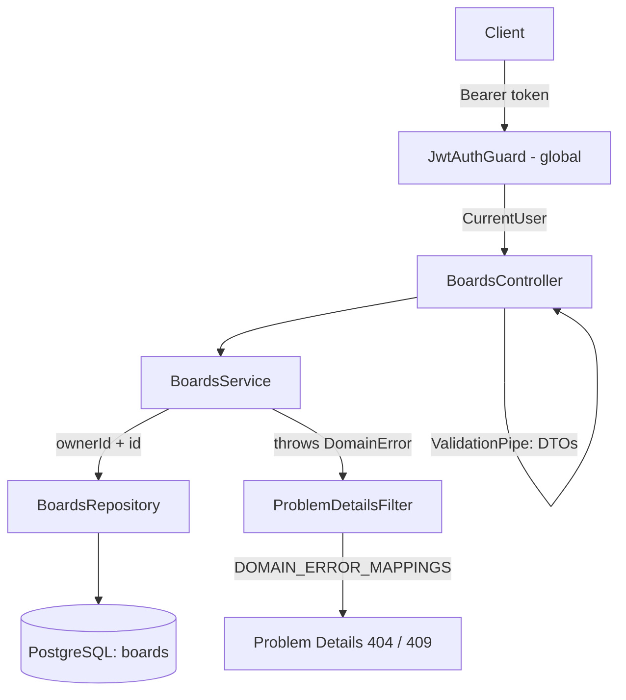

# Boards Design

**Spec**: `.specs/features/boards/spec.md`
**Status**: Approved

---

## Architecture Overview

A new `boards` module following BE-AD-005: entity, repository, service, controller and DTOs in `src/boards/`. Ownership is enforced in the repository: every query that reads or writes a board filters by `owner_id`, so the service never holds another user's board and a foreign id behaves exactly like a missing one (BRD-09, BRD-21).



### Approaches considered

| Approach | How ownership is enforced | Verdict |
| -------- | ------------------------- | ------- |
| **A. Owner-scoped repository** (chosen) | Repository methods take `ownerId` and put it in every `WHERE`; service throws `BoardNotFoundError` on `null` | Recommended: one query per lookup, impossible to forget per call because there is no unscoped finder; matches the `users` repository style |
| B. Ownership guard / interceptor | Guard loads the board by id, compares `ownerId` to the caller, attaches it to the request | Extra layer and a second lookup path; the guard and the service both need the board; harder to unit test |
| C. PostgreSQL row-level security | `SET app.user_id` per request plus RLS policies | Overkill for one API process; needs per-request transaction plumbing |

---

## Code Reuse Analysis

### Existing Components to Leverage

| Component | Location | How to Use |
| --------- | -------- | ---------- |
| `JwtAuthGuard` (global) + `@CurrentUser()` | `src/auth/jwt-auth.guard.ts`, `src/auth/current-user.decorator.ts` | Controller reads the caller; no `@Public()`, so every route is protected (BRD-22) |
| Global `ValidationPipe` (`whitelist`, `forbidNonWhitelisted`, `transform`) + `validationExceptionFactory` | `src/app.setup.ts:33` | DTO errors become `400` with `errors[{ field, message }]` (BRD-03, BRD-04, BRD-07, BRD-12); unknown body or query properties → `400` |
| `trim` transform pattern | `src/auth/dto/register.dto.ts:6` | Same transform shape for `title`; leaves non-strings to `@IsString` |
| `DomainError` + `DOMAIN_ERROR_MAPPINGS` | `src/errors/domain-error.ts`, `src/errors/domain-error-mappings.ts` | Three new errors mapped to `404` / `409` with specific `type` (BE-AD-007) |
| `toUserResponse` pattern | `src/users/dto/user-response.dto.ts:19` | `toBoardResponse` is the only way a `Board` leaves the API (`ownerId` never does) |
| Hand-written SQL migration | `src/database/migrations/1792080000000-CreateUsers.ts` | Same style for `CreateBoards` |
| `bootWithDatabase` | `test/support/boot-with-database.ts` | Integration tests for `BoardsRepository` and the `boards` table |
| `createTestApp` | `test/support/create-test-app.ts` | e2e tests against the full app |

### Integration Points

| System | Integration Method |
| ------ | ------------------ |
| `AppModule` | Imports `BoardsModule` |
| `users` table | `boards.owner_id` FK → `users.id` `ON DELETE CASCADE` (BRD-23); no TypeORM relation, so `boards` does not import the `User` entity |
| Error mapping | `domain-error-mappings.ts` imports `boards.errors.ts` |
| Future `lists` / `cards` | `BoardsModule` exports `BoardsService`; `lists` will call `boardsService.findOwned(ownerId, id)` to check board access |

---

## Components

### `Board` entity

- **Purpose**: TypeORM mapping of the `boards` table.
- **Location**: `src/boards/board.entity.ts`
- **Interfaces**: columns `id`, `ownerId`, `title`, `description`, `archivedAt`, `createdAt`, `updatedAt` (see Data Models).
- **Dependencies**: TypeORM.
- **Reuses**: `User` entity style.

### `BoardsRepository`

- **Purpose**: Every query on `boards`, always scoped by owner.
- **Location**: `src/boards/boards.repository.ts`
- **Interfaces**:
  - `create(input: { ownerId; title; description }): Promise<Board>`
  - `findOwned(ownerId: string, id: string): Promise<Board | null>`
  - `listOwned(ownerId: string, archived: boolean): Promise<Board[]>` - `archived_at IS [NOT] NULL`, `ORDER BY created_at DESC`
  - `save(board: Board): Promise<Board>` - persists changes to a board already loaded through `findOwned`
  - `deleteOwned(ownerId: string, id: string): Promise<void>`
- **Dependencies**: `Repository<Board>`.
- **Reuses**: `UsersRepository` structure.

### `BoardsService`

- **Purpose**: Board rules: ownership lookup, read-only while archived, delete only from the archive, idempotent archive/unarchive.
- **Location**: `src/boards/boards.service.ts`
- **Interfaces**:
  - `create(ownerId, { title, description }): Promise<Board>`
  - `list(ownerId, archived: boolean): Promise<Board[]>`
  - `findOwned(ownerId, id): Promise<Board>` - throws `BoardNotFoundError` when `id` is not a UUID (checked with `isUUID` before querying, so PostgreSQL never sees a malformed uuid) or no owned board matches
  - `update(ownerId, id, changes: { title?; description? }): Promise<Board>` - `BoardArchivedError` while archived; no `save` when `changes` has no keys (BRD-13)
  - `archive(ownerId, id): Promise<Board>` - sets `archivedAt = new Date()` only when `null`; otherwise returns as is (BRD-16)
  - `unarchive(ownerId, id): Promise<Board>` - sets `archivedAt = null` only when set (BRD-18)
  - `remove(ownerId, id): Promise<void>` - `BoardNotArchivedError` while active
- **Dependencies**: `BoardsRepository`.
- **Reuses**: `DomainError`.

### `BoardsController`

- **Purpose**: HTTP contract under `/api/v1/boards`.
- **Location**: `src/boards/boards.controller.ts`
- **Interfaces**:
  - `POST /boards` → `201 BoardResponseDto`
  - `GET /boards?archived=` → `200 BoardResponseDto[]`
  - `GET /boards/:id` → `200 BoardResponseDto`
  - `PATCH /boards/:id` → `200 BoardResponseDto`
  - `POST /boards/:id/archive` → `200` (`@HttpCode(200)`)
  - `POST /boards/:id/unarchive` → `200` (`@HttpCode(200)`)
  - `DELETE /boards/:id` → `204` (`@HttpCode(204)`)
- **Dependencies**: `BoardsService`, `@CurrentUser()`.
- **Reuses**: Swagger decorators as in `AuthController`; `:id` is a plain string param (no `ParseUUIDPipe`, which would answer `400`).

### DTOs

- **Location**: `src/boards/dto/`
- `CreateBoardDto`: `title` (`trim`, `@IsString`, `@Length(1, 100)`), `description` (`trimToNull`, `@IsOptional`, `@IsString`, `@MaxLength(1000)`).
- `UpdateBoardDto`: `title` with `@ValidateIf((dto) => dto.title !== undefined)` so `null` is rejected but absence is allowed; `description` same as create (`null` allowed and clears it).
- `ListBoardsQueryDto`: `archived` `@IsOptional`, `@IsIn(['true', 'false'])`; the controller converts it to a boolean.
- `BoardResponseDto` + `toBoardResponse(board)`: `{ id, title, description, archivedAt, createdAt, updatedAt }`, dates as ISO strings, `archivedAt` `null` when active.
- `trimToNull` transform: strings are trimmed and `''` becomes `null`; non-strings pass through to the validators (BRD-02).

### Domain errors

- **Location**: `src/boards/boards.errors.ts`

| Error | Status | `type` | `detail` |
| ----- | ------ | ------ | -------- |
| `BoardNotFoundError` | `404` | `/problems/board-not-found` | `Board not found.` |
| `BoardArchivedError` | `409` | `/problems/board-archived` | `Archived boards cannot be changed.` |
| `BoardNotArchivedError` | `409` | `/problems/board-not-archived` | `Only archived boards can be deleted.` |

---

## Data Models

### `Board`

```typescript
@Entity('boards')
export class Board {
  @PrimaryGeneratedColumn('uuid') id!: string;
  @Column({ name: 'owner_id', type: 'uuid' }) ownerId!: string;
  @Column({ length: 100 }) title!: string;
  @Column({ type: 'varchar', length: 1000, nullable: true }) description!: string | null;
  @Column({ name: 'archived_at', type: 'timestamptz', nullable: true }) archivedAt!: Date | null;
  @CreateDateColumn({ name: 'created_at', type: 'timestamptz' }) createdAt!: Date;
  @UpdateDateColumn({ name: 'updated_at', type: 'timestamptz' }) updatedAt!: Date;
}
```

### Migration `CreateBoards`

```sql
CREATE TABLE "boards" (
  "id" uuid PRIMARY KEY DEFAULT gen_random_uuid(),
  "owner_id" uuid NOT NULL
    CONSTRAINT "FK_boards_owner_id" REFERENCES "users" ("id") ON DELETE CASCADE,
  "title" varchar(100) NOT NULL,
  "description" varchar(1000),
  "archived_at" timestamptz,
  "created_at" timestamptz NOT NULL DEFAULT now(),
  "updated_at" timestamptz NOT NULL DEFAULT now()
);
CREATE INDEX "IDX_boards_owner_id_created_at" ON "boards" ("owner_id", "created_at" DESC);
```

**Relationships**: many boards → one user. The index serves both list queries (filter by owner, order by `created_at DESC`) and the owner-scoped lookups.

---

## Error Handling Strategy

| Error Scenario | Handling | User Impact |
| -------------- | -------- | ----------- |
| Missing / invalid token | Global `JwtAuthGuard` | `401` `about:blank` |
| Invalid body or query | `ValidationPipe` → `RequestValidationException` | `400` with `errors[]` per field |
| Unknown, foreign or malformed id | Service throws `BoardNotFoundError` | `404` `/problems/board-not-found` |
| `PATCH` on archived board | `BoardArchivedError` | `409` `/problems/board-archived` |
| `DELETE` on active board | `BoardNotArchivedError` | `409` `/problems/board-not-archived` |
| Database failure | Unhandled → filter | `500` (FND-11) |

---

## Risks & Concerns

| Concern | Location (file:line) | Impact | Mitigation |
| ------- | -------------------- | ---------- | ---------- |
| Test gap / fragile tests: integration suites call `undoLastMigration()` once, assuming `CreateUsers` is the last migration; `database.module.int-spec` asserts the exact migration history | `test/integration/users/users-table.int-spec.ts:26`, `:97`; `test/integration/users/users.repository.int-spec.ts` afterAll; `test/integration/database/database.module.int-spec.ts:65` | With `CreateBoards`, users suites revert `boards` instead of `users`, leave `CreateUsers` in history and break the history assertion and the "dropped when reverted" test | First task: add a `revertAllMigrations(dataSource)` test helper and use it in every suite's `afterAll`; the users "dropped" test reverts down to `CreateUsers` explicitly. Lands before the migration so the suite stays green per commit |
| `UpdateDateColumn` changes on every `save` | `src/boards/board.entity.ts` (new) | An idempotent archive/unarchive or empty `PATCH` would bump `updatedAt` if it saved | Service returns the loaded board without calling `save` when nothing changes (BRD-13, BRD-16, BRD-18) |
| Malformed uuid reaching PostgreSQL | `src/boards/boards.service.ts` (new) | `invalid input syntax for type uuid` → `500` instead of `404` | `isUUID` check in `BoardsService.findOwned` before any query (BRD-21) |
| `PATCH` racing with `archive` | `src/boards/boards.service.ts` (new) | A patch read before an archive may save after it | Accepted: last write wins (spec Assumptions); TypeORM `save` writes only changed columns, so the patch never clears `archivedAt` |

---

## Tech Decisions

| Decision | Choice | Rationale |
| -------- | ------ | --------- |
| Ownership enforcement | Owner-scoped repository methods (approach A) | One query, no unscoped finder to misuse; recorded as BE-AD-008 for lists and cards |
| `boards.owner_id` mapping | Plain uuid column + SQL FK, no TypeORM relation | Boards never need the `User` row; keeps `boards` independent of the `users` entity |
| Malformed id | `isUUID` in the service → `BoardNotFoundError` | Spec BRD-21 wants `404`; `ParseUUIDPipe` would answer `400` |
| `archived` query | String `IsIn(['true','false'])`, converted in the controller | Avoids implicit boolean conversion quirks (`'false'` → `true`) |
| Sort tie-break | `ORDER BY created_at DESC, id DESC` | Deterministic order when two boards share a timestamp |
