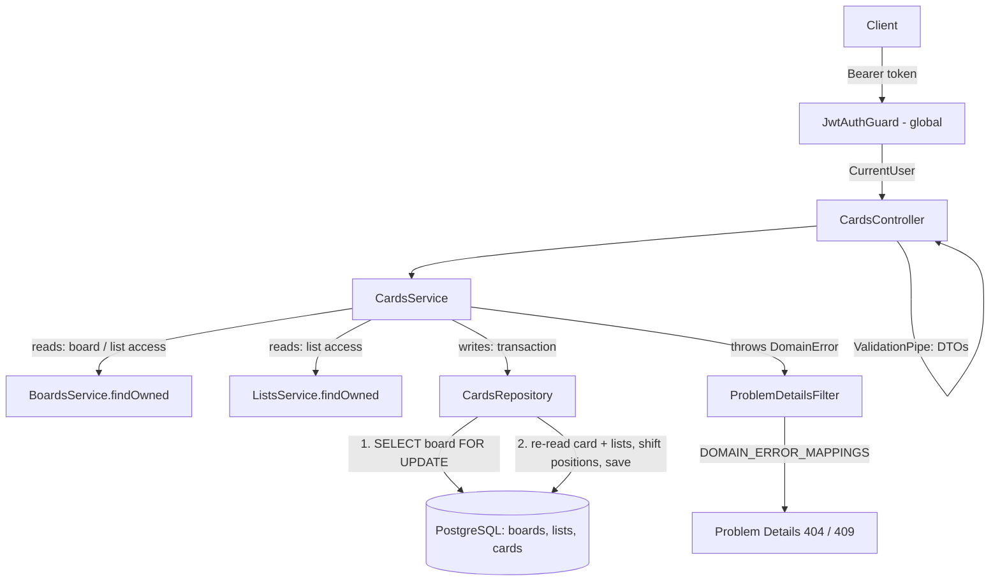

# Cards Design

**Spec**: `.specs/features/cards/spec.md`
**Status**: Approved

---

## Architecture Overview

A new `cards` module following BE-AD-005: entity, repository, service, controller and DTOs in `src/cards/`. Access follows BE-AD-008: a card is reachable only through a list of a board owned by the caller, so every card query joins `lists` and `boards` on `owner_id`, and a foreign card behaves exactly like a missing one (CRD-38).

Every card write (create, update, move, archive, unarchive, delete) runs in one transaction that first locks the **board** row with `SELECT ... FOR UPDATE` (BE-AD-010). List writes and board archive/delete take the same row lock, so card writes serialize with them: the archive checks (CRD-26, CRD-35, CRD-36) always see the committed state, and a cross-list move (CRD-21) needs one lock, not two. The guards run after the lock, in precedence order: board archived → list archived → card state.



### Approaches considered (position consistency, CRD-28)

| Approach | How concurrent card writes stay contiguous | Verdict |
| -------- | ------------------------------------------ | ------- |
| **A. Board row lock + deferred unique constraint** (chosen) | Every card write locks the owning board row `FOR UPDATE`; `UNIQUE (list_id, position) DEFERRABLE INITIALLY DEFERRED` rejects duplicates at commit | Recommended and confirmed: one lock for cross-list moves, no lock ordering; serializes with list archive/delete and board archive/delete, so the list-archived and board-archived checks have no race. Writes on one board queue behind each other, fine at personal scale |
| B. List row locks (source and target, ordered by id) | Locks the list rows `FOR UPDATE`, following BE-AD-009 literally | Two locks with a fixed order to avoid deadlocks; the board-archived check is not under any lock; more code and more tests for the same result |

---

## Code Reuse Analysis

### Existing Components to Leverage

| Component | Location | How to Use |
| --------- | -------- | ---------- |
| `JwtAuthGuard` (global) + `@CurrentUser()` | `src/auth/jwt-auth.guard.ts`, `src/auth/current-user.decorator.ts` | Every card route is protected (CRD-39) |
| Global `ValidationPipe` + `validationExceptionFactory` | `src/app.setup.ts:33` | DTO errors become `400` with `errors[{ field, message }]`; unknown properties → `400` |
| `trim`, `trimToNull` transforms | `src/boards/dto/create-board.dto.ts:6`, `:10` | `title` and `description` (CRD-02) |
| `BoardsService.findOwned(ownerId, id)` | `src/boards/boards.service.ts` | `GET /boards/:boardId/cards` board check (CRD-12) |
| `ListsService.findOwned(ownerId, id)` | `src/lists/lists.service.ts` | `GET /lists/:listId/cards` list check (CRD-06); `isUUID` guard + `ListNotFoundError` built in |
| `BoardNotFoundError`, `BoardArchivedError` | `src/boards/boards.errors.ts` | Reused as is (CRD-12, CRD-36) |
| `ListNotFoundError`, `ListArchivedError` | `src/lists/lists.errors.ts` | Reused as is (CRD-06, CRD-25, CRD-26, CRD-35) |
| `ListsRepository` lock-and-shift pattern | `src/lists/lists.repository.ts` | Same `transaction`, `lockOwnedBoard`, raw-SQL `shift` (scoped by `list_id`) |
| `ListsService.writeLocked` flow | `src/lists/lists.service.ts` | Same item-write flow: lookup → lock → re-read → guards → work |
| `toListResponse`, `ListListsQueryDto` patterns | `src/lists/dto/` | `toCardResponse`, `ListCardsQueryDto` |
| `CreateLists` migration | `src/database/migrations/1792454400000-CreateLists.ts` | Same style: deferred unique constraint + position/archive check |
| `bootWithDatabase`, `revertAllMigrations`, `createTestApp` | `test/support/` | Integration and e2e suites |

### Integration Points

| System | Integration Method |
| ------ | ------------------ |
| `AppModule` | Imports `CardsModule` |
| `ListsModule` | Adds `exports: [ListsService]` (one-line change); `CardsModule` imports it |
| `BoardsModule` | `CardsModule` imports it for `BoardsService` (already exported) |
| `lists` table | `cards.list_id` FK → `lists.id` `ON DELETE CASCADE`: deleting a list deletes its cards, deleting a board cascades boards → lists → cards (CRD-40); `ListsService.remove` is unchanged |
| List archive / unarchive | No change: they never touch `cards` rows (CRD-37) |
| Error mapping | `domain-error-mappings.ts` imports `cards.errors.ts` |

---

## Components

### `Card` entity

- **Purpose**: TypeORM mapping of the `cards` table.
- **Location**: `src/cards/card.entity.ts`
- **Interfaces**: columns `id`, `listId`, `title`, `description` (`string | null`), `dueDate` (`string | null`, `YYYY-MM-DD`), `done`, `position` (`number | null`), `archivedAt`, `createdAt`, `updatedAt`.
- **Reuses**: `List` entity style: plain FK column `list_id`, no TypeORM relation.

### `CardsRepository`

- **Purpose**: All queries on `cards`, always scoped by the owner through `lists` and `boards`.
- **Location**: `src/cards/cards.repository.ts`
- **Interfaces**:
  - `transaction<T>(work: (cards: CardsRepository) => Promise<T>): Promise<T>`
  - `lockOwnedBoard(ownerId, boardId): Promise<Board | null>` - `pessimistic_write`, filtered by `owner_id`.
  - `findOwned(ownerId, id): Promise<Card | null>` - card joined to `lists` and `boards` with `boards.owner_id = ownerId`.
  - `findOwnedList(ownerId, listId): Promise<List | null>` - list joined to `boards` with `owner_id` (create lookup before the lock).
  - `findListInBoard(boardId, listId): Promise<List | null>` - re-read of the card's list and lookup of the move target under the lock; a list of another board is `null` (CRD-25).
  - `listInList(listId, archived): Promise<Card[]>` - active by `position ASC`; archived by `archived_at DESC, id DESC`.
  - `listInBoard(boardId, archived): Promise<Card[]>` - joins `lists` on `board_id`; active: cards with `archived_at IS NULL` of lists with `archived_at IS NULL`, ordered by `lists.position ASC, cards.position ASC`; archived: cards with `archived_at IS NOT NULL` of any list, ordered by `cards.archived_at DESC, cards.id DESC`.
  - `countActive(listId): Promise<number>`
  - `create(input: { listId, title, description, dueDate, position }): Promise<Card>`
  - `shift(listId, from, to, delta: 1 | -1): Promise<void>` - raw SQL `UPDATE cards SET position = position + $delta WHERE list_id = $1 AND position BETWEEN $from AND $to`, so shifted cards keep `updated_at`.
  - `save(card): Promise<Card>`, `delete(id): Promise<void>`
- **Dependencies**: `Repository<Card>` (default) or the transaction's `EntityManager` (also used for `Board` and `List` reads).
- **Reuses**: `ListsRepository` (same methods, scoped by `list_id`).

### `CardsService`

- **Purpose**: Card rules: access, archive guards, position arithmetic, cross-list move.
- **Location**: `src/cards/cards.service.ts`
- **Interfaces**:
  - `create(ownerId, listId, input: { title, description?, dueDate? }): Promise<Card>`
  - `listInList(ownerId, listId, archived): Promise<Card[]>` - `ListsService.findOwned` first.
  - `listInBoard(ownerId, boardId, archived): Promise<Card[]>` - `BoardsService.findOwned` first.
  - `findOwned(ownerId, id): Promise<Card>`
  - `update(ownerId, id, changes: Partial<{ title, description, dueDate, done }>): Promise<Card>`
  - `move(ownerId, id, { listId?, position }): Promise<Card>`
  - `archive(ownerId, id)`, `unarchive(ownerId, id)`: `Promise<Card>`
  - `remove(ownerId, id): Promise<void>`
- **Dependencies**: `CardsRepository`, `ListsService`, `BoardsService`.
- **Create flow**: `isUUID(listId)` → `findOwnedList` (else `ListNotFoundError`) → `transaction`: `lockOwnedBoard(list.boardId)` → `findListInBoard` re-read (either `null` → `ListNotFoundError`) → board archived `409` → list archived `409` → `position = countActive(listId)` → `create`.
- **Item write flow (`writeLocked`)**: `isUUID(id)` → `findOwned` (else `CardNotFoundError`) → `findOwnedList(card.listId)` for the `boardId` → `transaction`: `lockOwnedBoard` → re-read card and its list under the lock (any `null` → `CardNotFoundError`) → board archived `409 board-archived` → list archived `409 list-archived` → `work(card, list, cards)` with the card-state guards.
- **Move precedence** (inside `work`): card archived `409 card-archived` → target list not in the board `404 list-not-found` → target list archived `409 list-archived`.
- **Position arithmetic** (`n` = active cards of the card's list, `i` = current position):
  - create: `position = n`.
  - same-list move to `k`: `k = min(k, n - 1)`; `k === i` → return unchanged (CRD-23); `k < i` → `shift(list, k, i - 1, +1)`; `k > i` → `shift(list, i + 1, k, -1)`; `save` with `position = k`.
  - cross-list move to `k` (`m` = active cards of the target): `shift(source, i + 1, n - 1, -1)`; `k = min(k, m)`; `shift(target, k, m - 1, +1)`; `save` with `listId = target`, `position = k`.
  - archive: `shift(list, i + 1, n - 1, -1)`; `position = null`, `archivedAt = now`.
  - unarchive: `position = n`, `archivedAt = null`.
  - delete: the card is archived, so it holds no position; no shift.
- **No-op rule**: `{}`, same-place move, and idempotent archive/unarchive return the loaded row without `save`, so `updatedAt` stays (CRD-18, CRD-23, CRD-30, CRD-32).

### `CardsController`

- **Purpose**: HTTP contract.
- **Location**: `src/cards/cards.controller.ts`
- **Routes** (no prefix, full paths, like `ListsController`): `POST`/`GET lists/:listId/cards`; `GET boards/:boardId/cards`; `GET`/`PATCH`/`DELETE cards/:id`; `POST cards/:id/move`, `cards/:id/archive`, `cards/:id/unarchive` (`@HttpCode(200)` on the three `POST` actions, `204` on `DELETE`).
- **Reuses**: `ListsController` structure and Swagger decorators.

### DTOs

- **Location**: `src/cards/dto/`
- `CreateCardDto`: `title` (`trim`, `@IsString`, `@Length(1, 100)`); `description` (`trimToNull`, `@IsOptional`, `@IsString`, `@MaxLength(5000)`); `dueDate` (`@IsOptional`, `@Matches(/^\d{4}-\d{2}-\d{2}$/)`, `@IsISO8601({ strict: true })`). No `done`, no `position` (FND-09).
- `UpdateCardDto`: `title` with `@ValidateIf(... !== undefined)` so `null` is rejected (CRD-15); `description` and `dueDate` as in create, where `@IsOptional` lets `null` through to clear (CRD-16); `done` with `@ValidateIf(... !== undefined)` + `@IsBoolean` so `null` is rejected (CRD-17).
- `MoveCardDto`: `listId` `@IsOptional` + `@IsUUID()` (CRD-24); `position` `@IsInt`, `@Min(0)`, no upper bound (CRD-22).
- `ListCardsQueryDto`: `archived` `@IsOptional`, `@IsIn(['true', 'false'])` (CRD-11), used by both collection routes.
- `CardResponseDto` + `toCardResponse(card)`: `{ id, listId, title, description, dueDate, done, position, archivedAt, createdAt, updatedAt }`, timestamps as ISO strings, `dueDate` as `YYYY-MM-DD` or `null`.

### Domain errors

- **Location**: `src/cards/cards.errors.ts`

| Error | Status | `type` | `detail` |
| ----- | ------ | ------ | -------- |
| `CardNotFoundError` | `404` | `/problems/card-not-found` | `Card not found.` |
| `CardArchivedError` | `409` | `/problems/card-archived` | `Archived cards cannot be changed.` |
| `CardNotArchivedError` | `409` | `/problems/card-not-archived` | `Only archived cards can be deleted.` |

---

## Data Models

### `Card`

```typescript
@Entity('cards')
export class Card {
  @PrimaryGeneratedColumn('uuid') id!: string;
  @Column({ name: 'list_id', type: 'uuid' }) listId!: string;
  @Column({ length: 100 }) title!: string;
  @Column({ type: 'varchar', length: 5000, nullable: true }) description!: string | null;
  @Column({ name: 'due_date', type: 'date', nullable: true }) dueDate!: string | null;
  @Column({ type: 'boolean', default: false }) done!: boolean;
  @Column({ type: 'integer', nullable: true }) position!: number | null;
  @Column({ name: 'archived_at', type: 'timestamptz', nullable: true }) archivedAt!: Date | null;
  @CreateDateColumn({ name: 'created_at', type: 'timestamptz' }) createdAt!: Date;
  @UpdateDateColumn({ name: 'updated_at', type: 'timestamptz' }) updatedAt!: Date;
}
```

### Migration `CreateCards`

```sql
CREATE TABLE "cards" (
  "id" uuid PRIMARY KEY DEFAULT gen_random_uuid(),
  "list_id" uuid NOT NULL
    CONSTRAINT "FK_cards_list_id" REFERENCES "lists" ("id") ON DELETE CASCADE,
  "title" varchar(100) NOT NULL,
  "description" varchar(5000),
  "due_date" date,
  "done" boolean NOT NULL DEFAULT false,
  "position" integer,
  "archived_at" timestamptz,
  "created_at" timestamptz NOT NULL DEFAULT now(),
  "updated_at" timestamptz NOT NULL DEFAULT now(),
  CONSTRAINT "UQ_cards_list_id_position" UNIQUE ("list_id", "position")
    DEFERRABLE INITIALLY DEFERRED,
  CONSTRAINT "CHK_cards_position_archived"
    CHECK (
      ("archived_at" IS NULL AND "position" IS NOT NULL AND "position" >= 0)
      OR ("archived_at" IS NOT NULL AND "position" IS NULL)
    )
);
```

**Relationships**: many cards → one list → one board. The unique constraint's index (`list_id`, `position`) serves the per-list query, the shifts and the `list_id` join of the board query. A cross-list move changes `list_id` and `position` of one row inside the transaction; the deferred constraint checks both lists at commit.

---

## Error Handling Strategy

| Error Scenario | Handling | User Impact |
| -------------- | -------- | ----------- |
| Missing / invalid token | Global `JwtAuthGuard` | `401` `about:blank` |
| Invalid body or query (incl. `dueDate` `2026-02-30`, `listId` not a UUID) | `ValidationPipe` → `RequestValidationException` | `400` with `errors[]` per field |
| Unknown, foreign or malformed `:boardId` | `BoardsService.findOwned` → `BoardNotFoundError` | `404` `/problems/board-not-found` |
| Unknown, foreign or malformed `:listId`; move target outside the board | `ListsService.findOwned` / `findOwnedList` / `findListInBoard` → `ListNotFoundError` | `404` `/problems/list-not-found` |
| Unknown, foreign or malformed card `:id` | `CardNotFoundError` | `404` `/problems/card-not-found` |
| Card write on an archived board | `BoardArchivedError` | `409` `/problems/board-archived` |
| Card write on an archived list, or move into one | `ListArchivedError` | `409` `/problems/list-archived` |
| `PATCH` / `move` on an archived card | `CardArchivedError` | `409` `/problems/card-archived` |
| `DELETE` on an active card | `CardNotArchivedError` | `409` `/problems/card-not-archived` |
| Card, list or board deleted between the lookup and the lock | Re-read under the lock returns `null` → `CardNotFoundError` (or `ListNotFoundError` on create) | `404` |
| Position constraint violated (bug) | Commit fails → unhandled → filter | `500` (FND-11); transaction rolled back, nothing changes |
| Database failure | Unhandled → filter | `500` (FND-11) |

---

## Risks & Concerns

| Concern | Location (file:line) | Impact | Mitigation |
| ------- | -------------------- | ------ | ---------- |
| `date` column round-trip: node-pg parses `date` to a local-midnight `Date`; TypeORM turns it back with `DateUtils.mixedDateToDateString` using local getters | `node_modules/typeorm/driver/postgres/PostgresDriver.js:635` | A time-zone mismatch could shift `dueDate` by a day | Integration test writes `2026-11-01` and reads back exactly `"2026-11-01"`; e2e asserts the response string |
| `@IsISO8601({ strict: true })` is the only calendar check | class-validator `0.15.1` | `2026-02-30` could pass if strict mode did not check day ranges | Unit/e2e cases: `2026-02-30` → `400`, `2028-02-29` → `201`, `2026-2-1` → `400` |
| `ListsService` is not exported | `src/lists/lists.module.ts:14` | `CardsModule` cannot inject it | Add `exports: [ListsService]`; no behavior change for lists |
| `lockOwnedBoard` duplicated in `ListsRepository` and `CardsRepository` | `src/lists/lists.repository.ts:31` | Two copies of a 4-line query can drift | Accepted: both filter by `id` + `owner_id` and are covered by their own concurrency tests; extract only if a third module needs it |
| Item writes run two lookups before the transaction (card, then its list for the `boardId`) | `src/cards/cards.service.ts` (new) | One extra query per write | Accepted at personal scale; the lookups are primary-key reads |
| Every write on a board serializes (cards and lists share the board lock) | BE-AD-010 | Throughput per board is one write at a time | Accepted at personal scale (ROADMAP: single owner) |
| Concurrency test may pass without real overlap | `test/e2e/cards/` (new) | CRD-28 unproven | e2e fires ≥ 10 concurrent creates, same-list moves, cross-list moves and archives on one board with `Promise.all` and asserts both lists hold `0..n-1`; integration test proves the deferred constraint rejects a duplicate at commit |
| Cascade from board through lists to cards untested | `test/integration/cards/` (new) | CRD-40 unproven | Integration test deletes a list and a board and asserts their cards are gone |

---

## Tech Decisions

| Decision | Choice | Rationale |
| -------- | ------ | --------- |
| Lock for card writes | Board row lock (approach A) | One lock for cross-list moves; serializes with list and board writes; recorded as BE-AD-010 (supersedes BE-AD-009) |
| `dueDate` storage | PostgreSQL `date`, entity type `string` | Calendar date with no time zone (context.md); TypeORM hydrates `date` columns to `YYYY-MM-DD` strings |
| Board id on cards | Not stored; derived through `lists` | `boardId` never changes (same-board moves only) but a second copy needs a consistency constraint; one extra join is cheap |
| Move target outside the board | Looked up with `findListInBoard(lockedBoardId, listId)` | One query answers "unknown", "foreign" and "other board" identically (CRD-25) |
| Board cards route ordering | Single query joining `lists`, ordered by `lists.position, cards.position` | One round trip for the board view (CRD-09) |
