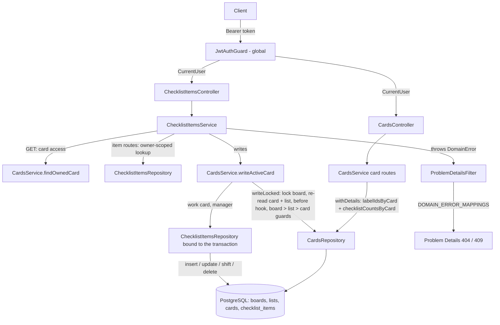

# Checklists Design

**Spec**: `.specs/features/checklists/spec.md`
**Status**: Approved

---

## Architecture Overview

A new `checklists` module following BE-AD-005 owns the checklist item CRUD and reorder: entity, repository, service, controller and DTOs in `src/checklists/`. Access follows BE-AD-008: an item is reachable only through a card of a board owned by the caller, so the item lookup joins `cards`, `lists` and `boards` on `owner_id`, and a foreign item behaves exactly like a missing one (CHK-23).

An item write is a card write: it must lock the board, re-read the card and its list, and guard board > list > card exactly like `CardsService.writeLocked`. Instead of a second copy of that flow, `CardsService` exports one public method, `writeActiveCard`, that wraps `writeLocked`, adds the card-archived guard and hands the work the transaction's `EntityManager`. `ChecklistItemsService` builds a `ChecklistItemsRepository` bound to that manager, so the item writes run in the same transaction as the board lock (BE-AD-010). `checklists` depends on `cards`; `cards` never imports `checklists`: it reads the `checklist_items` table with one raw aggregate query for the card counters, the same way it reads `card_labels`. No module cycle.



### Approaches considered

| Decision | Options | Verdict |
| -------- | ------- | ------- |
| Owner of the items | **A. `checklists` module + `CardsService.writeActiveCard`** (chosen) / B. everything inside `cards` / C. `checklists` with its own copy of the lock + guards | A confirmed: one copy of the board > list > card rule; `cards.service.ts` grows by one method instead of ~180 lines (B); no second guard flow to drift (C) |
| Loading `checklist` counters | **A. Separate aggregate query** (chosen) / B. counter columns on `cards` | A: one `GROUP BY` per response next to `labelIdsByCard`, no denormalized state. B makes every item write touch the card row, which would bump `updated_at` (CHK-18) or need raw SQL, and can drift |

---

## Code Reuse Analysis

### Existing Components to Leverage

| Component | Location | How to Use |
| --------- | -------- | ---------- |
| `JwtAuthGuard` (global) + `@CurrentUser()` | `src/auth/jwt-auth.guard.ts`, `src/auth/current-user.decorator.ts` | Every item route is protected (CHK-24) |
| Global `ValidationPipe` + `validationExceptionFactory` | `src/app.setup.ts:33` | DTO errors → `400` with `errors[{ field, message }]`; unknown properties → `400` |
| `trim` transform | `src/boards/dto/create-board.dto.ts` | `text` (CHK-02, CHK-06) |
| `ValidateIf(value !== undefined)` for required fields on `PATCH` | `src/cards/dto/update-card.dto.ts:17` | `text: null`, `done: null` → `400` (CHK-07, CHK-08) |
| `MoveListDto` | `src/lists/dto/move-list.dto.ts` | Same shape for `MoveChecklistItemDto` (`position` `IsInt` `Min(0)`, no upper bound) |
| `CardsService.writeLocked` | `src/cards/cards.service.ts:302` | Wrapped by the new public `writeActiveCard`; its `before` hook keeps item-not-found ahead of the archived guards (CHK-22) |
| `CardsService.findOwnedCard` | `src/cards/cards.service.ts:114` | Made public for `GET /cards/:cardId/checklist-items` (CHK-04, CHK-05): `isUUID` guard + `CardNotFoundError`, no label or counter queries |
| `CardNotFoundError`, `CardArchivedError`, `ListArchivedError`, `BoardArchivedError` | `src/cards/cards.errors.ts`, `src/lists/lists.errors.ts`, `src/boards/boards.errors.ts` | Reused as is (CHK-04, CHK-19 to CHK-21) |
| `CardsRepository.shift` + deferred `UQ_cards_list_id_position` | `src/cards/cards.repository.ts:110`, `CreateCards` migration | Same raw-SQL shift and deferred unique constraint for items (CHK-13, CHK-15) |
| `CardsService.move` same-list branch | `src/cards/cards.service.ts:164` | Same clamp, no-op and shift order for `move` (CHK-10 to CHK-12) |
| `CardsRepository.labelIdsByCard` | `src/cards/cards.repository.ts:141` | Same shape for `checklistCountsByCard` (one query, `ANY($1)`, `[]` skips the query) |
| `toCardResponse` / `toLabelResponse` | `src/cards/dto/card-response.dto.ts:40`, `src/labels/dto/` | `toChecklistItemResponse`; `toCardResponse` gains `checklist` |
| `CreateCards` migration | `src/database/migrations/1792540800000-CreateCards.ts` | Same style: raw SQL, named constraints, cascade FK |
| `bootWithDatabase`, `revertAllMigrations`, `createTestApp` | `test/support/` | Integration and e2e suites |

### Integration Points

| System | Integration Method |
| ------ | ------------------ |
| `AppModule` | Imports `ChecklistsModule` |
| `CardsModule` | Exports `CardsService` (today it exports nothing) |
| `ChecklistsModule` | Imports `CardsModule`; registers `ChecklistItem` in `TypeOrmModule.forFeature` |
| `cards` table | `checklist_items.card_id` FK → `cards.id` `ON DELETE CASCADE`: deleting a card, a list or a board deletes its items (CHK-25); `CardsService.remove` needs no cleanup |
| Card responses | Every `CardsController` route maps `CardView` through `toCardResponse` (CHK-17) |
| Error mapping | `domain-error-mappings.ts` imports `checklists.errors.ts` |

---

## Components

### `CardView` rename (refactor, no behavior change)

- **Purpose**: The card type that leaves `CardsService` is about to carry more than labels.
- **Change**: `CardWithLabels` → `CardView`, `withLabelIds` / `withLabelIdsOf` → `withDetails` / `withDetailsOf`. Same fields, same queries; its own commit before the counters.

### `CardsService` (changed)

- **New interfaces**:
  - `writeActiveCard<T>(ownerId, cardId, work: (card: Card, manager: EntityManager) => Promise<T>, before?: (card: Card, manager: EntityManager) => Promise<void>): Promise<T>` - calls `writeLocked`; `before` runs under the lock ahead of the archived guards; `work` first throws `CardArchivedError` on an archived card, then runs. Precedence: `card-not-found` > `before` checks > `board-archived` > `list-archived` > `card-archived` (CHK-19 to CHK-22).
  - `findOwnedCard(ownerId, id): Promise<Card>` - existing private method made public.
  - `type ChecklistProgress = { total: number; done: number }`; `CardView = Card & { labelIds: string[]; checklist: ChecklistProgress }`.
  - `withDetails(cards)` runs `labelIdsByCard` and `checklistCountsByCard`; `create` returns `checklist: { total: 0, done: 0 }` without a query (CHK-17).
- **Unchanged**: every existing caller of `writeLocked`.

### `CardsRepository` (changed)

- **New interfaces**:
  - `get manager(): EntityManager` - the manager of this repository; inside `transaction()` it is the transaction's manager.
  - `checklistCountsByCard(cardIds: string[]): Promise<Map<string, ChecklistProgress>>` - `SELECT card_id, count(*)::int AS total, (count(*) FILTER (WHERE done))::int AS done FROM checklist_items WHERE card_id = ANY($1) GROUP BY card_id`; cards without rows get `{ total: 0, done: 0 }`; `[]` skips the query.

### `toCardResponse` (changed)

- Takes `CardView`, adds `checklist`; `CardResponseDto` gains `checklist: ChecklistProgressDto` (`total`, `done`, both `@ApiProperty({ minimum: 0 })`).

### `ChecklistItem` entity

- **Location**: `src/checklists/checklist-item.entity.ts`
- **Interfaces**: `id`, `cardId` (plain FK column, no relation), `text`, `done`, `position: number`, `createdAt`, `updatedAt`
- **Reuses**: `Card` entity style

### `ChecklistItemsRepository`

- **Purpose**: All item queries. The injected instance serves owner-scoped reads; writes use an instance bound to the card write's transaction.
- **Location**: `src/checklists/checklist-items.repository.ts`
- **Interfaces**:
  - `static bound(manager: EntityManager): ChecklistItemsRepository` - `new ChecklistItemsRepository(manager.getRepository(ChecklistItem))`
  - `findOwned(ownerId, id): Promise<ChecklistItem | null>` - joins `cards`, `lists`, `boards` on `owner_id` (CHK-23)
  - `findInCard(cardId, id): Promise<ChecklistItem | null>` - re-read under the lock
  - `listInCard(cardId): Promise<ChecklistItem[]>` - `ORDER BY position` (CHK-05)
  - `countInCard(cardId): Promise<number>`
  - `create(input: Pick<ChecklistItem, 'cardId' | 'text' | 'position'>): Promise<ChecklistItem>`
  - `shift(cardId, from, to, delta: 1 | -1): Promise<void>` - raw SQL, siblings keep `updated_at` (CHK-13)
  - `save(item)`, `delete(id)`
- **Reuses**: `CardsRepository` shift and lookup style

### `ChecklistItemsService`

- **Purpose**: Item rules on top of the card write flow.
- **Location**: `src/checklists/checklist-items.service.ts`
- **Interfaces**:
  - `create(ownerId, cardId, text): Promise<ChecklistItem>` - `writeActiveCard(cardId, …)` → `position = countInCard` → `create` (CHK-01, CHK-04, CHK-15)
  - `listInCard(ownerId, cardId): Promise<ChecklistItem[]>` - `findOwnedCard`, no lock, archived states readable (CHK-05)
  - `update(ownerId, id, changes: Partial<{ text, done }>): Promise<ChecklistItem>` - `{}` returns the row unsaved (CHK-06, CHK-09)
  - `move(ownerId, id, position): Promise<ChecklistItem>` - clamp to `n-1`, same-place no-op, shift then save (CHK-10 to CHK-13)
  - `remove(ownerId, id): Promise<void>` - delete, then shift `position+1..n-1` by `-1` (CHK-16)
  - private `writeItem(ownerId, id, work)` - `isUUID` guard + `findOwned` (`ChecklistItemNotFoundError`) → `writeActiveCard(found.cardId, work, before)` where `before` re-reads the item with `findInCard` and throws `ChecklistItemNotFoundError` if it is gone; a `CardNotFoundError` from `writeActiveCard` (card deleted since the lookup) is rethrown as `ChecklistItemNotFoundError`, so item routes only ever answer the item's `404` (CHK-23)
- **Dependencies**: `ChecklistItemsRepository`, `CardsService`

### `ChecklistItemsController`

- **Location**: `src/checklists/checklist-items.controller.ts`
- **Interfaces**: `POST /cards/:cardId/checklist-items` (`201`), `GET /cards/:cardId/checklist-items` (`200`), `PATCH /checklist-items/:id` (`200`), `POST /checklist-items/:id/move` (`200`), `DELETE /checklist-items/:id` (`204`); Swagger tag `checklists`, responses like `CardsController`
- **Reuses**: `CardsController` structure (no prefix, nested collection + flat item)

### Checklist DTOs

- **Location**: `src/checklists/dto/`
- `CreateChecklistItemDto`: `text` (`@Transform(trim) @IsString() @Length(1, 200)`)
- `UpdateChecklistItemDto`: `text` with `ValidateIf(dto.text !== undefined)` + the create rules; `done` with `ValidateIf(dto.done !== undefined)` + `@IsBoolean()` (CHK-07, CHK-08)
- `MoveChecklistItemDto`: `position` `@IsInt() @Min(0)` (CHK-14)
- `ChecklistItemResponseDto` + `toChecklistItemResponse(item)`: `{ id, cardId, text, done, position, createdAt, updatedAt }` (CHK-01)

### Checklist domain errors

- **Location**: `src/checklists/checklists.errors.ts`
- `ChecklistItemNotFoundError` → `404` `/problems/checklist-item-not-found`

---

## Data Models

### `ChecklistItem`

```typescript
@Entity('checklist_items')
class ChecklistItem {
  id: string          // uuid, gen_random_uuid()
  cardId: string      // card_id, FK_checklist_items_card_id ON DELETE CASCADE
  text: string        // varchar(200), stored trimmed
  done: boolean       // default false
  position: number    // NOT NULL, >= 0, contiguous per card
  createdAt: Date
  updatedAt: Date
}
```

**Relationships**: card 1—N checklist items. Items never change card.

### Migration `CreateChecklistItems`

```sql
CREATE TABLE "checklist_items" (
  "id" uuid PRIMARY KEY DEFAULT gen_random_uuid(),
  "card_id" uuid NOT NULL
    CONSTRAINT "FK_checklist_items_card_id" REFERENCES "cards" ("id") ON DELETE CASCADE,
  "text" varchar(200) NOT NULL,
  "done" boolean NOT NULL DEFAULT false,
  "position" integer NOT NULL
    CONSTRAINT "CHK_checklist_items_position" CHECK ("position" >= 0),
  "created_at" timestamptz NOT NULL DEFAULT now(),
  "updated_at" timestamptz NOT NULL DEFAULT now(),
  -- Deferred so shifts may collide inside a transaction; its index also
  -- serves the per-card list, count and counter queries.
  CONSTRAINT "UQ_checklist_items_card_id_position" UNIQUE ("card_id", "position")
    DEFERRABLE INITIALLY DEFERRED
);
```

`down`: drop `checklist_items`.

---

## Error Handling Strategy

| Error Scenario | Handling | User Impact |
| -------------- | -------- | ----------- |
| Missing / invalid token | Global `JwtAuthGuard` | `401` `about:blank` |
| Invalid body (`text` blank / > 200 / `null`, `done` not boolean or `null`, `position` negative / not integer, unknown property) | `ValidationPipe` → `RequestValidationException`, before any lookup | `400` with `errors[]` per field |
| Unknown, foreign or malformed `:cardId` | `findOwnedCard` / `writeActiveCard` → `CardNotFoundError` | `404` `/problems/card-not-found` |
| Unknown, foreign or malformed item `:id` | `isUUID` guard / `findOwned` `null` → `ChecklistItemNotFoundError` | `404` `/problems/checklist-item-not-found` |
| Item or its card deleted between the lookup and the lock | `before` re-read `null`, or `CardNotFoundError` rethrown → `ChecklistItemNotFoundError` | `404` `/problems/checklist-item-not-found` |
| Write on an archived board / list / card | `writeLocked` guards / `writeActiveCard` | `409` `/problems/board-archived`, `/problems/list-archived`, `/problems/card-archived` |
| Database failure, other constraint violation (bug) | Unhandled → filter | `500` (FND-11); transaction rolled back |

---

## Risks & Concerns

| Concern | Location (file:line) | Impact | Mitigation |
| ------- | -------------------- | ------ | ---------- |
| `writeActiveCard` hands out the raw `EntityManager` | `src/cards/cards.service.ts` (new method) | A caller could write cards outside the card rules | The only caller is `ChecklistItemsService`, which only builds `ChecklistItemsRepository.bound(manager)`; documented on the method |
| Every card route changes its body again | `src/cards/dto/card-response.dto.ts:40` | Existing e2e tests that compare full card bodies with `toEqual` fail once `checklist` is added | The counters task updates those expectations to include `checklist: { total: 0, done: 0 }` in the same commit; no assertion is weakened |
| `cards.service.spec.ts` mocks the repository | `test/unit/cards/cards.service.spec.ts` (1106 lines) | New `checklistCountsByCard` calls need a mock | Default mock returns an empty `Map`; the `withLabels` helper of the spec builds `CardView` with `checklist` |
| `CardNotFoundError` leaking from item routes | `writeLocked` throws it when the card vanished | `PATCH /checklist-items/:id` would answer `card-not-found` | `writeItem` maps it to `ChecklistItemNotFoundError`; unit test covers the rethrow |
| One more query per card response | `CardsService.withDetails` | Card routes run three queries instead of two | One indexed `GROUP BY` per response, not per card; fine at personal scale |
| Concurrency tests may pass without real overlap | `test/e2e/checklists/` (new) | CHK-15 unproven | e2e fires ≥ 10 concurrent creates and moves on one card with `Promise.all`; asserts all succeed and positions are exactly `0..n-1` |

---

## Tech Decisions

| Decision | Choice | Rationale |
| -------- | ------ | --------- |
| Module owning items | `checklists`, writing through `CardsService.writeActiveCard` | One copy of the board > list > card guards, no module cycle (confirmed); recorded as BE-AD-011 |
| Counter loading | Aggregate query per response in `CardsRepository` | No denormalized counter, card `updated_at` untouched (CHK-18) |
| `position` | `NOT NULL` + `CHECK >= 0` + deferred unique | Items have no archive, so no `NULL` state as in lists and cards; conforms to BE-AD-010 otherwise |
| Item writes lock the board | Through `writeActiveCard` | Serializes with card archive/delete and board/list archive, which take the same lock (BE-AD-010) |
