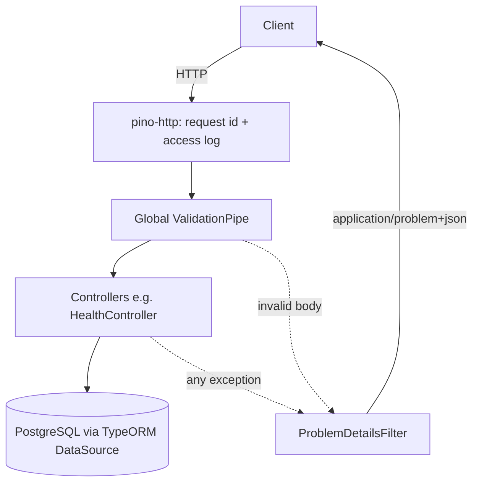

# Foundation Design

**Spec**: `back-end/.specs/features/foundation/spec.md`
**Context**: `back-end/.specs/features/foundation/context.md`
**Status**: Approved

Conforms to GL-AD-001 (pnpm workspace), GL-AD-002 (specs layout), GL-AD-003 (Docker), BE-AD-003 (three test levels), BE-AD-004 (error contract), BE-AD-005 (entity / repository / service / controller per module; TypeORM, migrations, no `synchronize`).

---

## Architecture Overview

One NestJS 12 app in `back-end/`. `main.ts` only boots; all HTTP wiring (prefix, validation, error filter, Swagger) lives in one `configureApp(app)` function so e2e tests boot the exact same app.



Request flow: `pino-http` assigns the request id (FND-13/14), sets `X-Request-Id` (FND-15) and writes the completion log line (FND-16). Every thrown exception reaches the single global `ProblemDetailsFilter`, which builds the RFC 9457 body (FND-07..12, FND-26).

### Monorepo and Docker layout

```
my-trello-version/
├── package.json            # private root, "packageManager": "pnpm@11.8.0", engines.node
├── pnpm-workspace.yaml     # packages: [back-end]  (front-end/ mobile added later)
├── pnpm-lock.yaml
├── .nvmrc                  # 24.17.0
├── .gitignore
├── .dockerignore
├── docker-compose.yml      # services: postgres, api
└── back-end/
    ├── Dockerfile          # build context = repo root (needs root lockfile)
    ├── .env.example
    ├── package.json
    ├── nest-cli.json  tsconfig.json  tsconfig.build.json  .oxlintrc.json  .prettierrc
    ├── src/
    │   ├── main.ts
    │   ├── app.module.ts
    │   ├── app.setup.ts                    # configureApp(app)
    │   ├── config/env.schema.ts            # zod schema + validateEnv()
    │   ├── logging/logging.module.ts       # nestjs-pino setup
    │   ├── errors/
    │   │   ├── problem-details.ts          # ProblemDetails type + builder (pure TS)
    │   │   ├── problem-details.filter.ts   # global ExceptionFilter
    │   │   └── validation.exception.ts     # ValidationPipe exceptionFactory → field errors
    │   ├── database/
    │   │   ├── database.module.ts          # TypeOrmModule.forRootAsync
    │   │   ├── data-source.ts              # DataSource for the TypeORM CLI
    │   │   └── migrations/
    │   └── health/
    │       ├── health.controller.ts
    │       └── database-health.ts          # SELECT 1 with 3 s timeout
    └── test/
        ├── jest-unit.config.ts  jest-integration.config.ts  jest-e2e.config.ts
        ├── support/postgres.global-setup.ts   # Testcontainers start + env
        ├── support/postgres.global-teardown.ts
        ├── support/create-test-app.ts         # Test module + configureApp()
        ├── support/test-only.controller.ts    # routes used only by error-format e2e tests
        └── unit/  integration/  e2e/
```

All tests live under `back-end/test/`, never next to production code: unit tests in `test/unit/` mirroring `src/` (`*.spec.ts`), integration in `test/integration/` (`*.int-spec.ts`), e2e in `test/e2e/` (`*.e2e-spec.ts`).

---

## Code Reuse Analysis

### Existing Components to Leverage

| Component | Location | How to Use |
| --------- | -------- | ---------- |
| Nest 12 official app template | `@nestjs/schematics` 12.0.7 (`application/files/ts`) | Base for `package.json` scripts, `tsconfig.json`, `jest.config.ts`, oxlint + Prettier setup |
| None in repo | — | Greenfield: `back-end/` is empty |

### Integration Points

| System | Integration Method |
| ------ | ------------------ |
| PostgreSQL 18 | `DATABASE_URL` → `TypeOrmModule.forRootAsync`, `migrationsRun: true` |
| Docker compose | `api` waits for `postgres` `service_healthy`; `api` healthcheck calls `/api/v1/health` |
| Testcontainers | Jest `globalSetup` starts `PostgreSqlContainer`, exports `DATABASE_URL` to test workers |

---

## Components

### configureApp

- **Purpose**: Apply all cross-cutting HTTP wiring to a Nest app instance.
- **Location**: `back-end/src/app.setup.ts`
- **Interfaces**:
  - `configureApp(app: INestApplication): void` - sets global prefix `api/v1` (FND-04), global `ValidationPipe({ whitelist: true, forbidNonWhitelisted: true, transform: true, exceptionFactory })` (FND-08/09), global `ProblemDetailsFilter`, Swagger at `api/docs` + `api/docs-json` (FND-19/20), `enableShutdownHooks()`.
- **Dependencies**: `@nestjs/common`, `@nestjs/swagger`, `nestjs-pino` logger.
- **Reuses**: called by `main.ts` and by `test/support/create-test-app.ts`.

### Env schema

- **Purpose**: Validate environment variables at boot and fail fast (FND-03).
- **Location**: `back-end/src/config/env.schema.ts`
- **Interfaces**:
  - `validateEnv(raw: Record<string, unknown>): Env` - parses with zod; on failure throws an `Error` whose message lists every invalid variable name.
  - `type Env = { NODE_ENV: 'development' | 'test' | 'production'; PORT: number; LOG_LEVEL: pino level; DATABASE_URL: string }`
- **Dependencies**: `zod`; plugged into `ConfigModule.forRoot({ isGlobal: true, validate: validateEnv })`.
- **Reuses**: —

Variables: `NODE_ENV` (default `development`), `PORT` (default `3000`), `LOG_LEVEL` (default `info`, FND-18), `DATABASE_URL` (required, `postgres://` URL). All documented in `.env.example`.

### Logging module

- **Purpose**: Request id, access log and redaction (FND-13..18).
- **Location**: `back-end/src/logging/logging.module.ts`
- **Interfaces**: `LoggerModule.forRootAsync` with `pinoHttp`:
  - `genReqId(req, res)`: reuse `x-request-id` when it is a non-empty string ≤ 128 chars, else `randomUUID()`; always `res.setHeader('X-Request-Id', id)`.
  - `redact: { paths: ['req.headers.authorization', '*.password', '*.*.password'], censor: '[REDACTED]' }`.
  - `level` from `LOG_LEVEL`; `customProps` / serializers keep `requestId`, method, path, status, `responseTime`.
- **Dependencies**: `nestjs-pino` 5.3, `pino` 10, `pino-http` 11.
- **Reuses**: `app.useLogger(app.get(Logger))` so Nest's own logs are JSON too.

### ProblemDetails builder (pure TS)

- **Purpose**: Build RFC 9457 bodies as a plain function with no framework imports, unit-testable.
- **Location**: `back-end/src/errors/problem-details.ts`
- **Interfaces**:
  - `type FieldError = { field: string; message: string }`
  - `type ProblemDetails = { type: string; title: string; status: number; detail: string; instance: string; requestId: string; errors?: FieldError[] }`
  - `buildProblem(input: { status: number; detail: string; instance: string; requestId: string; errors?: FieldError[]; type?: string }): ProblemDetails` - `type` defaults to `about:blank`, `title` = HTTP reason phrase for `status`.
- **Dependencies**: none.

### ProblemDetailsFilter

- **Purpose**: Single global `@Catch()` filter turning any exception into Problem Details (FND-07, 10, 11, 12, 26).
- **Location**: `back-end/src/errors/problem-details.filter.ts`
- **Interfaces**: `catch(exception: unknown, host: ArgumentsHost): void`
  - `HttpException` → its status and message as `detail`; `RequestValidationException` → `400` + `errors`.
  - Body-parser JSON `SyntaxError` (status 400, `type === 'entity.parse.failed'`) → `400`, `detail: "Request body is not valid JSON."`.
  - Anything else → `500`, `detail: "An unexpected error occurred."`, logged at `error` with stack and `requestId`.
  - Always `Content-Type: application/problem+json`; `instance` = `req.originalUrl` path; `requestId` = `req.id`.
- **Dependencies**: `buildProblem`, `PinoLogger`.

### RequestValidationException

- **Purpose**: Convert class-validator `ValidationError[]` into flat `FieldError[]` (nested paths as `a.b.c`) (FND-08/09).
- **Location**: `back-end/src/errors/validation.exception.ts`
- **Interfaces**: `validationExceptionFactory(errors: ValidationError[]): RequestValidationException`; `class RequestValidationException extends BadRequestException { readonly fieldErrors: FieldError[] }`.
- **Dependencies**: `class-validator`, `class-transformer`.

### Database module and migrations

- **Purpose**: TypeORM connection, migrations on boot (FND-02), CLI data source.
- **Location**: `back-end/src/database/`
- **Interfaces**:
  - `DatabaseModule` - `TypeOrmModule.forRootAsync({ type: 'postgres', url: DATABASE_URL, synchronize: false, migrationsRun: true, migrations: [dist/database/migrations/*.js], autoLoadEntities: true })`.
  - `data-source.ts` - exported `DataSource` for scripts `migration:generate`, `migration:run`, `migration:revert`.
- **Dependencies**: `@nestjs/typeorm` 12, `typeorm` 1.1, `pg` 8.

No migration ships in this feature (no tables); the mechanism is proven by an integration test with a test-only migration directory.

### Health

- **Purpose**: `GET /api/v1/health` (FND-05/06).
- **Location**: `back-end/src/health/`
- **Interfaces**:
  - `checkDatabase(dataSource: DataSource, timeoutMs = 3000): Promise<'up' | 'down'>` - `SELECT 1` raced against a timer; any error or timeout → `'down'`.
  - `HealthController.get()` - `200 { status: 'ok', checks: { database: 'up' } }` or `503 { status: 'error', checks: { database: 'down' } }`.
- **Dependencies**: TypeORM `DataSource`.
- **Note**: health returns its own body (not Problem Details) on `503`, as the spec defines; this is the only non-error-format 5xx.

### Test harness

- **Purpose**: FND-21..25.
- **Location**: `back-end/test/`
- **Interfaces**:
  - `pnpm test` → `jest-unit.config.ts` (`test/unit/**/*.spec.ts`, no Docker).
  - `pnpm test:integration` → `jest-integration.config.ts` with `globalSetup`/`globalTeardown` (Testcontainers `postgres:18.6-alpine`).
  - `pnpm test:e2e` → `jest-e2e.config.ts`, same global setup, `createTestApp()` boots `AppModule` + `TestOnlyController` and calls `configureApp`.
  - `globalSetup` catches the container start failure and throws `Docker is required to run integration and e2e tests (Testcontainers could not reach a Docker daemon).` (FND-25).
  - `pnpm lint` → `oxlint --type-aware src/ test/ && prettier --check .` (FND-24, see Tech Decisions).
- **Dependencies**: `jest` 30, `ts-jest` 29, `supertest` 7, `@testcontainers/postgresql` 12.

### Docker

- **Purpose**: One-command run (FND-01, 02, 27).
- **Location**: `docker-compose.yml`, `back-end/Dockerfile`, `.dockerignore`.
- **Interfaces**:
  - `postgres`: `postgres:18.6-alpine`, named volume, `healthcheck: pg_isready`.
  - `api`: built from `back-end/Dockerfile` (context = repo root), `depends_on: postgres: condition: service_healthy` (FND-27), env from compose, port `3000`, healthcheck via `node -e "fetch('http://localhost:3000/api/v1/health')…"` (alpine image has no curl).
  - `Dockerfile`: multi-stage on `node:24.17.0-alpine`; `corepack enable`; `pnpm install --frozen-lockfile --filter back-end...`; `nest build`; runtime stage copies `dist` + prod deps; `CMD ["node", "dist/main.js"]` (migrations run inside boot via `migrationsRun`).

---

## Data Models

None. Foundation creates no tables.

---

## Error Handling Strategy

| Error Scenario | Handling | User Impact |
| -------------- | -------- | ----------- |
| Invalid / missing env var | `validateEnv` throws; Nest bootstrap fails; process exits 1 | Log names each bad variable (FND-03) |
| Body fails validation | `ValidationPipe` → `RequestValidationException` → filter | `400` + `errors[]` (FND-08/09) |
| Malformed JSON body | body-parser `SyntaxError` → filter | `400`, "Request body is not valid JSON." (FND-26) |
| Unknown route | Nest `NotFoundException` → filter | `404` Problem Details (FND-10) |
| Unhandled exception | filter logs with stack + `requestId` | `500`, generic detail, no stack (FND-11/12) |
| Database down / slow | `checkDatabase` timeout 3 s | Health `503` (FND-06) |
| Docker missing for tests | `globalSetup` rethrows clear message | Test command fails with "Docker is required…" (FND-25) |

---

## Risks & Concerns

| Concern | Location (file:line) | Impact | Mitigation |
| ------- | -------------------- | ------ | ---------- |
| Body-parser JSON errors may bypass Nest filters in some Nest/Express versions | `src/errors/problem-details.filter.ts` (new) | FND-26 returns a non-Problem body | e2e test for malformed JSON written first; if the filter does not see it, register an Express error middleware in `configureApp` that rethrows as `BadRequestException` |
| `pnpm deploy` / filtered install behavior changed across pnpm 9→11 | `back-end/Dockerfile` (new) | Docker image build fails or bundles dev deps | Docker task gate = `docker compose build` + `docker compose up` smoke test; fall back to `pnpm install --prod --filter back-end` in the runtime stage |
| TypeORM 1.x is a new major (was 0.3.x for years); some blog-era APIs may be gone | `src/database/` (new) | Wrong API use | Use only APIs confirmed in TypeORM 1.x docs during the database task; integration test proves the connection and migrations |
| TypeScript 7 (`latest`) is the native-compiler line; Nest 12 template pins `^6.0.2` | `back-end/package.json` (new) | Decorator metadata / ts-jest incompatibility | Pin `typescript@~6.0.3` as the template does; revisit TS 7 in a later chore |
| Testcontainers needs host Docker; slow first image pull | `test/support/*` (new) | Slow/failing CI-less local runs | One container per test run (globalSetup), not per file; FND-25 message |

---

## Tech Decisions (only non-obvious ones)

| Decision | Choice | Rationale |
| -------- | ------ | --------- |
| Lint tool | **oxlint** (`--type-aware`) + Prettier, instead of ESLint | Nest 12 official template ships oxlint; faster; FND-24 amended (approved 2026-10-14) |
| TypeScript version | `~6.0.3` | Matches the Nest 12 template; TS 7 compatibility unverified |
| Health implementation | Own `SELECT 1` check, no `@nestjs/terminus` | Spec defines a custom body; terminus' shape differs and adds a dependency for one query |
| Env validation | zod 4 via `ConfigModule.validate` | Lists every invalid variable at once; types `Env` from the schema |
| Request DTO validation | class-validator + class-transformer | Nest-native; `@nestjs/swagger` reads the same decorators for OpenAPI |
| Migrations on boot | `migrationsRun: true` in the TypeORM config | Works the same in Docker, local dev and e2e; no extra entrypoint script |
| Config of DB | Single `DATABASE_URL` | Testcontainers exposes a connection URI; one variable instead of five |
| Test location | All tests under `test/` (`unit/`, `integration/`, `e2e/`), unit mirroring `src/` | Pair-programming rule: tests separate from production code (decided 2026-10-14, replaces co-located `src/**/*.spec.ts`) |
| Images | `postgres:18.6-alpine`, `node:24.17.0-alpine` | Latest stable PostgreSQL (19 is beta); Node matches `.nvmrc` |

Project-level decision recorded: BE-AD-004 (RFC 9457 error contract through one global filter). Everything else is foundation-local.
