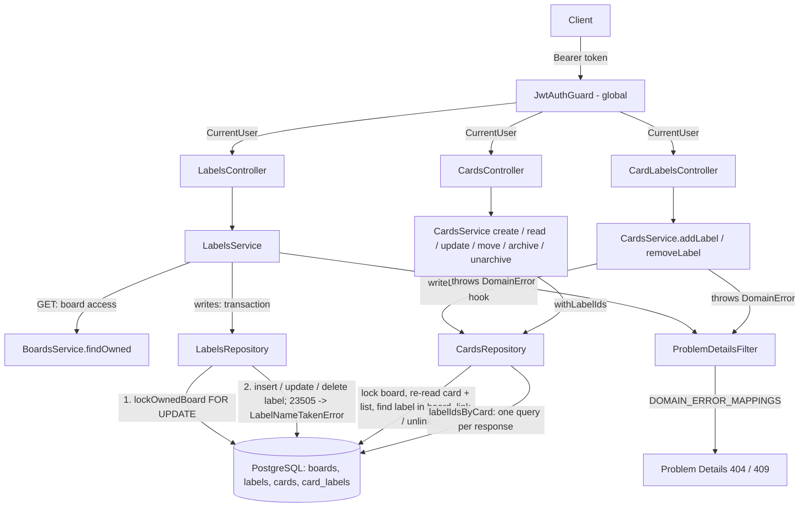

# Labels Design

**Spec**: `.specs/features/labels/spec.md`
**Status**: Approved

---

## Architecture Overview

A new `labels` module following BE-AD-005 owns the label CRUD: entity, repository, service, controller and DTOs in `src/labels/`. Access follows BE-AD-008: a label is reachable only through a board owned by the caller, so every label query joins `boards` on `owner_id`, and a foreign label behaves exactly like a missing one (LBL-28).

Applying and removing labels is a card write, so the `cards` module owns the `card_labels` link table, the `PUT`/`DELETE /cards/:id/labels/:labelId` routes and the `labelIds` of every card response. `CardsService.writeLocked` already locks the board, re-reads the card and its list, and guards board > list > card; apply/remove reuse it with one extra hook that looks the label up under the lock. `cards` depends on `labels` only for the `Label` entity and its errors, and `labels` depends on `boards`, so there is no module cycle.

Every label write (create, update, delete) and every apply/remove runs in one transaction that first locks the **board** row with `SELECT ... FOR UPDATE` (BE-AD-010). Board archive/delete, list writes and card writes take the same row lock, so the board-archived check (LBL-07, LBL-27) always sees the committed state, and a label cannot be deleted between the apply's label lookup and its insert.



### Approaches considered

| Decision | Options | Verdict |
| -------- | ------- | ------- |
| Owner of apply/remove and `card_labels` | **A. `cards` module** (chosen) / B. `labels` module | A confirmed: reuses `writeLocked` (lock, re-read, board > list > card guards). B needs the card guards from `cards` while `cards` needs `labelIds` from `labels`: a module cycle (`forwardRef`) or a second copy of `writeLocked` |
| Loading `labelIds` | **A. Separate query** (chosen) / B. TypeORM `@ManyToMany` / C. `@VirtualColumn` with `array_agg` | A confirmed: one explicit query per response (`card_id = ANY($1)`), no N+1, ordering in SQL. B makes `save(card)` sync the join table, racing concurrent applies, and orders the relation awkwardly. C relies on unverified `uuid[]` parsing and `save()` behavior |

---

## Code Reuse Analysis

### Existing Components to Leverage

| Component | Location | How to Use |
| --------- | -------- | ---------- |
| `JwtAuthGuard` (global) + `@CurrentUser()` | `src/auth/jwt-auth.guard.ts`, `src/auth/current-user.decorator.ts` | Every label route is protected (LBL-29) |
| Global `ValidationPipe` + `validationExceptionFactory` | `src/app.setup.ts:33` | DTO errors → `400` with `errors[{ field, message }]`; unknown properties → `400` |
| `trim` transform | `src/boards/dto/create-board.dto.ts:6` | `name` (LBL-02, LBL-10) |
| `BoardsService.findOwned(ownerId, id)` | `src/boards/boards.service.ts:32` | `GET /boards/:boardId/labels` board check (LBL-08, LBL-09); `isUUID` guard + `BoardNotFoundError` built in |
| `BoardNotFoundError`, `BoardArchivedError` | `src/boards/boards.errors.ts` | Reused as is (LBL-08, LBL-07, LBL-27) |
| `CardNotFoundError`, `CardArchivedError`, `ListArchivedError` | `src/cards/cards.errors.ts`, `src/lists/lists.errors.ts` | Reused as is (LBL-23, LBL-24, LBL-30) |
| `lockOwnedBoard` query | `src/lists/lists.repository.ts:31`, `src/cards/cards.repository.ts:34` | Extracted to one shared function, used by lists, cards and labels (see Risks) |
| `CardsService.writeLocked` | `src/cards/cards.service.ts:236` | Apply/remove flow: lookup → lock → re-read → label lookup hook → guards → work |
| `UsersRepository.create` unique-violation catch | `src/users/users.repository.ts:20` | Same `23505` + constraint-name check, mapped to `LabelNameTakenError` (LBL-05, LBL-13, LBL-31) |
| `toListResponse` / `toCardResponse` | `src/lists/dto/`, `src/cards/dto/card-response.dto.ts:37` | `toLabelResponse`; `toCardResponse` gains `labelIds` |
| `CreateCards` migration | `src/database/migrations/1792540800000-CreateCards.ts` | Same style: raw SQL, named constraints, cascade FKs |
| `bootWithDatabase`, `revertAllMigrations`, `createTestApp` | `test/support/` | Integration and e2e suites |

### Integration Points

| System | Integration Method |
| ------ | ------------------ |
| `AppModule` | Imports `LabelsModule` |
| `BoardsModule` | `LabelsModule` imports it for `BoardsService` (already exported) |
| `CardsModule` | Registers `Label` in `TypeOrmModule.forFeature`; imports `labels.errors.ts`; gains `CardLabelsController` |
| `boards` table | `labels.board_id` FK → `boards.id` `ON DELETE CASCADE` (LBL-33) |
| `cards`, `labels` tables | `card_labels.card_id` → `cards.id` and `card_labels.label_id` → `labels.id`, both `ON DELETE CASCADE`: deleting a card, a list, a board or a label deletes its links (LBL-17, LBL-33); `LabelsService.remove` and `CardsService.remove` need no link cleanup |
| Card responses | Every `CardsController` route maps `CardWithLabels` through `toCardResponse` (LBL-26) |
| Error mapping | `domain-error-mappings.ts` imports `labels.errors.ts` |

---

## Components

### Shared `lockOwnedBoard`

- **Purpose**: One copy of the board row lock used by every board-scoped write (BE-AD-010).
- **Location**: `src/boards/board-lock.ts`
- **Interfaces**:
  - `lockOwnedBoard(manager: EntityManager, ownerId: string, boardId: string): Promise<Board | null>` - `findOne(Board, { where: { id, ownerId }, lock: { mode: 'pessimistic_write' } })`; only valid inside a transaction.
- **Dependencies**: TypeORM `EntityManager`, `Board`
- **Reuses**: the body of `ListsRepository.lockOwnedBoard`; `ListsRepository` and `CardsRepository` keep their `lockOwnedBoard` method and delegate to it (no caller changes)

### `Label` entity

- **Purpose**: The `labels` table.
- **Location**: `src/labels/label.entity.ts`
- **Interfaces**: `id`, `boardId` (plain FK column, no relation), `name`, `color: LabelColor`, `createdAt`, `updatedAt`
- **Reuses**: `List` entity style (plain FK column, `CreateDateColumn` / `UpdateDateColumn`)

### `LABEL_COLORS`

- **Purpose**: The palette, single source for the DTO and the entity type. The `CreateLabels` migration writes its own copy into `CHK_labels_color` so the migration never changes with the code; the labels table integration test fails if the two drift apart.
- **Location**: `src/labels/label-colors.ts`
- **Interfaces**: `LABEL_COLORS = ['green', 'yellow', 'orange', 'red', 'purple', 'blue', 'sky', 'lime', 'pink', 'black'] as const`; `type LabelColor = (typeof LABEL_COLORS)[number]`
- **Reuses**: none

### `LabelsRepository`

- **Purpose**: All label queries, owner-scoped through the board (BE-AD-008).
- **Location**: `src/labels/labels.repository.ts`
- **Interfaces**:
  - `transaction<T>(work: (labels: LabelsRepository) => Promise<T>): Promise<T>`
  - `lockOwnedBoard(ownerId, boardId): Promise<Board | null>` - delegates to the shared function
  - `findOwned(ownerId, id): Promise<Label | null>` - joins `boards` on `owner_id`
  - `listInBoard(boardId): Promise<Label[]>` - `ORDER BY created_at, id` (LBL-09)
  - `create(input: Pick<Label, 'boardId' | 'name' | 'color'>): Promise<Label>` - catches `23505` on `UQ_labels_board_id_name` → `LabelNameTakenError`
  - `save(label): Promise<Label>` - same catch
  - `delete(id): Promise<void>`
- **Dependencies**: `Repository<Label>`
- **Reuses**: `ListsRepository` transaction pattern, `UsersRepository` conflict check

### `LabelsService`

- **Purpose**: Label rules: board access, archived board, name uniqueness through the repository.
- **Location**: `src/labels/labels.service.ts`
- **Interfaces**:
  - `create(ownerId, boardId, input: { name, color }): Promise<Label>` - `isUUID` guard → lock board → `BoardNotFoundError` if `null` → `BoardArchivedError` → `create` (LBL-01, LBL-05 to LBL-08)
  - `listInBoard(ownerId, boardId): Promise<Label[]>` - `BoardsService.findOwned`, no lock, archived boards readable (LBL-09)
  - `update(ownerId, id, changes: Partial<{ name, color }>): Promise<Label>` - `writeLocked`; `{}` returns the row unsaved (LBL-15)
  - `remove(ownerId, id): Promise<void>` - `writeLocked` → `delete`; links go by cascade (LBL-16, LBL-17)
  - private `writeLocked(ownerId, id, work)` - `findOwned` (`isUUID` guard, `LabelNotFoundError`) → lock board → re-read label under lock (`LabelNotFoundError` if deleted meanwhile) → `BoardArchivedError` → `work`
- **Dependencies**: `LabelsRepository`, `BoardsService`
- **Reuses**: `ListsService` item-write flow

### `LabelsController`

- **Purpose**: HTTP contract of the label CRUD.
- **Location**: `src/labels/labels.controller.ts`
- **Interfaces**: `POST /boards/:boardId/labels` (`201`), `GET /boards/:boardId/labels` (`200`), `PATCH /labels/:id` (`200`), `DELETE /labels/:id` (`204`); Swagger tags and responses like `CardsController`
- **Reuses**: `CardsController` structure (no prefix, nested collection + flat item)

### Label DTOs

- **Location**: `src/labels/dto/`
- `CreateLabelDto`: `name` (`@Transform(trim) @IsString() @Length(1, 50)`), `color` (`@IsIn(LABEL_COLORS)`)
- `UpdateLabelDto`: same rules, each `@IsOptional()`; `null` is rejected because `@IsOptional` lets `null` through, so it uses `@ValidateIf((_, value) => value !== undefined)` like `UpdateCardDto.title` (LBL-11, LBL-12)
- `LabelResponseDto` + `toLabelResponse(label)`: `{ id, boardId, name, color, createdAt, updatedAt }` (LBL-01)

### Label domain errors

- **Location**: `src/labels/labels.errors.ts`
- `LabelNotFoundError` → `404` `/problems/label-not-found`
- `LabelNameTakenError` → `409` `/problems/label-name-taken`

### `CardsRepository` (changed)

- **New interfaces**:
  - `findLabelInBoard(boardId, labelId): Promise<Label | null>` - a label of another board is `null` (LBL-22)
  - `linkLabel(cardId, labelId): Promise<void>` - `INSERT INTO card_labels ... ON CONFLICT DO NOTHING` (LBL-19, LBL-32)
  - `unlinkLabel(cardId, labelId): Promise<void>` - `DELETE ... WHERE card_id AND label_id`; zero rows is fine (LBL-20)
  - `labelIdsByCard(cardIds: string[]): Promise<Map<string, string[]>>` - one query joining `labels`, `ORDER BY labels.created_at, labels.id`; skips the query for `[]` (LBL-26)
- Raw SQL on `card_labels`: no entity, so no `save` ever touches `cards.updated_at` (LBL-21)

### `CardsService` (changed)

- **New interfaces**:
  - `addLabel(ownerId, id, labelId): Promise<void>` and `removeLabel(ownerId, id, labelId): Promise<void>` - `writeLocked` with a `findLabel` hook; work throws `CardArchivedError` on an archived card, then links / unlinks
  - `type CardWithLabels = Card & { labelIds: string[] }`
  - every method returning cards (`create`, `listInList`, `listInBoard`, `findOwned`, `update`, `move`, `archive`, `unarchive`) returns `CardWithLabels` through a private `withLabelIds(cards)`; `create` returns `labelIds: []` without a query
- **`writeLocked` change**: an optional `before(board, card, cards)` hook runs under the lock after the card re-read and before the board-archived guard, so the label lookup keeps the precedence `card-not-found` > `label-not-found` > `board-archived` > `list-archived` > `card-archived` (LBL-25). Every existing caller passes no hook and keeps its behavior.
- `labelIdsByCard` runs after the write transaction commits, outside the lock: a concurrent apply may or may not show, which is the same as reading a moment later.

### `CardLabelsController` (new)

- **Location**: `src/cards/card-labels.controller.ts`
- **Interfaces**: `PUT /cards/:id/labels/:labelId` and `DELETE /cards/:id/labels/:labelId`, both `@HttpCode(204)`
- Separate class so `CardsController` stays the card CRUD; both share `CardsService`.

### `toCardResponse` (changed)

- Takes `CardWithLabels`, adds `labelIds`; `CardResponseDto` gains `@ApiProperty({ type: [String], format: 'uuid' }) labelIds`.

---

## Data Models

### `Label`

```typescript
@Entity('labels')
class Label {
  id: string            // uuid, gen_random_uuid()
  boardId: string       // board_id, FK_labels_board_id ON DELETE CASCADE
  name: string          // varchar(50), stored trimmed
  color: LabelColor     // varchar(10), CHK_labels_color
  createdAt: Date
  updatedAt: Date
}
```

### `card_labels` (no entity)

```sql
card_id  uuid NOT NULL  -- FK_card_labels_card_id  -> cards(id)  ON DELETE CASCADE
label_id uuid NOT NULL  -- FK_card_labels_label_id -> labels(id) ON DELETE CASCADE
PRIMARY KEY (card_id, label_id)                    -- PK_card_labels: one link per pair (LBL-19, LBL-32)
```

**Relationships**: board 1—N labels; card N—N labels through `card_labels`. A link's card and label belong to the same board; the database does not enforce it (no `board_id` on cards), `CardsService.addLabel` does through `findLabelInBoard` under the board lock.

### Migration `CreateLabels`

```sql
CREATE TABLE "labels" (
  "id" uuid PRIMARY KEY DEFAULT gen_random_uuid(),
  "board_id" uuid NOT NULL
    CONSTRAINT "FK_labels_board_id" REFERENCES "boards" ("id") ON DELETE CASCADE,
  "name" varchar(50) NOT NULL,
  "color" varchar(10) NOT NULL
    CONSTRAINT "CHK_labels_color" CHECK ("color" IN ('green', 'yellow', 'orange', 'red', 'purple', 'blue', 'sky', 'lime', 'pink', 'black')),
  "created_at" timestamptz NOT NULL DEFAULT now(),
  "updated_at" timestamptz NOT NULL DEFAULT now()
);
-- Case-insensitive uniqueness per board (LBL-05, LBL-13, LBL-31); name is stored trimmed.
CREATE UNIQUE INDEX "UQ_labels_board_id_name" ON "labels" ("board_id", lower("name"));

CREATE TABLE "card_labels" (
  "card_id" uuid NOT NULL
    CONSTRAINT "FK_card_labels_card_id" REFERENCES "cards" ("id") ON DELETE CASCADE,
  "label_id" uuid NOT NULL
    CONSTRAINT "FK_card_labels_label_id" REFERENCES "labels" ("id") ON DELETE CASCADE,
  CONSTRAINT "PK_card_labels" PRIMARY KEY ("card_id", "label_id")
);
-- Label delete cascades by label_id; the PK only serves lookups by card_id.
CREATE INDEX "IDX_card_labels_label_id" ON "card_labels" ("label_id");
```

`down`: drop `card_labels`, then `labels`.

---

## Error Handling Strategy

| Error Scenario | Handling | User Impact |
| -------------- | -------- | ----------- |
| Missing / invalid token | Global `JwtAuthGuard` | `401` `about:blank` |
| Invalid body (`name` blank / > 50 / `null`, `color` outside the palette or `"Green"`, unknown property) | `ValidationPipe` → `RequestValidationException` | `400` with `errors[]` per field |
| Unknown, foreign or malformed `:boardId` | `isUUID` guard / `lockOwnedBoard` `null` / `BoardsService.findOwned` → `BoardNotFoundError` | `404` `/problems/board-not-found` |
| Unknown, foreign or malformed label `:id` | `LabelNotFoundError` | `404` `/problems/label-not-found` |
| Unknown, foreign or malformed card `:id` on apply/remove | `writeLocked` → `CardNotFoundError` | `404` `/problems/card-not-found` |
| `:labelId` unknown, foreign, of another board or malformed on apply/remove | `isUUID` guard / `findLabelInBoard` `null` in the hook → `LabelNotFoundError` | `404` `/problems/label-not-found` |
| Name taken on the board (including a concurrent create or rename) | `23505` on `UQ_labels_board_id_name` → `LabelNameTakenError` | `409` `/problems/label-name-taken` |
| Label write, or apply/remove, on an archived board | `BoardArchivedError` | `409` `/problems/board-archived` |
| Apply/remove on a card of an archived list | `ListArchivedError` | `409` `/problems/list-archived` |
| Apply/remove on an archived card | `CardArchivedError` | `409` `/problems/card-archived` |
| Label or board deleted between the lookup and the lock | Re-read under the lock returns `null` → `LabelNotFoundError` / `BoardNotFoundError` | `404` |
| Database failure, other constraint violation (bug) | Unhandled → filter | `500` (FND-11); transaction rolled back |

---

## Risks & Concerns

| Concern | Location (file:line) | Impact | Mitigation |
| ------- | -------------------- | ------ | ---------- |
| `lockOwnedBoard` would get a third copy | `src/lists/lists.repository.ts:31`, `src/cards/cards.repository.ts:34` | Three copies of the lock query can drift; the cards design accepted two copies "until a third module needs it" | First task extracts `src/boards/board-lock.ts`; the existing methods delegate to it, so the list and card concurrency tests guard the refactor |
| Every card route changes its body | `src/cards/dto/card-response.dto.ts:37` | Existing e2e tests that compare full card bodies with `toEqual` fail once `labelIds` is added | The `labelIds` task updates those expectations to include `labelIds: []` in the same commit; no assertion is weakened |
| `CardsService` return types change | `src/cards/cards.service.ts` | `cards.service.spec.ts` (27K) mocks the repository; new `labelIdsByCard` calls need a mock | Default mock returns an empty `Map`; assertions on the card fields stay as they are |
| `@IsOptional` accepts `null` | class-validator | `PATCH { "name": null }` would pass and fail at the `NOT NULL` column → `500` | `UpdateLabelDto` uses `ValidateIf(value !== undefined)`; e2e cases for `name: null` and `color: null` → `400` |
| Unique-violation constraint name on an expression index | PostgreSQL reports the index name in `constraint` for unique-index violations | If the name did not come through, a clash would surface as `500` | Integration test inserts two labels `"Bug"` / `"bug"` on one board and asserts `LabelNameTakenError`; e2e asserts `409` |
| Same-board link is enforced only in code | `card_labels` (new) | A bug could link a label of another board | `findLabelInBoard(lockedBoardId, labelId)` is the only path to `linkLabel`; e2e covers label of another board → `404` (LBL-22) |
| `labelIds` read outside the write lock | `CardsService.withLabelIds` (new) | A response may miss an apply that commits right after | Accepted: same as reading a moment later; no invariant depends on it |
| Concurrency tests may pass without real overlap | `test/e2e/labels/` (new) | LBL-31, LBL-32 unproven | e2e fires ≥ 10 concurrent creates with names differing only in case and ≥ 10 concurrent applies of one label with `Promise.all`; asserts one `201` + rest `409`, and all `204` + `labelIds` of length 1 |

---

## Tech Decisions

| Decision | Choice | Rationale |
| -------- | ------ | --------- |
| Module owning apply/remove | `cards` | Reuses `writeLocked`; no module cycle (confirmed) |
| `labelIds` loading | Separate query per response | Explicit, one query, ordering in SQL (confirmed) |
| Name uniqueness | Unique expression index `(board_id, lower(name))`, `23505` mapped in the repository | Holds under races without a prior lookup (LBL-31); same pattern as `UQ_users_email` |
| Color storage | `varchar(10)` + `CHECK` | Matches the project's `CHECK` style; adding a color is one migration either way, and a `CHECK` is simpler to change than a PostgreSQL enum |
| `card_labels` without an entity | Raw SQL in `CardsRepository` | No `save` path can touch `cards.updated_at` (LBL-21); `ON CONFLICT DO NOTHING` gives idempotency in one statement |
| Label writes lock the board | `lockOwnedBoard` like lists and cards | The board-archived guard sees committed state, and a label cannot vanish between the apply's lookup and its insert; conforms to BE-AD-010 |
