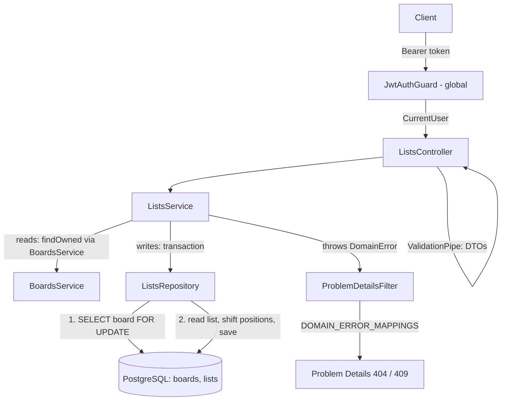

# Lists Design

**Spec**: `.specs/features/lists/spec.md`
**Status**: Approved

---

## Architecture Overview

A new `lists` module following BE-AD-005: entity, repository, service, controller and DTOs in `src/lists/`. Access follows BE-AD-008: a list is reachable only through a board owned by the caller, so every list query joins `boards` on `owner_id`, and a foreign list behaves exactly like a missing one (LST-27).

Every write that can change positions (create, move, archive, unarchive, delete) runs in one transaction that first locks the parent board row with `SELECT ... FOR UPDATE`. Writes on the same board queue behind that lock, so each one reads a fresh, contiguous set of positions and leaves a contiguous set behind (LST-19). The archive state checks (LST-05, LST-13, LST-18, LST-25, LST-26) run inside the same transaction, after the lock, so a board archived by a concurrent request is always seen.



### Approaches considered (position consistency, LST-19)

| Approach | How concurrent position writes stay contiguous | Verdict |
| -------- | ---------------------------------------------- | ------- |
| **A. Board row lock + deferred unique constraint** (chosen) | Transaction locks the board row `FOR UPDATE`, then reads and shifts positions; `UNIQUE (board_id, position) DEFERRABLE INITIALLY DEFERRED` rejects any bug that would leave duplicates | Recommended: plain `READ COMMITTED`, no retry loop; the lock also serializes against board archive/delete, which take the same row lock through `UPDATE`/`DELETE`; the constraint is a database-level safety net |
| B. `SERIALIZABLE` transactions + retry on `40001` | PostgreSQL aborts conflicting transactions; the service retries | Needs a retry wrapper and retry tests; failures under load surface as latency spikes |
| C. Transaction-scoped advisory lock `pg_advisory_xact_lock(hashtext(board_id))` | Same serialization as A without touching the board row | Does not serialize against a concurrent board archive (BRD-15) without changing `BoardsService`; hash collisions block unrelated boards |

---

## Code Reuse Analysis

### Existing Components to Leverage

| Component | Location | How to Use |
| --------- | -------- | ---------- |
| `JwtAuthGuard` (global) + `@CurrentUser()` | `src/auth/jwt-auth.guard.ts`, `src/auth/current-user.decorator.ts` | Every list route is protected (LST-28) |
| Global `ValidationPipe` + `validationExceptionFactory` | `src/app.setup.ts:33` | DTO errors become `400` with `errors[{ field, message }]` (LST-03, LST-08, LST-11, LST-17); unknown properties → `400` |
| `trim` transform | `src/boards/dto/create-board.dto.ts:6` | Imported for `title` |
| `BoardsService.findOwned(ownerId, id)` | `src/boards/boards.service.ts:32` | Read routes on `/boards/:boardId/lists` check the board (LST-04, LST-06, LST-07): `isUUID` guard + `BoardNotFoundError` already built in |
| `BoardNotFoundError`, `BoardArchivedError` | `src/boards/boards.errors.ts` | Reused as is for LST-04, LST-05, LST-26 (same `type`, same body as BRD-21 / BRD-14) |
| `DomainError` + `DOMAIN_ERROR_MAPPINGS` | `src/errors/domain-error.ts`, `src/errors/domain-error-mappings.ts` | Three new list errors mapped to `404` / `409` (BE-AD-007) |
| `toBoardResponse` pattern | `src/boards/dto/board-response.dto.ts:25` | `toListResponse` is the only way a `List` leaves the API |
| `ListBoardsQueryDto` pattern | `src/boards/dto/list-boards-query.dto.ts` | Same `archived` rule in `ListListsQueryDto` (LST-08) |
| Hand-written SQL migration | `src/database/migrations/1792368000000-CreateBoards.ts` | Same style for `CreateLists` |
| `bootWithDatabase`, `revertAllMigrations`, `createTestApp` | `test/support/` | Integration and e2e suites |

### Integration Points

| System | Integration Method |
| ------ | ------------------ |
| `AppModule` | Imports `ListsModule` |
| `BoardsModule` | `ListsModule` imports it for `BoardsService` (already exported); no change to boards code |
| `boards` table | `lists.board_id` FK → `boards.id` `ON DELETE CASCADE` (LST-29); the repository locks `boards` rows through the transaction's `EntityManager` |
| Error mapping | `domain-error-mappings.ts` imports `lists.errors.ts` |
| Future `cards` | `ListsModule` exports `ListsService`; cards reuse the same lock-and-shift approach inside a list (BE-AD-009) |

---

## Components

### `List` entity

- **Purpose**: TypeORM mapping of the `lists` table.
- **Location**: `src/lists/list.entity.ts`
- **Interfaces**: columns `id`, `boardId`, `title`, `position` (`number | null`), `archivedAt`, `createdAt`, `updatedAt`.
- **Reuses**: `Board` entity style: plain FK column `board_id`, no TypeORM relation.

### `ListsRepository`

- **Purpose**: All queries on `lists`, always scoped by the owner through `boards`.
- **Location**: `src/lists/lists.repository.ts`
- **Interfaces**:
  - `transaction<T>(work: (lists: ListsRepository) => Promise<T>): Promise<T>` - runs `work` with a repository bound to one transaction's `EntityManager`.
  - `lockOwnedBoard(ownerId, boardId): Promise<Board | null>` - `SELECT` the board with `pessimistic_write` (`FOR UPDATE`), filtered by `owner_id`.
  - `findOwned(ownerId, id): Promise<List | null>` - list joined to `boards` with `boards.owner_id = ownerId`.
  - `listInBoard(boardId, archived): Promise<List[]>` - active by `position ASC`, archived by `archived_at DESC, id DESC`.
  - `countActive(boardId): Promise<number>`
  - `create(input: { boardId, title, position }): Promise<List>`
  - `shift(boardId, from, to, delta: 1 | -1): Promise<void>` - raw SQL `UPDATE lists SET position = position + $delta WHERE board_id = $1 AND position BETWEEN $from AND $to`; raw SQL so `updated_at` of shifted rows stays unchanged.
  - `save(list): Promise<List>`, `delete(id): Promise<void>`
- **Dependencies**: `Repository<List>` (default) or the transaction's `EntityManager`.
- **Reuses**: `BoardsRepository` style (owner scoping in the `WHERE`).

### `ListsService`

- **Purpose**: List rules: board access, archive guards, position arithmetic.
- **Location**: `src/lists/lists.service.ts`
- **Interfaces**:
  - `create(ownerId, boardId, title): Promise<List>`
  - `listInBoard(ownerId, boardId, archived): Promise<List[]>`
  - `findOwned(ownerId, id): Promise<List>`
  - `update(ownerId, id, { title? }): Promise<List>`
  - `move(ownerId, id, position): Promise<List>`
  - `archive(ownerId, id)`, `unarchive(ownerId, id)`: `Promise<List>`
  - `remove(ownerId, id): Promise<void>`
- **Dependencies**: `ListsRepository`, `BoardsService`.
- **Write flow (item routes)**: `isUUID(id)` → `findOwned` (gets `boardId`, else `ListNotFoundError`) → `transaction`: `lockOwnedBoard` → re-read the list under the lock → guards in precedence order → change.
- **Guard precedence**: list not found `404` → board archived `409 board-archived` → list state `409 list-archived` / `list-not-archived` (spec Assumptions).
- **Position arithmetic** (`n` = active lists, `i` = current position):
  - create: `position = n`.
  - move to `k`: `k = min(k, n - 1)`; `k === i` → return unchanged (LST-16); `k < i` → `shift(k, i - 1, +1)`; `k > i` → `shift(i + 1, k, -1)`; then `save` with `position = k`.
  - archive: `shift(i + 1, n - 1, -1)`; `position = null`, `archivedAt = now`.
  - unarchive: `position = n`, `archivedAt = null`.
  - delete: the list is archived, so it holds no position; no shift.
- **Reuses**: `BoardsService` no-op pattern: idempotent calls and `{}` return the loaded row without `save`, so `updatedAt` stays (LST-12, LST-16, LST-21, LST-23).

### `ListsController`

- **Purpose**: HTTP contract.
- **Location**: `src/lists/lists.controller.ts`
- **Routes**: a controller with no prefix and full paths: `POST`/`GET boards/:boardId/lists`; `GET`/`PATCH`/`DELETE lists/:id`; `POST lists/:id/move`, `lists/:id/archive`, `lists/:id/unarchive` (`@HttpCode(200)` on the three `POST` actions, `204` on `DELETE`).
- **Reuses**: `BoardsController` structure and Swagger decorators.

### DTOs

- **Location**: `src/lists/dto/`
- `CreateListDto`: `title` (`trim`, `@IsString`, `@Length(1, 100)`).
- `UpdateListDto`: `title` with `@ValidateIf((dto) => dto.title !== undefined)` so `null` is rejected (LST-11).
- `MoveListDto`: `position` `@IsInt`, `@Min(0)`; no upper bound, the service clamps (LST-15). `"2"` stays a string (no implicit conversion) and fails `@IsInt`.
- `ListListsQueryDto`: `archived` `@IsOptional`, `@IsIn(['true', 'false'])`.
- `ListResponseDto` + `toListResponse(list)`: `{ id, boardId, title, position, archivedAt, createdAt, updatedAt }`, dates as ISO strings.

### Domain errors

- **Location**: `src/lists/lists.errors.ts`

| Error | Status | `type` | `detail` |
| ----- | ------ | ------ | -------- |
| `ListNotFoundError` | `404` | `/problems/list-not-found` | `List not found.` |
| `ListArchivedError` | `409` | `/problems/list-archived` | `Archived lists cannot be changed.` |
| `ListNotArchivedError` | `409` | `/problems/list-not-archived` | `Only archived lists can be deleted.` |

---

## Data Models

### `List`

```typescript
@Entity('lists')
export class List {
  @PrimaryGeneratedColumn('uuid') id!: string;
  @Column({ name: 'board_id', type: 'uuid' }) boardId!: string;
  @Column({ length: 100 }) title!: string;
  @Column({ type: 'integer', nullable: true }) position!: number | null;
  @Column({ name: 'archived_at', type: 'timestamptz', nullable: true }) archivedAt!: Date | null;
  @CreateDateColumn({ name: 'created_at', type: 'timestamptz' }) createdAt!: Date;
  @UpdateDateColumn({ name: 'updated_at', type: 'timestamptz' }) updatedAt!: Date;
}
```

### Migration `CreateLists`

```sql
CREATE TABLE "lists" (
  "id" uuid PRIMARY KEY DEFAULT gen_random_uuid(),
  "board_id" uuid NOT NULL
    CONSTRAINT "FK_lists_board_id" REFERENCES "boards" ("id") ON DELETE CASCADE,
  "title" varchar(100) NOT NULL,
  "position" integer,
  "archived_at" timestamptz,
  "created_at" timestamptz NOT NULL DEFAULT now(),
  "updated_at" timestamptz NOT NULL DEFAULT now(),
  CONSTRAINT "UQ_lists_board_id_position" UNIQUE ("board_id", "position")
    DEFERRABLE INITIALLY DEFERRED,
  CONSTRAINT "CHK_lists_position_archived"
    CHECK (
      ("archived_at" IS NULL AND "position" IS NOT NULL AND "position" >= 0)
      OR ("archived_at" IS NOT NULL AND "position" IS NULL)
    )
);
```

**Relationships**: many lists → one board. The unique constraint's index serves the active list query (`board_id`, ordered by `position`) and the shifts. `NULL` positions never collide, so archived lists are free. The check constraint ties `position` to the archive state: active ⇔ non-negative position, archived ⇔ `NULL` (one branch per state, so an archived list cannot keep a negative position).

---

## Error Handling Strategy

| Error Scenario | Handling | User Impact |
| -------------- | -------- | ----------- |
| Missing / invalid token | Global `JwtAuthGuard` | `401` `about:blank` |
| Invalid body or query | `ValidationPipe` → `RequestValidationException` | `400` with `errors[]` per field |
| Unknown, foreign or malformed `:boardId` | `BoardsService.findOwned` / `lockOwnedBoard` → `BoardNotFoundError` | `404` `/problems/board-not-found` |
| Unknown, foreign or malformed list `:id` | `ListNotFoundError` | `404` `/problems/list-not-found` |
| Write on a list of an archived board | `BoardArchivedError` | `409` `/problems/board-archived` |
| `PATCH` / `move` on archived list | `ListArchivedError` | `409` `/problems/list-archived` |
| `DELETE` on active list | `ListNotArchivedError` | `409` `/problems/list-not-archived` |
| Board deleted between `findOwned` and the lock | `lockOwnedBoard` returns `null` → `ListNotFoundError` (the list went with the board) | `404` `/problems/list-not-found` |
| Position constraint violated (bug) | Commit fails → unhandled → filter | `500` (FND-11); transaction rolled back, nothing changes |
| Database failure | Unhandled → filter | `500` (FND-11) |

---

## Risks & Concerns

| Concern | Location (file:line) | Impact | Mitigation |
| ------- | -------------------- | ------ | ---------- |
| TypeORM's `UpdateQueryBuilder` adds `updated_at = CURRENT_TIMESTAMP` to every update | `node_modules/typeorm/query-builder/UpdateQueryBuilder.js:442` | Shifted lists would get a new `updatedAt`, breaking the spec assumption | `shift` uses raw SQL through the transaction's `EntityManager.query`; integration test asserts a shifted list keeps its `updatedAt` |
| Board writes do not lock explicitly | `src/boards/boards.service.ts:70`, `:92` | Could a board archive slip past a list write? | No: `UPDATE`/`DELETE` on the board row take the same row lock as `FOR UPDATE`, so they serialize with list writes; e2e covers archived board → `409` (LST-26) |
| Concurrency test can be flaky or pass without real overlap | `test/integration/lists/` (new) | LST-19 under concurrency unproven | Integration test fires ≥ 10 concurrent creates and moves on one board with `Promise.all` (pool default 10) and asserts positions `0..n-1`; a second test proves the deferred unique constraint rejects a duplicate at commit |
| `GET /boards/:boardId/lists` reads two queries without a transaction | `src/lists/lists.service.ts` (new) | A concurrent move could be half-visible | No: every move commits atomically, and a single `SELECT` sees one snapshot under `READ COMMITTED` |
| Malformed uuid reaching PostgreSQL | `src/lists/lists.service.ts` (new) | `500` instead of `404` | `isUUID` before any list query (LST-27); board ids go through `BoardsService.findOwned`, which already checks |
| Test gap: board delete cascade untested for children | `test/integration/boards/boards-table.int-spec.ts` | LST-29 unproven | Integration test in `lists-table.int-spec.ts` deletes a board and asserts its lists are gone |

---

## Tech Decisions

| Decision | Choice | Rationale |
| -------- | ------ | --------- |
| Position consistency | Board row lock + deferred unique constraint (approach A) | No retries, serializes with board archive/delete; recorded as BE-AD-009 for cards |
| Position storage | Contiguous 0-based integers, `NULL` while archived | Matches the move API (index); cheap to renumber at personal scale |
| Shifting rows | Raw SQL `UPDATE ... SET position = position ± 1` | One statement per move; keeps `updated_at` of shifted rows |
| Route layout | One `ListsController` with full paths, no prefix | Mixed prefixes (`boards/:boardId/lists`, `lists/:id`) in one place; cards follow the same layout |
| Board access from lists | Reads through `BoardsService.findOwned`; writes lock through `ListsRepository.lockOwnedBoard` on the transaction's manager | Reads reuse the board rule; writes need the lock in the same transaction, which a cross-module service call cannot join |
