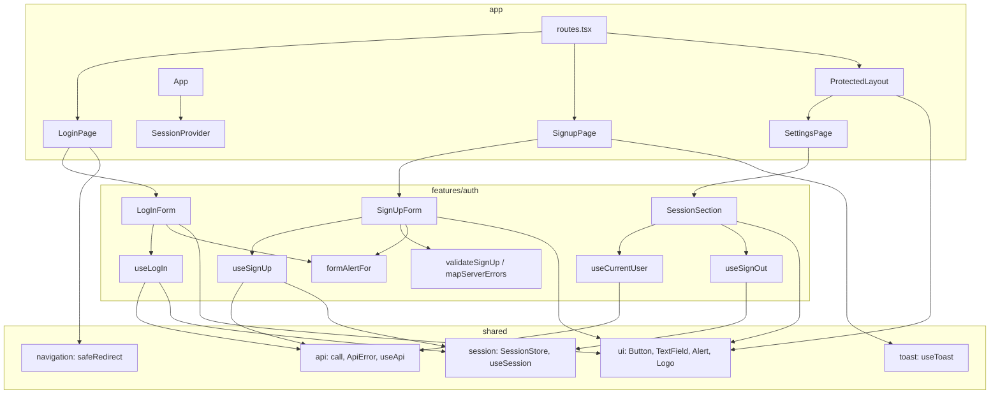

# Auth Design

**Spec**: `front-end/.specs/features/auth/spec.md`
**Context**: `front-end/.specs/features/auth/context.md`
**Status**: Approved

---

## Architecture Overview

The feature follows FE-AD-006 with no deviation: a `features/auth` module (model, api, components) composed by three pages, a set of Púrpura primitives in `shared/ui` built on React Aria Components, and a protected layout route that adds the top bar. Pages own routing concerns (read `redirect`/`reason`, navigate, toast); the feature owns forms, API calls and error mapping, and knows no route paths except through props.



**Sign-up flow:** `SignUpForm` submit → `validateSignUp(values)`; errors → set field errors, focus first invalid field, stop. Clean → `useSignUp().mutate(trimmed)` → `201`: `session.setToken(accessToken)` in the hook's `onSuccess`, then the form calls `onSuccess()` → `SignupPage` navigates to `/boards` and shows the "Conta criada" toast. Error → `409` maps to the E-mail field, `400` maps `errors[]` per field, everything else goes to `formAlertFor(err)`.

**Log-in flow:** `LogInForm` submit → `useLogIn().mutate(trimmed)` → `200`: `setToken`, `onSuccess()` → `LoginPage` navigates to `safeRedirect(searchParams.get('redirect'))`. Error → `formAlertFor(err)`.

**Sign-out flow:** `SessionSection` "Sair" → `useSignOut()`: `session.clear()` → `await navigate('/login')` → `queryClient.clear()`. The token goes first so the `/login` loader (`redirectIfSession`) lets the navigation through; the cache goes last so the still-mounted `/settings` query does not refetch without a token before the page unmounts.

---

## Code Reuse Analysis

### Existing Components to Leverage

| Component | Location | How to Use |
| --------- | -------- | ---------- |
| `call`, `ApiError`, `isProblemType` | `src/shared/api/api-error.ts` | `mutationFn: () => call(api.POST(...))`; `status` 0 / 400 / 401 / 409 / 429 / 5xx drive the error mapping |
| `useApi` | `src/shared/api/api-context.tsx` | The only way the feature gets the client |
| `createApiClient` (no-expiry list) | `src/shared/api/client.ts:14` | Log-in and sign-up `401`s never expire the session (FND-15); nothing to change |
| `SessionStore` (`setToken`, `clear`) | `src/shared/session/session-store.ts` | Store the token, sign out |
| `safeRedirect` | `src/shared/navigation/safe-redirect.ts` | `LoginPage` target after log in (FAUTH-14) |
| `useToast` | `src/shared/ui/toast/use-toast.ts` | "Conta criada" (FAUTH-08) |
| `requireSession` / `redirectIfSession` | `src/app/guards.ts` | Unchanged; the protected pathless route gains an `element` |
| `LoginPlaceholderPage` session-expired check | `src/pages/login-placeholder-page.tsx:9` | Logic moves into `LoginPage`; the placeholder file is deleted |
| i18n `errors.network`, `session.expired` | `src/shared/i18n/locales/*.ts` | Reused for FAUTH-18 and FAUTH-16 |
| `renderApp`, MSW `server` | `test/support/` | Page tests with a memory router and mocked API |
| Púrpura CSS (`.p-btn`, `.p-field`, `.p-input`, `.is-invalid`) | `front-end/design/_ds/.../css/components.css:23-59` | Reference for the Tailwind classes of `Button` and `TextField` (FE-AD-004: tokens already copied) |
| Prototype form | `front-end/design/Task List.dc.html:130-150` | Layout, alert slot, icons (`clock`, `timer`, `circle-alert`, `list-checks`) |

### Integration Points

| System | Integration Method |
| ------ | ------------------ |
| `POST /api/v1/auth/register` | `useSignUp` → `{ accessToken, user }` (`AuthResponseDto`), `201` |
| `POST /api/v1/auth/login` | `useLogIn` → `AuthResponseDto`, `200` |
| `GET /api/v1/me` | `useCurrentUser` → `UserResponseDto` (`name`, `email`) |
| Route table | `/login` → `LoginPage`, `/signup` → `SignupPage`, protected pathless route gets `element: <ProtectedLayout />`, `/settings` → `SettingsPage` |
| `App` providers | `SessionProvider` wraps the tree so features read the store with `useSession()` |

---

## Components

### `SessionProvider` / `useSession` (shared)

- **Purpose**: Give components the app's single `SessionStore` instance.
- **Location**: `src/shared/session/session-context.tsx`
- **Interfaces**:
  - `SessionProvider({ store, children })`
  - `useSession(): SessionStore` - throws outside the provider (same pattern as `useApi`)
- **Dependencies**: `SessionStore`
- **Reuses**: `ApiProvider` / `useApi` pattern

### `Button` (shared/ui)

- **Purpose**: Púrpura button (`primary` / `secondary`, `md` / `lg`, `fullWidth`).
- **Location**: `src/shared/ui/button.tsx`
- **Interfaces**: `Button(props: RACButtonProps & { variant?, size?, fullWidth? })` - `isDisabled` renders the native `disabled` (FAUTH-07, FAUTH-13)
- **Dependencies**: `react-aria-components` `Button`
- **Reuses**: `.p-btn` styles

### `TextField` (shared/ui)

- **Purpose**: Label + input + hint + error, wired for accessibility.
- **Location**: `src/shared/ui/text-field.tsx`
- **Interfaces**: `TextField({ label, value, onChange, type?, autoComplete?, hint?, error?, inputRef? })` - `error` sets `isInvalid`, renders `FieldError`; RAC links hint and error through `aria-describedby` and sets `aria-invalid` (FAUTH-26)
- **Dependencies**: RAC `TextField`, `Label`, `Input`, `Text slot="description"`, `FieldError`; `validationBehavior="aria"` so the browser never blocks submit
- **Reuses**: `.p-field`, `.p-input`, `.is-invalid`, `.p-hint`, `.p-error`

### `Alert` (shared/ui)

- **Purpose**: The form-level box: `tone="danger"` (red, `role="alert"`) or `tone="info"` (blue, `role="status"`), with a leading icon.
- **Location**: `src/shared/ui/alert.tsx`
- **Interfaces**: `Alert({ tone, icon: LucideIcon, children })`
- **Dependencies**: `lucide-react` icon type
- **Reuses**: Prototype classes `bg-red-50 text-red-700` / `bg-blue-50 text-blue-700`

### `Logo` (shared/ui)

- **Purpose**: Purple square with `ListChecks` + "task list" wordmark.
- **Location**: `src/shared/ui/logo.tsx`
- **Interfaces**: `Logo()` - presentational; callers wrap it in a link when needed
- **Reuses**: Prototype header markup

### Auth model (feature)

- **Purpose**: Framework-free rules for validation and error mapping.
- **Location**: `src/features/auth/model/`
- **Interfaces**:
  - `validateSignUp(values: SignUpValues): SignUpFieldErrors` - FAUTH-02–05; checks trimmed name/e-mail, raw password; e-mail rule is the prototype `EMAIL_RE` (`/^[^\s@]+@[^\s@]+\.[^\s@]{2,}$/`)
  - `mapSignUpServerErrors(err: ApiError, values: SignUpValues): SignUpFieldErrors | null` - `409` + `/problems/email-already-registered` → `{ email: 'emailTaken' }`; `400` with `errors[]` → per-field keys (FAUTH-09, FAUTH-10); otherwise `null`
  - `formAlertFor(err: ApiError, form: 'logIn' | 'signUp'): FormAlert` - `429` → `rateLimited`; `0` or `>= 500` → `network`; log in `400`/`401` → `invalidCredentials`; anything else → `network` (FAUTH-15, FAUTH-17, FAUTH-18)
  - `firstInvalidField(errors: SignUpFieldErrors): SignUpField | null` - order name → email → password (FAUTH-25)
- **Dependencies**: `ApiError` type only
- **Reuses**: none

### Auth api (feature)

- **Purpose**: The only code that calls auth endpoints.
- **Location**: `src/features/auth/api/` (`keys.ts`, `queries.ts`, `mutations.ts`)
- **Interfaces**:
  - `authKeys.me = ['me']`
  - `useCurrentUser(): UseQueryResult<UserResponse, ApiError>`
  - `useSignUp(): UseMutationResult<AuthResponse, ApiError, SignUpValues>` - `onSuccess` stores the token
  - `useLogIn(): UseMutationResult<AuthResponse, ApiError, LogInValues>` - `onSuccess` stores the token
  - `useSignOut(): () => Promise<void>` - clear token → navigate `/login` → clear cache
- **Dependencies**: `useApi`, `useSession`, `useQueryClient`, `useNavigate`
- **Reuses**: `call`

### `SignUpForm` / `LogInForm` (feature components)

- **Purpose**: The two forms: controlled `useState` values, field errors, one form alert slot.
- **Location**: `src/features/auth/components/sign-up-form.tsx`, `log-in-form.tsx`
- **Interfaces**: `SignUpForm({ onSuccess(): void })`, `LogInForm({ onSuccess(): void, sessionExpired: boolean })`
- **Behavior**: `<form noValidate>`; submit is a no-op while `isPending` (FAUTH-24); a new submit clears alert and field errors first (FAUTH-19); focus moves through `inputRef`s (FAUTH-25); button label switches to "Criando…" / "Entrando…" (FAUTH-07, FAUTH-13); `autoComplete` values per FAUTH-27
- **Dependencies**: auth model and api, shared `TextField`, `Button`, `Alert`
- **Reuses**: FE-AD-006 forms rule (controlled inputs, no form library)

### `AuthCard` (feature component)

- **Purpose**: Shared frame of both auth pages: logo top-left, centered 420 px column with title, subtitle, children and a footer slot for the switch link.
- **Location**: `src/features/auth/components/auth-card.tsx`
- **Interfaces**: `AuthCard({ title, subtitle, footer, children })`

### `SessionSection` (feature component)

- **Purpose**: "Sessão" block of `/settings` (FAUTH-20, FAUTH-21).
- **Location**: `src/features/auth/components/session-section.tsx`
- **Interfaces**: `SessionSection()` - shows "Conectado como {name} · {email}" when `useCurrentUser` has data, nothing in the text slot while loading or failed; "Sair" always enabled

### Pages

- **`LoginPage`** (`src/pages/login-page.tsx`): reads `redirect` and `reason`; renders `AuthCard` + `LogInForm`, footer link to `/signup`; `onSuccess` → `navigate(safeRedirect(redirect), { replace: true })`.
- **`SignupPage`** (`src/pages/signup-page.tsx`): `AuthCard` + `SignUpForm`, footer link to `/login`; `onSuccess` → `navigate('/boards', { replace: true })` then `toast.show({ message: t('auth.accountCreated') })`.
- **`ProtectedLayout`** (`src/pages/protected-layout.tsx`): `h-14` header with `Logo` inside a `Link` to `/boards` and, unless `pathname === '/settings'`, a `Link` with the `Settings` icon and `aria-label` "Configurações"; `<Outlet />` below (FAUTH-23).
- **`SettingsPage`** (`src/pages/settings-page.tsx`): heading "Configurações" + `SessionSection`. Feature 6 adds sections here.

---

## Data Models

```typescript
// features/auth/model/types.ts
import type { components } from '@my-trello/api-contract';

export type AuthResponse = components['schemas']['AuthResponseDto'];
export type UserResponse = components['schemas']['UserResponseDto'];

export type LogInValues = { email: string; password: string };
export type SignUpValues = LogInValues & { name: string };

export type SignUpField = 'name' | 'email' | 'password';
export type SignUpFieldError =
  | 'nameRequired'      // "Informe seu nome"
  | 'nameTooLong'       // "Use até 100 caracteres"
  | 'emailInvalid'      // "Informe um e-mail válido"
  | 'emailTaken'        // "Este e-mail já está cadastrado"
  | 'passwordLength';   // "Use de 8 a 72 caracteres"
export type SignUpFieldErrors = Partial<Record<SignUpField, SignUpFieldError>>;

export type FormAlert = 'invalidCredentials' | 'rateLimited' | 'network';
```

Values are i18n key suffixes (`auth.errors.<value>`), so the model stays free of text and React. No parallel domain model: API shapes come from the contract (FE-AD-006).

### New i18n keys (EN source, PT-BR mirror; texts from `design/i18n.js`)

`auth.logIn.{title, subtitle, submit, submitting, noAccount, createAccountLink}`, `auth.signUp.{title, subtitle, submit, submitting, haveAccount, haveAccountLink, passwordHint}`, `auth.fields.{name, email, password}`, `auth.errors.{nameRequired, nameTooLong, emailInvalid, emailTaken, passwordLength, invalidCredentials, rateLimited}`, `auth.accountCreated`, `settings.title`, `settings.session.{title, connectedAs, signOut}`, `nav.settings`, `nav.myBoards`. `errors.network` and `session.expired` are reused.

---

## Error Handling Strategy

| Error Scenario | Handling | User Impact |
| -------------- | -------- | ----------- |
| Sign-up field invalid (client) | `validateSignUp`; no request | Message under the field, focus on first invalid |
| `409` email-already-registered | `mapSignUpServerErrors` | "Este e-mail já está cadastrado" under E-mail |
| `400` with `errors[]` on sign up | `mapSignUpServerErrors` | Doc message under each listed field |
| `400` / `401` on log in | `formAlertFor` → `invalidCredentials` | Red alert "E-mail ou senha inválidos"; no expiry (FND-15) |
| `429` on either form | `formAlertFor` → `rateLimited` | Red alert with `Timer` icon; button stays enabled |
| Network (`status 0`) or `5xx` | `formAlertFor` → `network` | Red alert with `CircleAlert` icon and `errors.network` text |
| `GET /me` fails | Query error ignored by `SessionSection` | No "Conectado como" line; "Sair" still works |
| `401` on `GET /me` | FND-14 session expiry already handles it | Back to `/login?…&reason=session-expired` |

---

## Risks & Concerns

| Concern | Location (file:line) | Impact | Mitigation |
| ------- | -------------------- | ------ | ---------- |
| Auth routes are throttled to 10 requests/min per IP, and the e2e API runs with that limit | `back-end/src/auth/auth.module.ts:41` | An e2e suite with many log-in/sign-up calls hits `429` and flakes | One Playwright journey (sign up → sign out → log in) uses 2 auth calls; validation and error states are covered by component tests with MSW, never by e2e |
| Sign-out order: clearing the cache before leaving `/settings` makes the mounted `me` query refetch without a token | `useSignOut` (new) | A stray `GET /me` without `Authorization`, `401` ignored by FND-15 rule but noisy | Order fixed in the design (token → navigate → cache) and asserted by a test that counts `/me` requests |
| RAC field validation: default `validationBehavior="native"` plus `type="email"` would let the browser block submit and show its own bubble | `shared/ui/text-field.tsx` (new) | Doc messages never show for e-mail | `validationBehavior="aria"` on every field and `noValidate` on the form; a test submits an invalid e-mail and expects the doc message |
| `lucide-react` publishes almost daily (1.58–1.61 in Oct 16–21) | `front-end/package.json` | Caret range picks new minors on lockfile refresh | Install exact `1.61.0` like `openapi-fetch` and `react-router`; icons are imported by name, so a bump is a one-line diff |
| Whether `lucide-react` icons set `aria-hidden` by default is not verified | `shared/ui/alert.tsx`, `logo.tsx` (new) | Screen readers may announce decorative SVGs | Pass `aria-hidden` explicitly on every decorative icon; a component test checks it |
| No test covers `LoginPlaceholderPage` removal side effects | `test/unit/app/routes.spec.tsx` | FND-16 regression when the placeholder goes away | FAUTH-16 tests target the new `LoginPage`; existing route tests stay green |

---

## Tech Decisions (only non-obvious ones)

| Decision | Choice | Rationale |
| -------- | ------ | --------- |
| Icon library | `lucide-react` `1.61.0`, icons imported by name, no wrapper component | Design system iconography is Lucide (`_ds/.../readme.md:80`); default `strokeWidth` 2 and `currentColor` already match, so a wrapper adds nothing. Project-level → FE-AD-008 |
| Interactive primitives | Add `react-aria-components` `1.22.1` now (`Button`, `TextField`, `FieldError`) | FE-AD-006 and the foundation design defer it to the first feature that needs a widget; this is that feature |
| Where the token is stored | In the mutation hooks' `onSuccess`, not in pages | Pages only navigate; the hooks are the only code that touches API + session (FE-AD-006 `api/` role) |
| Session access in components | `SessionProvider` + `useSession()` in `shared/session` | The store lived only in `AppServices`; same context pattern as `useApi` |
| View-model | None | Two short forms and one section; FE-AD-006 keeps view-models for complex screens |
| Top bar location | `pages/protected-layout.tsx` as the protected route `element` | Pages may compose; `app/` stays wiring only; breadcrumb is added there by `boards`/`board` |
