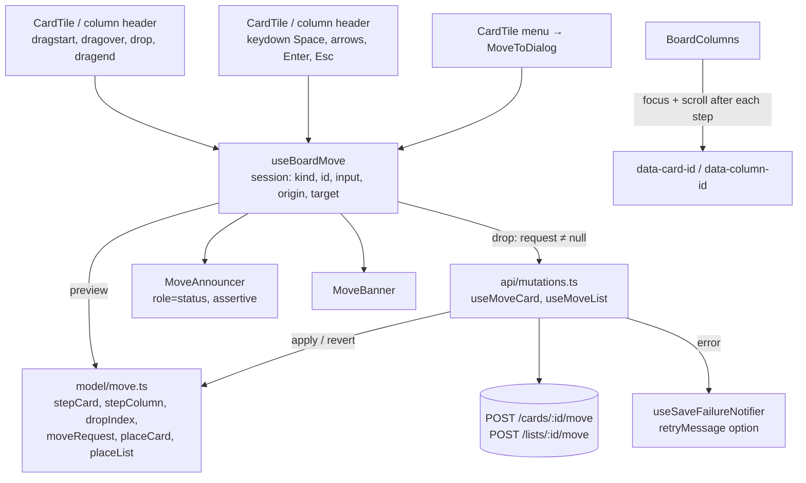

# Board Drag and Drop Design

**Spec**: `front-end/.specs/features/board-dnd/spec.md`
**Status**: Approved

---

## Architecture Overview

No drag-and-drop library (FE-AD-012, user choice). The mouse uses native HTML5 drag events, as the prototype does (`design/Task List.dc.html:385`, `:412`, `:924-952`); HTML5 drag never starts from touch, which is the spec's "no touch drag". The keyboard is a state machine over column/index spots, built from pure functions in `model/move.ts`. Both inputs feed one **move session** held by a new view-model hook, `useBoardMove`, which the board view-model composes. A session previews the move on screen while it runs; dropping turns it into one optimistic mutation (FE-AD-009, FE-AD-010) that patches the board cache with the same pure functions.



**Session lifecycle**

| Step | Mouse | Keyboard | "Mover para…" |
| ---- | ----- | -------- | ------------- |
| Start | `dragstart` on a draggable card or column header → `start(kind, id, 'mouse')` | Space on the focused card or header itself → `start(kind, id, 'keyboard')`, announce | Menu item → `askMoveTo(cardId)` opens the dialog; no session |
| Preview | `dragover` → `hover(target)`; card: source stays dashed in place, a placeholder shows at the target; column: the row reorders live, the dragged column dashed | Arrows → `step(key)`; the card or column renders at the target, lifted; banner and live region update | — |
| Drop | `drop` on a column → `drop()` | Space / Enter → `drop()`, announce "solta em…" | Option → `moveTo(listId)`: end of that column |
| Cancel | `dragend` without a drop (outside, or Esc of the native drag) → `cancel()`, silent | Esc → `cancel()`, announce "Movimento cancelado" | Esc / close → dialog closes |
| Send | `moveRequest(origin, target)`; `null` (same spot) sends nothing (FDND-07, FDND-28) | same | current column sends nothing (FDND-32) |

---

## Code Reuse Analysis

### Existing Components to Leverage

| Component | Location | How to Use |
| --------- | -------- | ---------- |
| `useOptimisticBoardViewChange`, `BOARD_VIEW_CHANGE_KEY`, `usePendingItemIds` | `src/features/board/api/mutations.ts:225-278` | `useMoveCard` and `useMoveList` are two more changes; the shared key makes a moving item pending (FDND-40) and refetches once the last change settles |
| `CacheChange` (`apply` / `revert`) | `src/features/board/api/mutations.ts:19-26` | The move patch remembers the item's old spot in `apply` and puts only that item back in `revert` (FE-AD-010) |
| `toColumns`, `byPosition` | `src/features/board/model/columns.ts` | Columns stay derived from the flat caches; the move patch only rewrites `listId` and `position`, so the counters follow (FDND-06) |
| `useSaveFailureNotifier` (`notify`, `runChange`) | `src/shared/ui/toast/use-save-failure-notifier.ts` | Same `409` / `404` / retry handling; gains an optional `retryMessage` so a card move says "Não foi possível mover a tarefa" (FDND-35), and `runChange` accepts `null` for "no success toast" |
| `ActionMenu` | `src/shared/ui/menu.tsx` | The card menu (…) with one item, "Mover para…" (FDND-29) |
| `Dialog` | `src/shared/ui/dialog.tsx` | `MoveToDialog` (FDND-30, FDND-33): React Aria handles Esc, the close button and focus return |
| `scrollToColumn`, `columnWidth` | `src/features/board/components/board-columns.tsx:101-117` | ← → on the phone layout scroll the target column into view (FDND-18) |
| `renderApp`, MSW handlers | `test/support/` | Component and view-model tests, as in `board` |

### Integration Points

| System | Integration Method |
| ------ | ------------------ |
| `POST /api/v1/cards/{id}/move` | `useMoveCard`, body `MoveCardDto` (`position`, `listId` only when the column changes) |
| `POST /api/v1/lists/{id}/move` | `useMoveList`, body `MoveListDto` (`position`) |
| Board cache | `boardViewKeys.cards(boardId, false)` and `boardViewKeys.lists(boardId, false)`; archived caches are never touched |
| `board-filters` (3c) | The view-model exposes `canMove`; 3c adds "no active filter" to it |
| `card-detail` (4) | Reuses `MoveToDialog` and `useMoveCard` from the detail footer; checklist reorder reuses the keyboard pattern (FE-AD-012) |

---

## Components

### `model/move.ts` (new, pure)

- **Purpose**: Every position rule of a move, framework-free.
- **Location**: `src/features/board/model/move.ts`
- **Interfaces**:
  - `type CardSpot = { listId: string; index: number }`, `type ColumnSpot = { index: number }`
  - `cardSpot(columns: Column[], cardId: string): CardSpot | null`
  - `stepCard(columns: Column[], cardId: string, at: CardSpot, key: ArrowKey): CardSpot` - ↑ ↓ within the column, ← → to the neighbour column at the same index capped at the number of *other* cards there; stays put at every edge (FDND-10, FDND-11)
  - `stepColumn(count: number, at: ColumnSpot, key: 'ArrowLeft' | 'ArrowRight'): ColumnSpot` (FDND-23)
  - `dropSlot(rect: { top: number; height: number }, clientY: number): 'before' | 'after'` and the horizontal twin for columns
  - `dropIndex(otherIds: string[], hoveredId: string | null, slot): number` - `null` hovered means the end of the column (FDND-05)
  - `cardMoveBody(origin: CardSpot, target: CardSpot): MoveCardDto | null` - `null` on the same spot; `listId` only when it changes (FDND-03, FDND-04, FDND-07)
  - `columnMoveBody(origin: ColumnSpot, target: ColumnSpot): MoveListDto | null` (FDND-20, FDND-28)
  - `previewColumns(columns: Column[], session: MoveSession | null): ColumnsPreview` - what to render while a session runs (see Data Models)
  - `placeCard(cards: Card[], id: string, listId: string, index: number): Card[]` and `placeList(lists: List[], id: string, index: number): List[]` - move one item and renumber the active positions `0..n-1` of every group it touched
- **Dependencies**: `model/types.ts`
- **Reuses**: `byPosition` ordering from `model/columns.ts`

### `api/mutations.ts` (extend)

- **Purpose**: The two optimistic moves.
- **Interfaces**:
  - `useMoveCard(boardId)`: variables `{ id: string; body: MoveCardDto }`; `apply` on `cards(boardId, false)` = `placeCard` to `body.listId ?? current listId` at `body.position`, remembering the old `{ listId, index }`; `revert` = `placeCard` back to that spot.
  - `useMoveList(boardId)`: variables `{ id: string; body: MoveListDto }`; same on `lists(boardId, false)` with `placeList`.
- **Reuses**: `useOptimisticBoardViewChange` unchanged.

### `useSaveFailureNotifier` (extend, shared)

- **Purpose**: Let one change name its own retry failure.
- **Interfaces**:
  - `notify(err, retry, options?: { retryMessage?: string })` - only the network / `5xx` / bare `400` branch uses `retryMessage`; `409` and `404` keep their texts (FDND-37, FDND-38).
  - `runChange(mutateAsync, variables, successMessage: string | null, options?)` - `null` shows no success toast.
- **Reuses**: existing branches; callers without `options` are unchanged.

### `view-models/use-board-move.ts` (new)

- **Purpose**: The move session, its announcements and the "Mover para…" dialog state.
- **Location**: `src/features/board/view-models/use-board-move.ts`
- **Interfaces** (returned as `{ state, actions }`, merged into the board view-model):
  - `state.session: MoveSession | null`, `state.preview: ColumnsPreview`, `state.announcement: string`, `state.banner: string | null`, `state.moveToCard: Card | null`
  - `actions.start(kind, id, input)` - ignored while `!canMove`, while another session runs (FDND-41), while the item is pending (FDND-40) or, for a column, while its rename field is open (FDND-27)
  - `actions.hover(target)`, `actions.step(key)`, `actions.drop()`, `actions.cancel()`
  - `actions.askMoveTo(cardId)`, `actions.moveTo(listId)`, `actions.closeMoveTo()`
- **Dependencies**: `columns`, `canMove`, `pendingIds`, `editing` from the board view-model; `useMoveCard`, `useMoveList`; `notify` / `runChange`; `t`.
- **Reuses**: `model/move.ts`; the failure toast flow of the board view-model (`runChange` with `retryMessage: t('board.toast.moveFailed')` for cards).

### Board view-model (extend)

- `useBoardViewModel` composes `useBoardMove`, exposes `canMove = !readOnly` (3c narrows it), and passes `state.preview.columns` to the screen instead of `columns`.

### `CardTile` (extend)

- **Purpose**: A card that can be focused, dragged, picked and moved through its menu.
- **Changes**:
  - Active mode on an active board: `role="button"`, `tabIndex={0}`, `aria-label={card.title}`, `aria-describedby` the visually hidden keyboard hint, `data-card-id`, visible purple focus outline (FDND-08).
  - `draggable` when `canMove && !isPending`; `onDragStart` sets `dataTransfer.setData('text/plain', id)` and `effectAllowed = 'move'` (Firefox needs the data), then `start('card', id, 'mouse')`; `onDragEnd` → `cancel()` (no-op after a drop).
  - `onKeyDown` acts only when `event.target === event.currentTarget`, so Space on the checkbox or the menu button keeps its own meaning (FDND-16, FDND-34).
  - Visual states from props: `dragSource` (dashed, translucent, FDND-02), `lifted` (keyboard pick, FDND-09).
  - The menu (…) with "Mover para…" (`ArrowRightLeft` icon), disabled while pending (FDND-29, FDND-40). Archived cards and read-only boards render none of this (FDND-42, FDND-43).

### `BoardColumn` (extend)

- Header row becomes the column handle: `role="button"`, `tabIndex={0}`, `aria-label` "Coluna {name}. Espaço para mover", `data-column-id`, `draggable` when `canMove && !isPending && !renaming`; `onKeyDown` only for `event.target === event.currentTarget` (FDND-21, FDND-26, FDND-27).
- `<section>` handles `dragover` (`preventDefault`, compute the target from the hovered card's `dropSlot`, or the end when over empty space) and `drop`; it shows the dashed purple outline while it is the card target (FDND-02).
- Renders the placeholder (`ColumnsPreview.placeholder`) before the card it precedes, or at the end.

### `BoardColumns` (extend)

- Column `dragover` / `drop` for column sessions (horizontal `dropSlot`).
- After each keyboard step, drop or cancel: `useLayoutEffect` focuses `[data-card-id]` / `[data-column-id]` of the session item, since a card that changes column is a new DOM node (FDND-15); on the phone layout it calls `scrollToColumn` for the target column (FDND-18).
- Never wires drag handlers on `ArchivedCardsColumn` or `ArchivedColumnsSection` (FDND-43).

### `MoveAnnouncer`, `MoveBanner`, `KeyboardHelp`, `MoveToDialog` (new components)

| Component | Location | Renders |
| --------- | -------- | ------- |
| `MoveAnnouncer` | `components/move-announcer.tsx` | `<div role="status" aria-live="assertive" className="sr-only">` with `state.announcement`; always mounted on an active board so the first message is read |
| `MoveBanner` | `components/move-banner.tsx` | Prototype `Task List.dc.html:356`: `Move` icon + `state.banner`, above the columns, only while a keyboard session runs (FDND-09, FDND-22) |
| `KeyboardHelp` | `components/keyboard-help.tsx` | Prototype `Task List.dc.html:522`: `Keyboard` icon + help text; `hidden md:flex`; mounted only when `canMove`, at least one active column and no keyboard session (FDND-17) |
| `MoveToDialog` | `components/move-to-dialog.tsx` | Shared `Dialog`, title "Mover para…", description “{title}”, one button per active column; the current one shows "Atual" and a `Check` (prototype `Task List.dc.html:1143-1145`) (FDND-30–FDND-33) |

---

## Data Models

```typescript
// model/move.ts
type MoveInput = 'mouse' | 'keyboard';

type MoveSession =
  | { kind: 'card'; id: string; input: MoveInput; origin: CardSpot; target: CardSpot | null }
  | { kind: 'column'; id: string; input: MoveInput; origin: ColumnSpot; target: ColumnSpot | null };

// What BoardColumns renders while a session runs.
type ColumnsPreview = {
  columns: Column[];               // keyboard card and every column session: item already at the target
  sourceCardId: string | null;     // mouse card: stays at its origin, dashed
  placeholder: { listId: string; beforeCardId: string | null } | null; // mouse card target; null on the origin
  targetListId: string | null;     // column outlined while a card is dragged over it
  liftedId: string | null;         // keyboard session item
};
```

`target` is `null` until the first `dragover`, so a drag that never leaves its spot sends nothing. Indexes are always counted among the *other* active items of the target group, which is exactly the API's `position` (back-end CRD-22: active positions stay `0..n-1`).

---

## Error Handling Strategy

| Error Scenario | Handling | User Impact |
| -------------- | -------- | ----------- |
| Card move: network, `5xx`, bare `400` | `revert` puts the card at its old spot; `notify(err, retry, { retryMessage: t('board.toast.moveFailed') })` | "Não foi possível mover a tarefa" + Tentar novamente resends the same body (FDND-35) |
| Column move: network, `5xx` | `revert`; `notify` default | "Não foi possível salvar. Tente novamente." + Tentar novamente (FDND-36) |
| `409` | `revert`; `notify` conflict branch | Conflict toast + Recarregar (FDND-37) |
| `404` | `revert`; `notify` not-found branch refetches the board | Save-fail toast, board reloads (FDND-38) |
| Two moves, one fails | Each `revert` touches only its own item (FE-AD-010); the refetch waits for the last change | The other move stays (FDND-39) |
| `401` | `notify` returns silently; FND-16 runs | Session-expired redirect, no move toast |
| `dragend` without `drop` | `cancel()` | Nothing moves, nothing is sent (FDND-07) |

---

## Risks & Concerns

| Concern | Location (file:line) | Impact | Mitigation |
| ------- | -------------------- | ------ | ---------- |
| Board view-model is already large | `src/features/board/view-models/use-board-view-model.ts` (286 lines) | Adding the session would make it hard to review | Session, announcements and dialog live in `use-board-move.ts`; the board view-model only composes it |
| A card that changes column remounts under another `BoardColumn` | `src/features/board/components/board-column.tsx:127-137` | Keyboard focus would be lost after ← → (FDND-15) | `BoardColumns` refocuses the session item by `data-card-id` in a layout effect after each step; tested with `document.activeElement` |
| `role="button"` on the card and header wraps the checkbox, rename button and menu | `card-tile.tsx`, `board-column.tsx` header | Nested interactive content; oxlint `jsx-a11y` rejects `tabIndex` on a non-interactive role, so `group` is not an option | Keep `role="button"` (same as the prototype and common sortable libraries); key handlers act only on the element itself, so the inner controls keep their keys; e2e covers checkbox and rename by keyboard |
| jsdom has no `DataTransfer` and returns zero rects | test setup | Mouse drag tests could pass for the wrong reason | Pure `dropSlot` / `dropIndex` get unit tests with real numbers; component tests pass a stub `dataTransfer` and stub `getBoundingClientRect`; one Playwright test drags with a real mouse and checks the order after a reload |
| Focus leaves a picked card (Tab, click) | `use-board-move.ts` | A keyboard session could linger with its banner | The board container handles Esc too, so Esc anywhere on the board cancels; a mouse `dragstart` or a click on another card does not start a second session (FDND-41) |
| Same text announced twice is not re-read | `MoveAnnouncer` | Pressing ↑ at the top repeats nothing | Accepted: the item did not move, so there is nothing new to announce |
| Boards snapshot rollback (STATE Open Item P1) | `src/features/boards/api/mutations.ts` | None for this feature | The board feature already uses per-item revert (FE-AD-010) |

---

## Tech Decisions (only non-obvious ones)

| Decision | Choice | Rationale |
| -------- | ------ | --------- |
| Drag library | None: HTML5 drag events + own keyboard model | User choice; recorded as FE-AD-012 |
| One session for both inputs | `MoveSession` with `input` | Drop, request building, pending and blocking rules are shared; only the preview differs |
| Mouse card preview | Source stays in place dashed; placeholder at the target | Doc §6 "Durante o arraste" |
| Keyboard and column preview | Item rendered at the target | Doc §6: the picked card "aparece levantado" at its new place; the prototype reorders columns live |
| Positions | Index among the other active items of the target group | Equals the API `position`; keeps `placeCard` the single source for preview and cache |
| Card move toast text | `retryMessage` option on the shared notifier | One extra option instead of a second notifier; other screens unchanged |
| "Mover para…" failure | Same path as a drag (`useMoveCard` + `moveFailed`) | One failure behavior for every card move |
