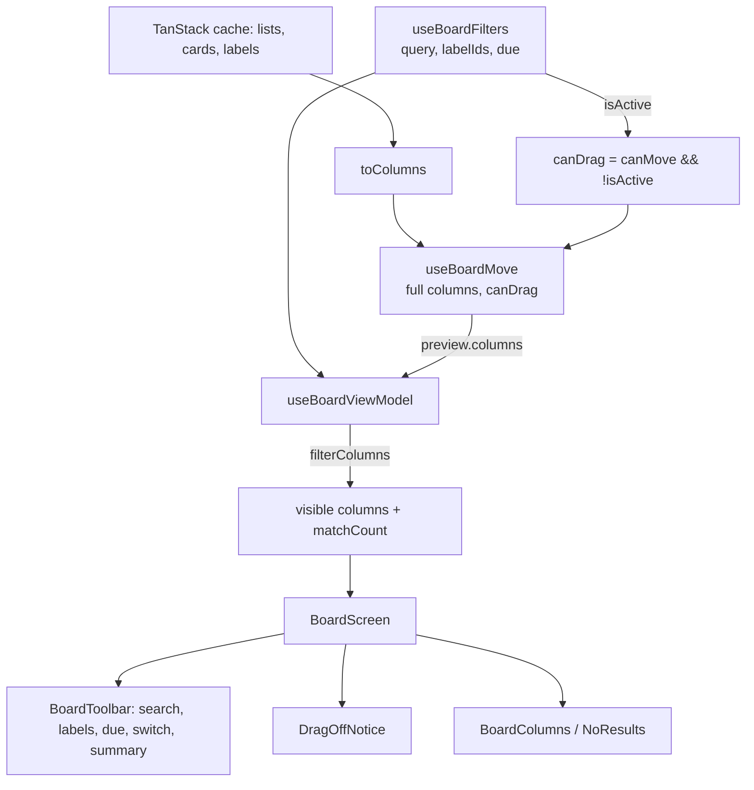

# Board Filters Design

**Spec**: `front-end/.specs/features/board-filters/spec.md`
**Status**: Approved

---

## Architecture Overview

Filtering is a pure view over the cached board. A new hook `useBoardFilters` holds the search, label and due values in React state. `useBoardViewModel` composes it with the existing pieces. `useBoardMove` keeps working on the **full** columns, so "Mover para…" still computes the end position from every card (FDND-31). The view model filters the move preview only for display. The board screen then shows the filtered columns, or the empty result.



### Approaches considered

| Approach | Summary | Verdict |
| -------- | ------- | ------- |
| **A. Filter hook + view-model filtering after the move preview** | `useBoardFilters` holds state; `filterColumns` (pure, `model/`) runs on `preview.columns`; moves keep the full columns | **Chosen.** Reset on open is free (`BoardScreen` is keyed by `boardId`, `board-page.tsx:13`); moves never see a partial list; pure filtering is unit-testable |
| B. Filters in URL search params | `?q=&labels=&due=` | Rejected: doc §6 resets filters on every open, so the URL would have to be cleared on every entry; FE-AD-006 keeps URL state for shareable or reload-safe state, which these are not |
| C. Filter in the `useCards` `select` | The query hands back only matching cards | Rejected: every consumer would see a partial list. `moveTo` takes the column length as the end position, and the archived count and the counters would change meaning |

---

## Code Reuse Analysis

### Existing Components to Leverage

| Component | Location | How to Use |
| --------- | -------- | ---------- |
| `isOverdue`, `parseDateOnly`, `todayParts` | `src/features/board/model/due-date.ts` | "Atrasadas" reuses `isOverdue`; a new `isDueToday` sits next to it with the same day math |
| `today` (read once) | `use-board-view-model.ts:101` | The due filter uses the same date as the card due labels |
| `labelsById` | `use-board-view-model.ts:130` | Label filter items and the "selected label still exists" check (FBF-15) |
| `useShortcut` | `src/shared/keyboard/use-shortcut.ts` | `/` (FBF-07, FBF-08), with FE-AD-011 guards; `n` keeps its call and clears filters first (FBF-38) |
| `Button` | `src/shared/ui/button.tsx` | Etiquetas button, Limpar filtros (`ghost` `sm` and `secondary` `sm`); gains a `soft` variant |
| `Switch` | `src/shared/ui/switch.tsx` | "Mostrar arquivadas", unchanged |
| React Aria `MenuTrigger`/`Menu`/`MenuItem` | `react-aria-components` 1.22.1 (as in `shared/ui/menu.tsx`) | Label filter: `selectionMode="multiple"` renders `menuitemcheckbox` (`react-aria/dist/private/menu/useMenuItem.mjs:63`). A mouse or Space pick keeps the menu open; Enter closes it (`:110`). Esc and outside click close the popover |
| `Checkbox` | `src/shared/ui/checkbox.tsx` | Visual check inside each label item (decorative, the item owns the role) |
| Label chip classes | `card-tile.tsx:21-32`, `:131-143` | Extracted to `label-chip.tsx` and shared by the card and the label filter |
| `KeyboardHelp`, `MoveAnnouncer` | `components/` | Help line hidden while filtering (FBF-33) |
| Prototype markup | `design/Task List.dc.html:323-379` | Toolbar, label menu, notice and empty result classes |
| Púrpura `.p-select`, `.p-btn--soft` | `design/_ds/.../css/components.css:50-58` | Tailwind port for the due select and the soft button |

### Integration Points

| System | Integration Method |
| ------ | ------------------ |
| Board view model | Composes `useBoardFilters`; returns visible columns, `matchCount`, `filters` state and actions; gates drag via `canDrag` |
| `useBoardMove` | New option `canDrag`; `start` returns early when it is false (FBF-31, FBF-32); `askMoveTo` still uses `canMove` (FBF-34) |
| Card tile | `CardMove` gains `canDrag`; when false the tile stays focusable with its menu, but is not draggable and Space does not pick |
| Column | `BoardColumns` passes no `ColumnMove` while drag is off (the header is not a handle); new `isFiltered` prop hides "Arraste cards para cá" (FBF-27) |
| i18n | New keys under `board.toolbar.*` in `en.ts` and `pt-BR.ts`, texts from `design/i18n.js` |
| API | None. No request is added |

---

## Components

### `model/filters.ts` (new)

- **Purpose**: Framework-free filter rules (FBF-02, -03, -10, -15, -17–-23).
- **Location**: `src/features/board/model/filters.ts`
- **Interfaces**:
  - `type DueFilter = 'any' | 'overdue' | 'today' | 'none' | 'done'`
  - `type BoardFilters = { query: string; labelIds: string[]; due: DueFilter }`
  - `const NO_FILTERS: BoardFilters`
  - `normalizeText(value: string): string`. NFD, strips U+0300–U+036F, lower-case.
  - `isFiltering(filters: BoardFilters, labelIds: ReadonlySet<string>): boolean`. True when the trimmed query is not empty, an existing label is selected, or `due !== 'any'`.
  - `matchesCard(card: Card, filters: BoardFilters, labelIds: ReadonlySet<string>, today: DateParts): boolean`
  - `filterColumns(columns: Column[], filters: BoardFilters, labelIds: ReadonlySet<string>, today: DateParts): { columns: Column[]; matchCount: number }`. Keeps every column and the card order, and drops the non-matching cards.
- **Dependencies**: `due-date.ts`, `types.ts`
- **Reuses**: `isOverdue`, new `isDueToday`

### `model/due-date.ts` (changed)

- **Purpose**: Add `isDueToday(card: Pick<Card, 'dueDate'>, today: DateParts): boolean` (FBF-18).
- **Reuses**: `parseDateOnly`, `daysBetween`

### `view-models/use-board-filters.ts` (new)

- **Purpose**: Hold the filter values for one open board.
- **Location**: `src/features/board/view-models/use-board-filters.ts`
- **Interfaces**:
  - `useBoardFilters(): { filters: BoardFilters; setQuery(q: string): void; setLabelIds(ids: string[]): void; setDue(due: DueFilter): void; clearQuery(): void; clearAll(): void }`
- **Dependencies**: React `useState`
- **Reuses**: `NO_FILTERS`. Reset on open comes from `key={boardId}` (FBF-37).

### `view-models/use-board-view-model.ts` (changed)

- **Purpose**: Compose filtering into the board state.
- **Changes**:
  - `existingLabelIds = new Set(labelsById.keys())`. `isFiltering = isFiltering(filters, existingLabelIds)`.
  - `canDrag = canMove && !isFiltering`, passed to `useBoardMove`.
  - `const { columns, matchCount } = filterColumns(move.state.preview.columns, …)` when filtering, else the preview as is.
  - The filter actions cancel a running move session before they change a value. A keyboard session can be live while the user clicks Etiquetas with the mouse.
  - `n` handler: `filters.clearAll()` then `setAddingCardListId(...)` (FBF-38).
  - New state: `filters`, `isFiltering`, `matchCount`, `canDrag`, `selectedLabelCount` (existing labels only, FBF-11, FBF-15), `labels` (the board label list, for the menu). New actions: `filters.*`.
- **Reuses**: everything already there.

### `view-models/use-board-move.ts` (changed)

- **Purpose**: Accept `canDrag: boolean` in `BoardMoveOptions`. `start` returns when `!canDrag` (FBF-31, FBF-32). `askMoveTo`/`moveTo` keep `canMove` (FBF-34).

### `components/board-toolbar.tsx` (changed)

- **Purpose**: The toolbar row of the prototype, as `role="search"` (FBF-40).
- **Interfaces**: props `filters`, `labels: Label[]`, `selectedLabelCount`, `isFiltering`, `matchCount`, `isSearchShortcutEnabled`, `showArchived`, plus the filter callbacks and `onShowArchivedChange`.
- **Children (in order)**: `BoardSearch`, `LabelFilter`, `DueFilter` (shared `Select`), `Switch`, spacer, `FilterSummary` (when filtering).

### `components/board-search.tsx` (new)

- **Purpose**: Search field (FBF-01–FBF-08, FBF-41).
- **Interfaces**: `{ value: string; isShortcutEnabled: boolean; onChange(v: string): void; onClear(): void }`
- **Behavior**: `<input aria-label>` with the placeholder. The clear `IconButton` (`X`, `aria-label` "Limpar busca") shows while `value !== ''`. Esc with text calls `onClear` and stops propagation, so the board Esc handler does not run. `useShortcut('/', focus, { enabled: isShortcutEnabled })`. The `/` hint is `hidden md:inline`. The field is `w-full md:w-65`.
- **Reuses**: `useShortcut`, `lucide-react` `Search`/`X`.

### `components/label-filter.tsx` (new)

- **Purpose**: Etiquetas menu (FBF-09–FBF-15).
- **Interfaces**: `{ labels: Label[]; selectedIds: string[]; selectedCount: number; onChange(ids: string[]): void }`
- **Behavior**: The `MenuTrigger` wraps a `Button` (`soft` while `selectedCount > 0`, else `secondary`; `Tag` icon; text "Etiquetas" or "Etiquetas · {n}"). The `Popover` holds a `Menu` with `aria-label` "Etiquetas", `selectionMode="multiple"`, `selectedKeys`, and `onSelectionChange` → `onChange`. Each item shows a decorative `Checkbox` and a `LabelChip`. An empty `labels` list renders "Nenhuma etiqueta ainda" with `renderEmptyState`.
- **Reuses**: `ActionMenu` popover classes, `LabelChip`, `Checkbox`.

### `components/label-chip.tsx` (new, extracted)

- **Purpose**: One label chip with its color dot. It moves `LABEL_CLASSES` and the chip markup out of `card-tile.tsx` without changing behavior.
- **Interfaces**: `{ label: Label }`

### `shared/ui/select.tsx` (new)

- **Purpose**: A native `<select>` styled as Púrpura `.p-select--md`. The prototype uses a native select (`_ds_bundle.js:970`).
- **Interfaces**: `{ label: string; value: string; options: { value: string; label: string }[]; onChange(value: string): void }`. `label` becomes `aria-label`.
- **Why native**: the prototype matches it, keyboard and phone pickers come built in, and `useShortcut` already ignores keys typed in a `select`.

### `shared/ui/button.tsx` (changed)

- Adds `soft: 'border-transparent bg-(--purple-50) text-purple-700 hover:bg-(--purple-100) active:bg-(--purple-200)'` (`.p-btn--soft`).

### `components/filter-summary.tsx` (new)

- **Purpose**: The count in `role="status"` and **Limpar filtros** (FBF-24, FBF-25).
- **Interfaces**: `{ matchCount: number; onClear(): void }`. The count text uses `board.toolbar.oneCard` when `matchCount === 1`, else `board.toolbar.cards` with `{{count}}`. This follows the `archivedColumns` key pattern.

### `components/drag-off-notice.tsx` (new)

- **Purpose**: "Arrastar fica desativado enquanto há filtros" with the `Info` icon (FBF-30). The screen renders it while `isFiltering && !readOnly` (FBF-36).

### `components/no-results.tsx` (new)

- **Purpose**: "Nenhuma tarefa encontrada" + **Limpar filtros** (`secondary` `sm`), `SearchX` icon (FBF-28).

### `components/board-screen.tsx` (changed)

- Passes the toolbar props. Renders `DragOffNotice`. Renders `NoResults` instead of `BoardColumns` when `isFiltering && matchCount === 0 && columns.length > 0` (FBF-28). `KeyboardHelp` additionally needs `canDrag` (FBF-33). `isSearchShortcutEnabled = !keyboardSession`.

### `components/board-columns.tsx`, `board-column.tsx`, `card-tile.tsx` (changed)

- `BoardColumnsMove` gains `canDrag`. `columnMove()` returns `undefined` when `!canDrag`, so the header is not a handle (FBF-31, FBF-32). `cardMove()` passes `canDrag`.
- `CardMove.canDrag`: when false, the tile keeps `role`, `tabIndex`, `data-card-id`, focus ring and the "Mover para…" menu. It sets `draggable={false}`, skips `onDragStart`, and Space does not pick (FBF-32, FBF-34).
- `BoardColumns` and `BoardColumn` gain `isFiltered`. While true, an empty column shows no "Arraste cards para cá" (FBF-27). The header counter already shows `cards.length` of the column it gets, the filtered one (FBF-26).

---

## Data Models

```typescript
type DueFilter = 'any' | 'overdue' | 'today' | 'none' | 'done';

type BoardFilters = {
  query: string;      // raw field text; trimmed + normalized only when matching
  labelIds: string[]; // checked label ids; ids not on the board are ignored (FBF-15)
  due: DueFilter;
};
```

No server model changes. Cards and labels come from the existing contract types.

### i18n keys (`board.toolbar.*`)

| Key | PT-BR | EN |
| --- | ----- | -- |
| `search` | Buscar no quadro… | Search this board… |
| `clearSearch` | Limpar busca | Clear search |
| `labels` | Etiquetas | Labels |
| `labelsCount` | Etiquetas · {{count}} | Labels · {{count}} |
| `noLabels` | Nenhuma etiqueta ainda | No labels yet |
| `due` | Prazo | Due date |
| `dueAny` / `dueOverdue` / `dueToday` / `dueNone` / `dueDone` | Qualquer prazo / Atrasadas / Vencem hoje / Sem prazo / Concluídas | Any due date / Overdue / Due today / No due date / Completed |
| `oneCard` / `cards` | 1 tarefa / {{count}} tarefas | 1 task / {{count}} tasks |
| `clearFilters` | Limpar filtros | Clear filters |
| `dragOff` | Arrastar fica desativado enquanto há filtros | Dragging is off while filters are applied |
| `noResults` | Nenhuma tarefa encontrada | No tasks found |

---

## Error Handling Strategy

| Error Scenario | Handling | User Impact |
| -------------- | -------- | ----------- |
| Labels query fails on first load | Existing board load error (`status = 'error'`, FBV-10) | "Não foi possível carregar"; no separate filter error |
| A write fails while filtered | Existing rollback (FE-AD-010) + toast; filtering re-runs on the restored cache (FBF-29) | The card returns to the matching set if it matches again |
| Selected label deleted elsewhere | Ignored by `isFiltering`/`matchesCard`/count (FBF-15) | The button count drops, and the filter stops when it was the only one |
| Keyboard move session live when a filter changes | Filter action cancels the session first | The move is cancelled and announced as cancelled (FDND-14), then the filter applies |

---

## Risks & Concerns

| Concern | Location (file:line) | Impact | Mitigation |
| ------- | -------------------- | ------ | ---------- |
| Card focus and menu are tied to `movable` | `card-tile.tsx:87`, `:114-125`, `:174` | Passing no `move` while filtering would also drop focusability and "Mover para…", which breaks FBF-34 | Keep passing `move`; add `canDrag` and gate only `draggable`, `onDragStart` and the Space pick |
| `useBoardMove` uses `columns` for `moveTo` end position | `use-board-move.ts:205-216` | Filtered columns would send a wrong `position` | The move hook keeps the full columns. Only the view filters, after the preview |
| Board Esc handler cancels on any bubbled Esc | `board-screen.tsx:41-45` | Esc in the search could reach it | The search stops propagation only when it handles Esc. With no keyboard session the handler does nothing anyway |
| `n` handler reads `columns[0]` | `use-board-view-model.ts:223` | After `clearAll`, `columns` in the closure is still the filtered set | Read the first column from the unfiltered preview columns |
| Single "today" read at open | `use-board-view-model.ts:101` | A board left open past midnight keeps yesterday's "Vencem hoje" | Accepted: same behavior as the due labels (FBV); spec ties the filter to that date |
| No `soft` button variant | `shared/ui/button.tsx:9-21` | Missing style for the selected label filter | Add the variant (one class string) |

---

## Tech Decisions (only non-obvious ones)

| Decision | Choice | Rationale |
| -------- | ------ | --------- |
| Where filter state lives | `useState` in `useBoardFilters`, reset by `key={boardId}` | Doc §6 reset on open; not shareable state (FE-AD-006) |
| Filter after the move preview | `filterColumns(preview.columns)` | Moves stay computed on full lists; drag is off anyway while filtering, so the preview equals the columns |
| Drag gate | `canDrag` separate from `canMove` | `canMove` (not read-only) still enables "Mover para…"; `canDrag` adds "not filtering" |
| Label filter widget | React Aria `Menu` `selectionMode="multiple"` | Doc §13 requires `menuitemcheckbox`; stays open on each pick, closes on Esc/outside |
| Due filter widget | Native `<select>` in `shared/ui/select.tsx` | Prototype uses a native select; built-in phone picker |
| `/` shortcut location | Inside `BoardSearch` | The handler needs the input ref; FE-AD-011 guards stay in the hook |

No project-level decision. Everything above is local to this feature and conforms to FE-AD-004, -006, -009, -010, -011 and -012.
