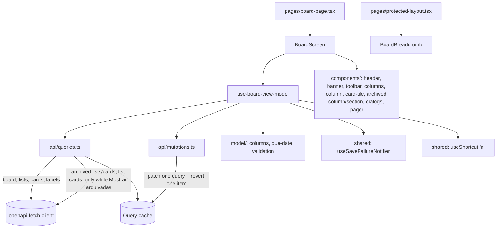

# Board Design

**Spec**: `.specs/features/board/spec.md`
**Status**: Approved

---

## Architecture Overview

New feature module `src/features/board/`, layered like `boards` (FE-AD-006). Server data stays in the TanStack Query cache as **one query per API resource**, and the view model joins them into columns through pure `model/` mappers. Every optimistic change patches only the query it touches and undoes only its own item (FE-AD-010), so overlapping changes never resurrect each other (the open risk P1 in `STATE.md`).



### Queries

| Query | Key | Request | Enabled |
| ----- | --- | ------- | ------- |
| `useBoard(boardId)` | `['board', boardId, 'detail']` | `GET /api/v1/boards/{id}` | always |
| `useLists(boardId, false)` | `['board', boardId, 'lists', { archived: false }]` | `GET /api/v1/boards/{id}/lists` | always |
| `useCards(boardId, false)` | `['board', boardId, 'cards', { archived: false }]` | `GET /api/v1/boards/{id}/cards` | always |
| `useLabels(boardId)` | `['board', boardId, 'labels']` | `GET /api/v1/boards/{id}/labels` | always |
| `useLists(boardId, true)` | `['board', boardId, 'lists', { archived: true }]` | `…/lists?archived=true` | `showArchived` |
| `useCards(boardId, true)` | `['board', boardId, 'cards', { archived: true }]` | `…/cards?archived=true` | `showArchived` |
| `useArchivedListCounts(boardId, lists)` | `['board', boardId, 'list-cards', listId]` per archived list (`useQueries`) | `GET /api/v1/lists/{listId}/cards` | `showArchived` |

`boardViewKeys.all(boardId) = ['board', boardId]` is the prefix that **Recarregar**, the `404` refetch and the settle invalidation use (FBV-54, FBV-55).

### Screen status

`status` is derived in the view model, in this order:

1. any always-on query failed with `404` → `notFound` (FBV-11; a board deleted elsewhere also makes `lists`/`cards` answer `404`);
2. any always-on query failed otherwise → `error`; **Tentar novamente** calls `refetch()` on the failed ones only (FBV-10);
3. any always-on query pending → `loading` (FBV-9);
4. else `ready`. `readOnly = board.archivedAt !== null` (FBV-44–FBV-46).

The archived queries never change `status`: while they load, the virtual column and the section show a small skeleton; if they fail, each shows `LoadError` with its own retry.

---

## Code Reuse Analysis

### Existing Components to Leverage

| Component | Location | How to Use |
| --------- | -------- | ---------- |
| `call`, `ApiError`, `useApi` | `src/shared/api/` | Every request (FE-AD-002) |
| Optimistic recipe + `usePendingBoardIds` | `src/features/boards/api/mutations.ts:120` | Same shape (mutation key, `onMutate`/`onError`/`onSettled`, `useMutationState` for pending ids); rollback changes to per-item revert (FE-AD-010) |
| `notifyFailure`, `runChange` | `src/features/boards/view-models/use-boards-view-model.ts:100-140` | Moved to `shared` as `useSaveFailureNotifier` and reused by both features (T-refactor) |
| `saveFailureKind`, `SaveFailureKind` | `src/features/boards/model/errors.ts:43`, `model/types.ts:18` | Moved to `src/shared/api/save-failure.ts` with the notifier |
| `ActionMenu` | `src/shared/ui/menu.tsx:31` | Board menu (…) and column menu (…) |
| `Dialog`, `Button`, `TextField`, `LoadError`, `Alert` | `src/shared/ui/` | Delete-column dialog, banner button, load errors |
| `useToast` | `src/shared/ui/toast/use-toast.ts` | Success and failure toasts |
| `formatShortDate`, `dates.months.*` keys | `src/shared/i18n/format-date.ts` | "Arquivada em 2 out, 2026" (date-time) |
| `renderApp`, MSW `server` | `test/support/` | Component and view-model tests |
| Prototype markup | `design/Task List.dc.html:281-523` | Port of header, banner, toolbar, columns, cards, archived column/section, add column, pager |
| Seed data | doc §15, `back-end` seed | MSW fixtures and e2e expectations |

### Integration Points

| System | Integration Method |
| ------ | ------------------ |
| Router | `routes.tsx` swaps the `b/:boardId` placeholder for `BoardPage`; `b/:boardId/t/:cardId` and `b/:boardId/labels` stay placeholders |
| Top bar | `ProtectedLayout` renders `<BoardBreadcrumb boardId>` from `@/features/board` when `useMatch('/b/:boardId/*')` matches (FBV-12) |
| `boards` feature | No import. Restoring a board in the banner does not touch `['boards']`: the boards list has `staleTime` 0, so `/boards` refetches on mount |
| API | Endpoints listed in Queries and Components; no contract change |

---

## Components

### `model/` (framework-free)

- **`types.ts`** – aliases of contract types (`Board`, `List`, `Card`, `Label` from `@my-trello/api-contract`), `CreateListDto`, `UpdateListDto`, `CreateCardDto`, `UpdateCardDto`, and the view types in Data Models. Field errors: `ItemFieldError = 'columnNameRequired' | 'columnNameTooLong' | 'cardTitleRequired' | 'cardTitleTooLong'` (i18n key suffixes).
- **`validation.ts`**
  - `validateColumnName(raw: string): ItemFieldError | null` – trim, empty → required, > 100 → too long (FBV-15, FBV-16).
  - `validateCardTitle(raw: string): ItemFieldError | null` (FBV-26, FBV-27).
  - `mapTitleServerError(err: ApiError, raw: string, kind: 'column' | 'card'): ItemFieldError | null` – `400` with an `errors[]` entry for `title` (FBV-57).
- **`due-date.ts`**
  - `parseDateOnly(value: string): { y; m; d }` – splits `YYYY-MM-DD`; never `new Date(value)` (see Risks).
  - `todayParts(now = new Date())` – local calendar date.
  - `dueLabel(due: string, today): { kind: 'today' | 'tomorrow' | 'yesterday' } | { kind: 'date'; day; month; year?: number }` (FBV-05).
  - `isOverdue(card, today): boolean` – `!card.done && due < today` (FBV-06, FBV-08).
- **`columns.ts`**
  - `toColumns(lists: List[], cards: Card[]): Column[]` – active lists by `position`, cards grouped by `listId` and sorted by `position` (FBV-02, FBV-03).
  - `toArchivedCards(cards: Card[], lists: List[]): ArchivedCardItem[]` – keeps API order (`archivedAt` desc) and resolves `fromTitle` from active ∪ archived lists (FBV-35).
  - `toArchivedColumns(lists: List[], archivedCards: Card[], activeCounts: Map<string, number | undefined>): ArchivedColumnItem[]` – newest `archivedAt` first; `cardCount = active + archived`, `undefined` while a count is loading (FBV-37).
  - `deleteMessageKey(count: number): 'many' | 'one' | 'none'` (FBV-40).

### `api/`

- **`keys.ts`** – `boardViewKeys` (`all`, `detail`, `lists`, `cards`, `labels`, `listCards`).
- **`queries.ts`** – `useBoard`, `useLists`, `useCards`, `useLabels`, `useArchivedListCounts` (table above).
- **`mutations.ts`**
  - `useCreateList(boardId)` – not optimistic; on success appends the returned list to `lists(false)` with `setQueryData`, then invalidates it (FBV-14).
  - `useCreateCard(boardId)` – `POST /lists/{listId}/cards`; on success appends to `cards(false)`, then invalidates (FBV-25).
  - `useRenameList`, `useArchiveList`, `useRestoreList`, `useDeleteList`, `useToggleCardDone`, `useRestoreBoard` – built on `useOptimisticBoardViewChange` (below). Mutation key `BOARD_VIEW_CHANGE_KEY = ['board', 'change']`.
  - `usePendingItemIds(): Set<string>` – ids of lists/cards with a change in flight (FBV-58).
  - `useOptimisticBoardViewChange<TVariables>(mutationFn, change: (v) => CacheChange[])` where `CacheChange = { key: QueryKey; apply(data): data; revert(data): data }`. `onMutate` cancels `boardViewKeys.all(boardId)`, runs every `apply`; `onError` runs every `revert` on the **current** cache; `onSettled` invalidates `all(boardId)` when it is the last pending change.

  | Change | `apply` | `revert` |
  | ------ | ------- | -------- |
  | rename list | set `title` on that list in `lists(false)` | set the previous `title` back |
  | archive list | remove from `lists(false)`; prepend with `archivedAt: now` to `lists(true)` when cached | re-insert at its old index in `lists(false)`; remove from `lists(true)` |
  | restore list | remove from `lists(true)`; append to `lists(false)` with `position = length` | remove from `lists(false)`; re-insert at its old index in `lists(true)` |
  | delete list | remove from `lists(true)`; remove its cards from `cards(true)` | re-insert the list and those cards at their old indexes |
  | toggle done | set `done` on that card in `cards(false)` | set the previous `done` back |
  | restore board | set `archivedAt: null` on `detail` | set the previous `archivedAt` back |

### `view-models/`

- **`use-board-view-model.ts`** – `useBoardViewModel(boardId)` returns `{ state, actions }`:
  - `state`: `status`, `board`, `readOnly`, `columns`, `labelsById`, `showArchived`, `archived` (`{ cards, columns, cardsStatus, columnsStatus }`), `addingCardListId`, `editingListId`, `deleteTarget`, `pendingIds`, `isCreatingList`, `isCreatingCard`, `today`.
  - `actions`: `retryLoad`, `setShowArchived`, `createList(raw) → Promise<ItemFieldError | null>`, `startRename(listId)`, `submitRename(list, raw) → ItemFieldError | null`, `cancelRename`, `archiveList`, `restoreList`, `askDeleteList`, `confirmDeleteList`, `cancelDelete`, `openAddCard(listId)`, `closeAddCard`, `createCard(listId, raw) → Promise<ItemFieldError | null>`, `toggleDone(card)`, `restoreBoard`.
  - Registers `useShortcut('n', () => openAddCard(columns[0].list.id), { enabled: status === 'ready' && !readOnly && columns.length > 0 })` (FBV-30, FBV-46).
  - `showArchived`, `addingCardListId`, `editingListId`, `deleteTarget` are `useState`, so they reset whenever the board opens (FBV-33). `BoardPage` keys `BoardScreen` by `boardId` so moving between boards also resets them.
  - Failures go through `useSaveFailureNotifier(() => invalidate(all(boardId)))` (FBV-53–FBV-55). Create failures keep the field text: the action returns the error to the field and only toasts for non-`400` (FBV-56).

### `components/`

| Component | Purpose | Spec |
| --------- | ------- | ---- |
| `board-screen.tsx` | Picks skeleton / error / not-found / board by `status`; owns the layout | FBV-09–FBV-11 |
| `board-skeleton.tsx` | Header, 3 columns, 2–3 cards each | FBV-09 |
| `board-not-found.tsx` | "Quadro não encontrado" + link to `/boards` | FBV-11 |
| `board-header.tsx` | Title, description, board menu (…) with "Etiquetas do quadro" link; on phone the back arrow "Voltar" to `/boards` | FBV-01, FBV-51 |
| `archived-board-banner.tsx` | `role="status"` banner + **Restaurar** | FBV-44, FBV-47 |
| `board-toolbar.tsx` | `Switch` **Mostrar arquivadas** (3c adds search and filters here) | FBV-33 |
| `board-columns.tsx` | Horizontal scroller (`overflow-x-auto`; `snap-x snap-mandatory md:snap-none`), renders columns, virtual column, archived section, add column; reports the visible index to the pager | FBV-02, FBV-48 |
| `board-column.tsx` | `<section aria-label={title}>`: header (name button or rename field, counter, menu), card list or "Arraste cards para cá", add-card control | FBV-03, FBV-18–FBV-23, FBV-24, FBV-32 |
| `inline-create-field.tsx` | Field used by add column and add card: Enter submits, Esc closes, error under the field, submit disabled while pending, clears and keeps focus on success | FBV-14–FBV-17, FBV-25–FBV-29 |
| `column-rename-field.tsx` | Rename input: Enter/blur submit, Esc cancels, stays open on error | FBV-19–FBV-21 |
| `add-column.tsx` | "+ Adicionar coluna" button that opens `inline-create-field`; empty-board variant "Adicione a primeira coluna" opens it at once | FBV-13, FBV-14 |
| `card-tile.tsx` | Labels, "Concluída" checkbox, title, meta line (due, "Atrasada", checklist) | FBV-04–FBV-08, FBV-31 |
| `archived-cards-column.tsx` | Virtual "Arquivadas" column, read-only tiles with "Arquivada em … · de: …" | FBV-34–FBV-36, FBV-43 |
| `archived-columns-section.tsx` | Dashed section, each item with date, count, **Restaurar**, **Excluir definitivamente** | FBV-37–FBV-39 |
| `delete-column-dialog.tsx` | `alertdialog` with the count-based text | FBV-40–FBV-42 |
| `column-pager.tsx` | `md:hidden` dots (`aria-label` "Ir para {title}") + `aria-live="polite"` text "{title} · {i} de {n}"; click scrolls the column into view | FBV-49, FBV-50 |
| `board-breadcrumb.tsx` | Exported: reads `useBoard(boardId)` and renders "Meus quadros › {title}" (`hidden md:flex`) | FBV-12 |

`index.ts` exports `BoardScreen` and `BoardBreadcrumb` only.

### `shared/` additions

| Item | Location | Interface |
| ---- | -------- | --------- |
| `Checkbox` | `src/shared/ui/checkbox.tsx` | RAC `Checkbox`; `{ label; isSelected; onChange; isDisabled }`, label visually hidden ("Concluída"), port of the Púrpura checkbox |
| `Switch` | `src/shared/ui/switch.tsx` | RAC `Switch`; `{ label; isSelected; onChange }` |
| `Button` `ghost` variant + `sm` size | `src/shared/ui/button.tsx` | For "+ Adicionar tarefa", banner and section buttons (prototype `tl-ghost-btn`, `size="sm"`) |
| `useShortcut` | `src/shared/keyboard/use-shortcut.ts` | `useShortcut(key, handler, { enabled })`; ignores keys with Ctrl/Meta/Alt, while focus is in `input`/`textarea`/`select`/`[contenteditable]`, and while an `[aria-modal="true"]` element exists (FE-AD-011) |
| `saveFailureKind`, `SaveFailureKind` | `src/shared/api/save-failure.ts` | Moved from `boards` |
| `useSaveFailureNotifier(reload)` | `src/shared/ui/toast/use-save-failure-notifier.ts` | `{ notify(err, retry) }`, the doc §10 toasts; `runChange(mutateAsync, vars, successMessage)` helper |
| `formatDayMonth` | `src/shared/i18n/format-date.ts` | `(parts, t)` → "12 out" / "Oct 12", ", 2027" when the year differs (new keys `dates.dayMonth`, `dates.dayMonthYear`) |

---

## Data Models

```typescript
import type { Schemas } from '@my-trello/api-contract';

type List = Schemas['ListResponseDto'];
type Card = Schemas['CardResponseDto'];
type Label = Schemas['LabelResponseDto'];

// One active column on screen.
type Column = { list: List; cards: Card[] };

// A card in the virtual "Arquivadas" column.
type ArchivedCardItem = { card: Card; fromTitle: string };

// An item of the archived columns section.
type ArchivedColumnItem = { list: List; cardCount: number | undefined };

// The calendar date the screen treats as today.
type DateParts = { year: number; month: number; day: number };
```

**Relationships**: `Card.listId` → `List.id`; `Card.labelIds[]` → `Label.id` (resolved through `labelsById`); `List.boardId` → board. Active cards of an archived list are absent from `cards(false)` and are only counted through `listCards`.

---

## Error Handling Strategy

| Error Scenario | Handling | User Impact |
| -------------- | -------- | ----------- |
| Load: `404` on board, lists or cards | `status = notFound` | "Quadro não encontrado" + link (FBV-11) |
| Load: network / `5xx` | TanStack retries (query client, 3×), then `status = error`; retry refetches failed queries | "Não foi possível carregar" + Tentar novamente (FBV-10) |
| Archived queries fail | Local `LoadError` inside the virtual column / section | Rest of the board keeps working |
| Optimistic write: network / `5xx` | `revert` of that item; notifier with retry | Item back + "Não foi possível salvar" + Tentar novamente (FBV-52, FBV-53) |
| Write `409` | `revert`; notifier with Recarregar → invalidate `all(boardId)` | Conflict toast (FBV-54) |
| Write `404` | `revert`; toast without button; invalidate `all(boardId)` | Item disappears after refetch if deleted elsewhere (FBV-55) |
| Create fails (non-`400`) | Field keeps text, submit enabled, notifier toast; retry resubmits the same text | FBV-56 |
| Create / rename `400` with `errors[].field = title` | `mapTitleServerError` → field message, no toast | FBV-57 |
| `401` | `saveFailureKind = sessionExpired` → nothing; FND-16 runs | Login screen |

---

## Risks & Concerns

| Concern | Location (file:line) | Impact | Mitigation |
| ------- | -------------------- | ------ | ---------- |
| Whole-snapshot rollback brings back items changed by an overlapping mutation (open P1 in STATE) | `src/features/boards/api/mutations.ts:120-161` | Archive A and B; A fails → B reappears | Board uses per-item `revert` (FE-AD-010); `boards` keeps P1 open, a later task ports it |
| `new Date('2026-11-01')` is UTC midnight, the previous day in Brazil (UTC-3) | `src/shared/i18n/format-date.ts:20` | Due dates one day early; "Hoje" shown on the wrong day | `parseDateOnly` splits the string; `formatShortDate` stays for date-time only; unit tests run with `TZ=America/Sao_Paulo` cases |
| N+1: one `GET /lists/{id}/cards` per archived column | `useArchivedListCounts` | Many archived columns → many requests when the toggle turns on | Only while **Mostrar arquivadas** is on; personal app scale; a back-end count field is a follow-up if it hurts |
| Notifier and failure mapping duplicated if copied from `boards` | `use-boards-view-model.ts:100-140` | Two copies drift | First task moves them to `shared` and repoints `boards` with its tests green (refactor commit) |
| Scroll-snap pager position cannot be measured in jsdom | `column-pager.tsx` | Unit tests cannot prove FBV-48/FBV-49 layout | Index math in a pure function (`visibleIndex(scrollLeft, width, count)`) unit-tested; layout covered by a Playwright test at 375 px |
| `n` fires inside RAC popovers or while typing | `use-shortcut.ts` | Unwanted field opens | Guard list above; tests for input focus and open dialog |
| Labels query duplicated by feature 5 | `useLabels` | Two caches of the same endpoint | `staleTime` 0 refetches on mount; feature 5 decides whether to share the key |

---

## Tech Decisions (only non-obvious ones)

| Decision | Choice | Rationale |
| -------- | ------ | --------- |
| Cache shape | One query per resource, joined in `model/columns.ts` | User choice; each mutation and 3b drag patch one list; failed loads retry only what failed |
| Rollback | Per-item `apply`/`revert` on the current cache (FE-AD-010) | Overlapping changes stay independent; closes P1 for this feature |
| Archived data | Lazy queries enabled by the toggle | Four requests on open; archived data costs only when asked for |
| Create | `setQueryData` append on success, then invalidate | Card appears in the same frame the toast shows (FBV-14, FBV-25) without waiting for the refetch |
| Shortcut hook | `shared/keyboard/use-shortcut.ts` (FE-AD-011) | `n` here, `/` in 3c and `?` in 6 share one guard set |
| Phone layout | CSS only (`md:` breakpoint, scroll snap); JS only for the pager index | No media-query hook; same DOM on every width |
| Due-date parsing | String split, local calendar | API sends date-only; avoids the UTC shift |
| State reset on open | `key={boardId}` on `BoardScreen` | FBV-33 resets toggles even when navigating board to board |
