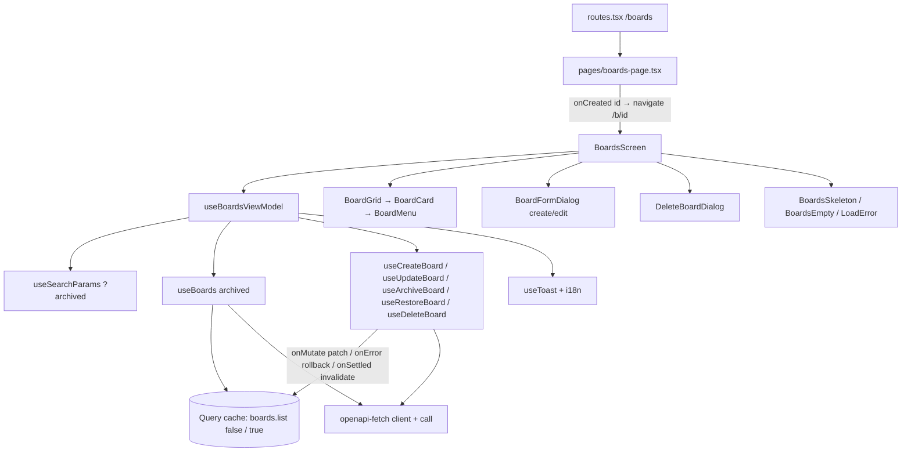

# Boards Design

**Spec**: `.specs/features/boards/spec.md`
**Status**: Approved

---

## Architecture Overview

`/boards` renders `BoardsPage`, which composes the `boards` feature module (FE-AD-006 layers). The feature reads both lists through TanStack Query, keeps the selected tab in the URL, and runs every change through mutation hooks in `api/`. Create waits for the server; edit, archive, restore and delete patch the query cache in `onMutate` and roll it back in `onError` (FE-AD-009). A view-model owns the dialog state and turns mutation outcomes into toasts and field errors, so the Views stay props-only.



Data flow for an optimistic change (archive shown; edit, restore and delete follow the same shape):

```mermaid
sequenceDiagram
    participant U as User
    participant VM as useBoardsViewModel
    participant M as useArchiveBoard
    participant C as Query cache
    participant A as API
    U->>VM: Arquivar (board)
    VM->>M: mutate({ board })
    M->>C: cancelQueries(boards); snapshot both lists; remove board from list(false)
    M->>A: POST /boards/{id}/archive
    alt 200
        A-->>M: board
        M-->>VM: onSuccess → toast "Quadro arquivado"
    else failure
        A-->>M: ApiError
        M->>C: restore snapshot
        M-->>VM: onError → toast by failure kind (retry / reload / plain)
    end
    M->>C: onSettled: invalidate boards when no other board change is pending
```

---

## Code Reuse Analysis

### Existing Components to Leverage

| Component | Location | How to Use |
| --------- | -------- | ---------- |
| `call` + `ApiError` | `src/shared/api/api-error.ts:14,36` | Wrap every `api.GET/POST/PATCH/DELETE`; failure kind is read from `status` (0, 404, 409, 400, 5xx) |
| `useApi` | `src/shared/api/api-context.tsx` | Typed client inside query and mutation hooks |
| Query retry policy | `src/shared/api/query-client.ts:12` | List queries already retry network/5xx up to 3 times and never 4xx; mutations never retry |
| Session expiry on `401` | `src/shared/api/client.ts:40` (FND-16) | Nothing to add; the view-model ignores `401` errors (no toast) |
| `useToast` / `ToastProvider` | `src/shared/ui/toast/use-toast.ts:15` | Success toasts and failure toasts with `action` (Tentar novamente / Recarregar); 3 s / 7 s timing already built |
| `Button` | `src/shared/ui/button.tsx:28` | Create, dialog buttons, retry; needs a `danger` variant for "Excluir definitivamente" |
| `TextField` | `src/shared/ui/text-field.tsx:25` | Nome field and delete confirmation field; needs an optional `placeholder` prop |
| Auth module shape | `src/features/auth/{api,model,components,index.ts}` | Same layout: `keys.ts`, `queries.ts`, `mutations.ts`, `model/{types,validation,errors}.ts` |
| Server field-error mapping | `src/features/auth/model/errors.ts:24` (`mapSignUpServerErrors`) | Same pattern for `mapBoardServerErrors` (message picked from the submitted value) — copied, not imported (features never import each other) |
| `errors.loadTitle/loadDetail/retry` i18n keys | `src/shared/i18n/locales/en.ts:64-69` | Text of the list error state (FBRD-10) |
| `renderApp` | `test/support/render-app.tsx` | Component and page tests with real providers and a memory router |
| MSW `server` | `test/support/msw/server.ts` | Board handlers added per test |

### Integration Points

| System | Integration Method |
| ------ | ------------------ |
| Back-end API | `GET /api/v1/boards[?archived=true]`, `POST /api/v1/boards`, `PATCH /api/v1/boards/{id}`, `POST /api/v1/boards/{id}/archive`, `POST /api/v1/boards/{id}/unarchive`, `DELETE /api/v1/boards/{id}`, typed by `paths` from `@my-trello/api-contract` |
| Router | `routes.tsx` swaps the `/boards` placeholder for `BoardsPage`; the tab uses `useSearchParams`; create navigates with `useNavigate` from the page |
| i18n | New `boards` namespace in `en.ts` / `pt-BR.ts`; shared `errors.saveFail`, `errors.conflict`, `errors.reload` and `dates.*` keys (feature 3 reuses them) |

---

## Components

### `shared/ui/dialog.tsx` — `Dialog`

- **Purpose**: Modal dialog with title, body and footer, closed by Esc, overlay click or a Cancel button.
- **Location**: `src/shared/ui/dialog.tsx`
- **Interfaces**:
  - `Dialog({ isOpen, onOpenChange, title, children, footer?, role? }: DialogProps): JSX.Element` — `role` is `'dialog'` (default) or `'alertdialog'` for delete
- **Dependencies**: React Aria `ModalOverlay`, `Modal`, `Dialog`, `Heading`
- **Reuses**: Púrpura modal styles from the prototype (`design/Task List.dc.html`, `p-modal`)

### `shared/ui/menu.tsx` — `ActionMenu`

- **Purpose**: Icon button (…) that opens a `role="menu"` list of actions.
- **Location**: `src/shared/ui/menu.tsx`
- **Interfaces**:
  - `ActionMenu({ label, items, isDisabled? }: { label: string; items: { id: string; label: string; icon: LucideIcon; tone?: 'danger'; onAction(): void }[]; isDisabled?: boolean })`
- **Dependencies**: React Aria `MenuTrigger`, `Popover`, `Menu`, `MenuItem`; `lucide-react` `Ellipsis`
- **Reuses**: `tl-menu` / `tl-menu-item` styles (`design/Task List.dc.html:74-75`)

### `shared/ui/tabs.tsx` — `SegmentedTabs`

- **Purpose**: Controlled two-option tab list (Ativos · Arquivados) styled as the Púrpura segmented control.
- **Location**: `src/shared/ui/tabs.tsx`
- **Interfaces**:
  - `SegmentedTabs<K extends string>({ label, options, selected, onChange }: { label: string; options: { id: K; label: string }[]; selected: K; onChange(id: K): void })`
- **Dependencies**: React Aria `Tabs`, `TabList`, `Tab` (controlled `selectedKey`; the panel is rendered by the caller)

### `shared/ui/text-area-field.tsx` — `TextAreaField`

- **Purpose**: Labeled multi-line field with an optional counter and error, matching `TextField`.
- **Location**: `src/shared/ui/text-area-field.tsx`
- **Interfaces**:
  - `TextAreaField({ label, value, onChange, placeholder?, counter?, error?, inputRef? })` — `counter` is the rendered "n / 1000" text
- **Dependencies**: React Aria `TextField`, `TextArea`, `Label`, `FieldError`
- **Reuses**: `inputClasses` from `text-field.tsx` (exported and shared)

### `shared/ui/load-error.tsx` — `LoadError`

- **Purpose**: "Não foi possível carregar" block with Tentar novamente (FBRD-10); feature 3 reuses it for the board screen.
- **Location**: `src/shared/ui/load-error.tsx`
- **Interfaces**: `LoadError({ onRetry }: { onRetry(): void })`
- **Reuses**: `errors.loadTitle`, `errors.loadDetail`, `errors.retry` keys; `Button` secondary

### `shared/i18n/format-date.ts` — `formatShortDate`

- **Purpose**: Format an ISO timestamp as the local calendar date "10 out, 2026" / "Oct 10, 2026" (FBRD-05).
- **Location**: `src/shared/i18n/format-date.ts`
- **Interfaces**: `formatShortDate(iso: string, t: TFunction): string` — reads `dates.months.<jan…dec>` and `dates.short` (`'{{day}} {{month}}, {{year}}'` PT-BR, `'{{month}} {{day}}, {{year}}'` EN)
- **Dependencies**: i18next `TFunction`
- **Reuses**: Month names of `design/i18n.js:3-6`

### `features/boards/model`

- **Purpose**: Framework-free rules: form values, validation, request bodies, server-error mapping, failure classification.
- **Location**: `src/features/boards/model/{types,validation,errors}.ts`
- **Interfaces**:
  - `validateBoardForm(values: BoardFormValues): BoardFieldErrors` — FBRD-13–15 (trimmed name 1–100, trimmed description ≤ 1000)
  - `toCreateBody(values): CreateBoardDto` — trimmed `title`; `description` only when not empty (FBRD-17)
  - `toUpdateBody(values): UpdateBoardDto` — trimmed `title`; `description` trimmed or `null` (FBRD-25)
  - `mapBoardServerErrors(err: ApiError, values): BoardFieldErrors | null` — `400` `errors[]` → field errors (FBRD-41)
  - `saveFailureKind(err: ApiError): 'retry' | 'conflict' | 'notFound' | 'invalid' | 'sessionExpired'` — `0`/`5xx` → retry, `409` → conflict, `404` → notFound, `400` with `errors[]` → invalid, `401` → sessionExpired, any other → retry
  - `isDeleteConfirmed(typed: string, title: string): boolean` — exact equality (FBRD-32/33)
  - `withoutBoard(list, id)`, `withBoard(list, board)` — pure list patches used by the optimistic hooks
- **Dependencies**: `Board`, `Schemas` from `@my-trello/api-contract`; `ApiError`
- **Reuses**: Auth `validation.ts` / `errors.ts` patterns

### `features/boards/api`

- **Purpose**: The only code that calls the boards endpoints and touches the boards cache.
- **Location**: `src/features/boards/api/{keys,queries,mutations}.ts`
- **Interfaces**:
  - `boardKeys = { all: ['boards'], list: (archived: boolean) => ['boards', 'list', { archived }] }`
  - `BOARD_CHANGE_KEY = ['boards', 'change']` — mutation key shared by the four optimistic mutations
  - `useBoards(archived: boolean): UseQueryResult<Board[], ApiError>`
  - `useCreateBoard(): UseMutationResult<Board, ApiError, CreateBoardDto>` — `onSuccess` invalidates `boardKeys.list(false)`
  - `useUpdateBoard()` — variables `{ board: Board; body: UpdateBoardDto }`; patches the board in `list(false)`
  - `useArchiveBoard()` / `useRestoreBoard()` — variables `{ board: Board }`; remove from `list(false)` / `list(true)`
  - `useDeleteBoard()` — variables `{ board: Board }`; removes from `list(true)`
  - `usePendingBoardIds(): Set<string>` — `useMutationState` over `BOARD_CHANGE_KEY` with `status: 'pending'` (FBRD-42)
- **Dependencies**: `useApi`, `call`, TanStack Query
- **Reuses**: Auth `mutations.ts` shape; `query-client.ts` retry defaults

Each optimistic hook follows the TanStack Query optimistic recipe: `onMutate` cancels `boardKeys.all`, snapshots `list(false)` and `list(true)`, writes the patch and returns the snapshot; `onError` writes the snapshot back; `onSettled` invalidates `boardKeys.all` only when `isMutating({ mutationKey: BOARD_CHANGE_KEY }) === 1`, so one change's refetch never overwrites another change still in flight. Invalidation also moves the board into the other tab (FBRD-30): the visible list refetches now, the hidden one is stale and refetches when its tab is shown.

### `features/boards/view-models/use-boards-view-model.ts`

- **Purpose**: State and actions for the whole screen.
- **Interfaces**:
  - `useBoardsViewModel({ onCreated }: { onCreated(id: string): void }): { state, actions }`
  - `state`: `tab: 'active' | 'archived'`, `query` (list result of the selected tab), `pendingIds`, `dialog: { kind: 'none' } | { kind: 'create'; values?; errors? } | { kind: 'edit'; board; values?; errors? } | { kind: 'delete'; board }`, `isCreating`
  - `actions`: `selectTab`, `openCreate`, `openEdit(board)`, `openDelete(board)`, `closeDialog`, `submitCreate(values)`, `submitEdit(board, values)`, `archive(board)`, `restore(board)`, `confirmDelete(board)`, `retryLoad`
- **Behavior**:
  - `tab` comes from `searchParams.get('archived') === 'true'`; `selectTab` calls `setSearchParams` with `{ archived: 'true' }` or `{}` (FBRD-03).
  - `submitCreate`: validates, sends, on success closes the dialog, toasts "Quadro criado" and calls `onCreated(id)`; on failure keeps the dialog and either sets field errors (`invalid`) or toasts "Não foi possível salvar" with Tentar novamente → `submitCreate(sameValues)` (FBRD-20).
  - `submitEdit`: validates, closes the dialog, mutates (the cache patch shows the new values at once); on `invalid` reopens `edit` with the submitted values and server errors (FBRD-41).
  - One `notifyFailure(err, retry)` maps `saveFailureKind` to the toast: retry → saveFail + Tentar novamente; conflict → conflict + Recarregar (`invalidateQueries(boardKeys.all)`); notFound → saveFail, no action, invalidate; sessionExpired → nothing.
- **Dependencies**: `useSearchParams`, `useQueryClient`, `useToast`, `useTranslation`, feature `api/` and `model/`

### `features/boards/components`

| View | Purpose | Spec |
| ---- | ------- | ---- |
| `boards-screen.tsx` — `BoardsScreen({ onCreated })` | Heading, Criar quadro (Ativos only), `SegmentedTabs`, and the state switch: skeleton / error / empty / grid; mounts the dialogs | FBRD-01–03, 07–11 |
| `board-grid.tsx` — `BoardGrid` | Responsive grid (`grid-cols-[repeat(auto-fill,minmax(260px,1fr))]`, one column at 360 px) | FBRD-04 |
| `board-card.tsx` — `BoardCard` | `Link` to `/b/{id}` covering the card (title, 2-line description, date line); `ActionMenu` sits beside the link, not inside it | FBRD-04–06, 22, 28, 42 |
| `boards-skeleton.tsx` | 6 pulsing card placeholders with `aria-busy` | FBRD-07 |
| `boards-empty.tsx` — `ActiveBoardsEmpty`, `ArchivedBoardsEmpty` | Empty states | FBRD-08, 09 |
| `board-form-dialog.tsx` — `BoardFormDialog` | Create/Edit modal: Nome, Descrição with counter, Cancelar, Criar/Salvar (Criando… while pending) | FBRD-12–18, 21, 23–24 |
| `delete-board-dialog.tsx` — `DeleteBoardDialog` | `alertdialog` with the typed-name confirmation | FBRD-31–33, 36 |

`index.ts` exports only `BoardsScreen`.

### `pages/boards-page.tsx`

- **Purpose**: Route element; passes `onCreated={(id) => navigate(`/b/${id}`)}` to `BoardsScreen`.
- **Reuses**: `SignupPage` composition pattern (`src/pages/signup-page.tsx`).

---

## Data Models

No new domain model (FE-AD-006): the feature uses the contract types.

```typescript
import type { Board, Schemas } from '@my-trello/api-contract';

type CreateBoardDto = Schemas['CreateBoardDto']; // { title: string; description?: string | null }
type UpdateBoardDto = Schemas['UpdateBoardDto']; // { title?: string; description?: string | null }

// UI form state: raw strings as typed; trimming happens in toCreateBody / toUpdateBody.
type BoardFormValues = { name: string; description: string };
type BoardField = keyof BoardFormValues;
type BoardFieldError = 'nameRequired' | 'nameTooLong' | 'descriptionTooLong';
type BoardFieldErrors = Partial<Record<BoardField, BoardFieldError>>;
type BoardsTab = 'active' | 'archived';
```

**Relationships**: `name` ↔ API `title`, `description` ↔ API `description` (spec assumption "Name field mapping").

---

## Error Handling Strategy

| Error Scenario | Handling | User Impact |
| -------------- | -------- | ----------- |
| List request: network / `5xx` | Query retries 3× (default), then `isError` | `LoadError` with Tentar novamente → `refetch()` (FBRD-10) |
| List request: `4xx` other than `401` | No retry, `isError` | Same `LoadError` |
| Any request `401` | Client middleware expires the session (FND-16); `saveFailureKind` = `sessionExpired` → no toast | Redirect to `/login` with the expired notice |
| Create: network / `5xx` / `404` / `409` | Dialog stays open with values, button enabled | Toast saveFail + Tentar novamente (FBRD-20) |
| Create / edit: `400` with `errors[]` | `mapBoardServerErrors` | Field messages in the open (create) or reopened (edit) dialog; no toast (FBRD-41) |
| Edit / archive / restore / delete: network / `5xx` | Rollback | Toast saveFail + Tentar novamente → same mutation, same variables (FBRD-37, 38) |
| … `409` (board-archived / board-not-archived) | Rollback | Toast conflict + Recarregar → invalidate `boardKeys.all` (FBRD-39) |
| … `404` | Rollback, invalidate `boardKeys.all` | Toast saveFail, no action; the board disappears after refetch (FBRD-40) |

---

## Risks & Concerns

| Concern | Location (file:line) | Impact | Mitigation |
| ------- | -------------------- | ------ | ---------- |
| FE-AD-006 forbids optimistic updates outside drag and drop and toggles | `.specs/STATE.md` FE-AD-006 | The approved spec (FBRD-25/27/29/34/37) would break an active decision | Superseded in part by FE-AD-009 (user choice at Design) |
| Overlapping optimistic changes: an `onSettled` refetch can overwrite another in-flight patch | `features/boards/api/mutations.ts` (new) | A second archived card reappears for a moment | Invalidate only when `isMutating(BOARD_CHANGE_KEY) === 1`; test with two concurrent archives |
| No dialog, menu, tabs or text-area primitives in `shared/ui` yet | `src/shared/ui/` | First feature to need them; easy to style inconsistently | Build them as shared primitives with their own unit tests in the first tasks; features 3–5 reuse them |
| `TextField` has no `placeholder` and `Button` no `danger` variant | `src/shared/ui/text-field.tsx:14`, `src/shared/ui/button.tsx:9` | FBRD-12 placeholders and the red delete button need them | Add both props in the primitives task, covered by the existing spec files |
| Toast "Tentar novamente" closes over the old variables after the dialog is gone | `useBoardsViewModel` | Retry after the user changed tabs must still target the same board | The retry callback captures the mutation variables, not screen state; test retry after a tab switch |
| `formatShortDate` depends on the browser time zone | `src/shared/i18n/format-date.ts` | Tests could flake across machines | Tests build ISO strings at local noon (`new Date(2026, 9, 10, 12).toISOString()`), so any zone within ±11 h gives the same date |
| e2e needs a seeded or freshly created user | `test/e2e/` | Board e2e depends on auth flow | Reuse the sign-up helper pattern of `auth.e2e-spec.ts` (new e-mail per run) |

---

## Tech Decisions

| Decision | Choice | Rationale |
| -------- | ------ | --------- |
| How optimistic changes are shown | Patch the query cache in `onMutate` and roll back in `onError` (recommended), instead of rendering pending `useMutationState` variables over the server list | Rollback is one `setQueryData`; every consumer of the list (both tabs) sees the same data; the recipe is TanStack's documented pattern. Rendering variables keeps the cache clean but each View must merge pending changes by hand |
| Moving a board to the other tab | Invalidate `boardKeys.all` on settle, not insert into the other list | The API decides `archivedAt` and order (spec: restored board at its `createdAt` position); the hidden tab refetches only when shown |
| Tabs | React Aria `Tabs` in controlled mode driven by `?archived` | Keyboard arrows and `role="tablist"` for free; URL stays the source of truth |
| Card as link + separate menu button | `Link` and `ActionMenu` are siblings inside a `relative` card, not nested | Nested interactive elements break keyboard and screen readers; the prototype's `role="link"` div is replaced by a real anchor |
| Date format | i18n keys (`dates.months.*`, `dates.short`) instead of `Intl.DateTimeFormat` | `Intl` gives "10 de out. de 2026" for `pt-BR`, which is not the prototype text |
| Delete confirmation | `alertdialog` role, button disabled until exact match | Doc §5; `alertdialog` announces a destructive confirmation |

> **Project-level decision:** FE-AD-009 (optimistic updates for changes to existing entities; create waits for the server) is appended to `.specs/STATE.md` and supersedes the optimistic-update rule of FE-AD-006.
