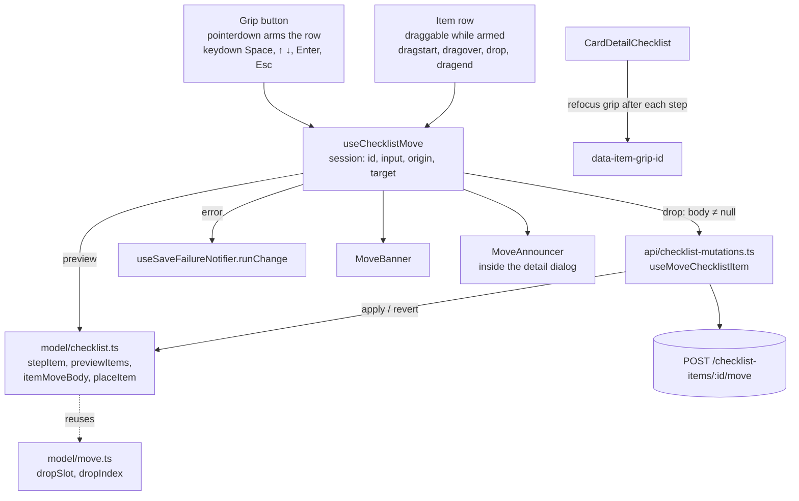

# Card Checklist Drag and Drop Design

**Spec**: `front-end/.specs/features/card-checklist-dnd/spec.md`
**Status**: Approved

---

## Architecture Overview

Conforms to FE-AD-012 (no library, native HTML5 drag for the mouse, a keyboard state machine over pure position functions, its own live region) and FE-AD-013 (the checklist stays in `features/board`). It is the `board-dnd` pattern cut down to one list and one axis: a **move session** held by a new view-model hook, `useChecklistMove`, which the checklist view-model composes. The session previews the order on screen while it runs; a drop turns it into one optimistic mutation (FE-AD-009, FE-AD-010) on the checklist cache.

**Session lifecycle**

| Step | Mouse | Keyboard |
| ---- | ----- | -------- |
| Start | `pointerdown` on the grip arms the row (`draggable` on); `dragstart` on the row → `start(id, 'mouse')`. Pointer up without a drag disarms it | Space on the focused grip → `start(id, 'keyboard')`, announce "Item {text}, posição {i} de {n}" |
| Preview | `dragover` on a row → `hover(index)` from `dropSlot` + `dropIndex`; the source row stays in place, dashed and translucent; a dashed placeholder renders at the target | ↑ ↓ → `step(key)`; the row renders at the target with `bg-brand-soft`; banner and live region update |
| Drop | `drop` on a row or on the list's end zone → `drop()` | Space / Enter → `drop()`, announce "Item {text} solto na posição {i} de {n}" |
| Cancel | `dragend` without a drop → `cancel()`, silent | Esc → `cancel()`, announce "Movimento cancelado"; the event stops so the dialog stays open |
| Send | `itemMoveBody(origin, target)`; `null` (same index) sends nothing (FCLD-06, FCLD-13) | same |
| Detail closes | The section unmounts; the session state goes with it and nothing is sent (FCLD-16) | same |

---

## Code Reuse Analysis

### Existing Components to Leverage

| Component | Location | How to Use |
| --------- | -------- | ---------- |
| `useOptimisticBoardViewChange`, `usePendingItemIds` | `src/features/board/api/mutations.ts` | `useMoveChecklistItem` is one more change; the shared key marks the moving item pending (FCLD-22), disables its checkbox and delete (card-checklist pending rule) and refetches once the last change settles |
| `CacheChange` (`apply` / `revert`) | `src/features/board/api/mutations.ts` | `apply` remembers the item's old index; `revert` puts only that item back (FCLD-21, FE-AD-010) |
| `dropSlot`, `dropIndex`, `DropSlot` | `src/features/board/model/move.ts:57-81` | The vertical slot and the index among the other items, unchanged |
| `byPosition`, `sortItems` | `src/features/board/model/columns.ts`, `model/checklist.ts` | `placeItem` sorts before splicing; the query's `select` already sorts what the screen reads |
| `useSaveFailureNotifier.runChange` | `src/shared/ui/toast/use-save-failure-notifier.ts` | `null` success message (silent move); default texts give FCLD-18 (retry), FCLD-19 (`409` + Recarregar), FCLD-20 (`404` + refetch) with the checklist view-model's existing `reload` |
| `MoveBanner` | `src/features/board/components/move-banner.tsx` | The keyboard banner (FCLD-08), unchanged |
| `MoveAnnouncer` | `src/features/board/components/move-announcer.tsx` | A second instance inside the checklist section, so it sits inside the modal dialog (FCLD-17) |
| `board.move.cancelled` | `src/shared/i18n/locales/*.ts` | "Movimento cancelado" / "Move cancelled" |
| Refocus effect | `src/features/board/components/board-columns.tsx:165-178` | Same `useLayoutEffect`: while a keyboard session runs, or right after it, refocus `[data-item-grip-id]` when focus fell to `body` (FCLD-15) |
| Drag event tests | `test/unit/features/board/components/card-tile.spec.tsx`, `board-column.spec.tsx` | Same `fireEvent.dragStart/dragOver/drop/dragEnd` with a stub `dataTransfer` and a stubbed `getBoundingClientRect` |
| `renderApp`, MSW checklist handlers | `test/support/`, `test/support/msw/` | Component tests through the rendered card detail (L-001) |

### Integration Points

| System | Integration Method |
| ------ | ------------------ |
| `POST /api/v1/checklist-items/{id}/move` | `useMoveChecklistItem`, body `MoveChecklistItemDto` (`position`) |
| Checklist cache | `boardViewKeys.checklist(boardId, cardId)` only; the card caches are not touched, since a move does not change `card.checklist` (back-end CHK-18) |
| Card detail | `useCardDetailViewModel` already composes `useCardChecklistViewModel`; the move state and actions travel inside its `state` and `actions` |
| Read-only modes | `CardDetailChecklist`'s existing `isDisabled` prop turns the move off (FCLD-24) |

---

## Components

### `model/checklist.ts` (extend, pure)

- **Purpose**: Every position rule of a checklist move.
- **Location**: `src/features/board/model/checklist.ts`
- **Interfaces**:
  - `type ItemMoveSession = { id: string; input: MoveInput; origin: number; target: number | null }` - `target` stays `null` until the first drag over or keyboard step
  - `stepItem(count: number, index: number, key: 'ArrowUp' | 'ArrowDown'): number` - one up or down, capped at `0` and `count - 1` (FCLD-09)
  - `itemMoveBody(origin: number, target: number | null): MoveChecklistItemDto | null` - `null` when `target` is `null` or equal to `origin` (FCLD-06, FCLD-13)
  - `placeItem(items: ChecklistItem[], id: string, index: number): ChecklistItem[]` - sorts by position, moves the item to `index` among the others, renumbers `0..n-1`; an unknown id returns `items` unchanged
  - `previewItems(items: ChecklistItem[], session: ItemMoveSession | null): ChecklistPreview`
  - `type ChecklistPreview = { items: ChecklistItem[]; sourceId: string | null; placeholderIndex: number | null; liftedId: string | null }` - mouse: `items` unchanged, `sourceId` and `placeholderIndex` set (FCLD-04); keyboard: `items` reordered with the picked item at `target`, `liftedId` set (FCLD-08, FCLD-09)
- **Dependencies**: `model/move.ts` (`MoveInput`), `model/types.ts`
- **Reuses**: `byPosition`

### `model/types.ts` (extend)

- `export type MoveChecklistItemDto = Schemas['MoveChecklistItemDto'];`

### `api/checklist-mutations.ts` (extend)

- **Purpose**: The optimistic move request.
- **Interfaces**:
  - `type MoveChecklistItemVariables = ItemVariables & { body: MoveChecklistItemDto }`
  - `useMoveChecklistItem(boardId: string, cardId: string)` - `POST /api/v1/checklist-items/{id}/move`; one `CacheChange` on `boardViewKeys.checklist(boardId, cardId)`: `apply` records the item's current index in the sorted list and calls `placeItem(items, id, body.position)`; `revert` calls `placeItem(items, id, previous)` (FCLD-05, FCLD-21)
- **Reuses**: `useOptimisticBoardViewChange`, `call`, `useApi`

### `view-models/use-checklist-move.ts` (new)

- **Purpose**: One move session shared by the mouse and the keyboard; a drop sends one optimistic move.
- **Location**: `src/features/board/view-models/use-checklist-move.ts`
- **Interfaces**:
  - `useChecklistMove(boardId: string, cardId: string, { items, canMove, pendingIds, reload })` returns:
    - `preview: ChecklistPreview`
    - `bannerText: string | null` - set only during a keyboard session (FCLD-08, FCLD-10)
    - `announcement: string` - the live region text
    - `keyboardItemId: string | null` - for the refocus effect
    - `canDrag(id: string): boolean` - `canMove && !session && !pendingIds.has(id)` (FCLD-22, FCLD-23, FCLD-24)
    - `start(id: string, input: MoveInput): void` - ignored unless `canDrag(id)`
    - `step(key: 'ArrowUp' | 'ArrowDown'): void` - keyboard sessions only
    - `hover(index: number): void` - mouse sessions only
    - `drop(): void` - clears the session, announces "solto" for a keyboard session, then `runChange(moveMutation.mutateAsync, { id, body }, null)` when `itemMoveBody` is not `null` (FCLD-05, FCLD-11, FCLD-12, FCLD-18–FCLD-20)
    - `cancel(): void` - clears the session; announces "Movimento cancelado" only for a keyboard session (FCLD-14)
  - Texts: `{text}` is the item's saved text; `{i}` = `target ?? origin` + 1; `{n}` = `items.length`
- **Dependencies**: `useMoveChecklistItem`, `useSaveFailureNotifier`, `useTranslation`
- **Reuses**: the `useBoardMove` structure (`start`/`step`/`hover`/`drop`/`cancel`, keyboard-only announcements)

### `view-models/use-card-checklist-view-model.ts` (extend)

- Composes `useChecklistMove(boardId, cardId, { items, canMove: status === 'ready', pendingIds, reload })` with the same `reload` it already passes to `useSaveFailureNotifier`.
- Exposes `state.move` (`preview`, `bannerText`, `announcement`, `keyboardItemId`) and `actions.move` (`canDrag`, `start`, `step`, `hover`, `drop`, `cancel`). The read-only gate stays in the component through `isDisabled`, as for add, edit and delete.

### `components/card-detail-checklist-item.tsx` (extend)

- **Purpose**: The item row gains the grip and the drag wiring.
- **New props**: `movable: { canDrag: boolean; isSource: boolean; isLifted: boolean; isPicked: boolean; onStart(input: MoveInput): void; onKey(event: KeyboardEvent): void; onHover(slot: DropSlot): void; onDrop(): void; onEnd(): void } | null` - `null` in the read-only modes, so no grip renders (FCLD-24)
- **Grip**: a native `<button type="button">` before the checkbox, `data-item-grip-id={item.id}`, `aria-label` "Reordenar o item {text}" (FCLD-01), `GripVertical` 14 px, `cursor-grab`, `focus-visible:outline-2 focus-visible:outline-border-focus` (FCLD-07), `disabled` while `!canDrag` and not picked (FCLD-22).
  - `onPointerDown` arms the row (local state); `onPointerUp` / `dragend` disarm it.
  - `onKeyDown`: Space with no session → `onStart('keyboard')`; while picked, Space/Enter → drop, ↑ ↓ → step, Esc → cancel. Every handled key calls `preventDefault`; Esc also calls `stopPropagation` so the dialog stays open (FCLD-14). Space on another grip while a session runs does nothing (FCLD-23).
- **Row**: `draggable={armed && canDrag}` (FCLD-02, FCLD-03); `dragstart` sets `text/plain` and `effectAllowed = 'move'` (Firefox needs data) and calls `onStart('mouse')`; `dragover` calls `preventDefault` and `onHover(dropSlot(rect, clientY))`; `drop` calls `onDrop`; `dragend` calls `onEnd`.
- **Looks**: `isSource` → `border border-dashed border-border-focus opacity-50` (FCLD-04); `isLifted` → `bg-brand-soft` (FCLD-08).

### `components/card-detail-checklist.tsx` (extend)

- Renders `MoveBanner` between the progress bar and the list when `bannerText` is set (FCLD-08).
- Renders the list from `preview.items`, a dashed placeholder (`h-9.5 rounded-sm border-2 border-dashed border-border-focus`, `data-testid="checklist-drop-placeholder"`) at `placeholderIndex` (FCLD-04), and an end zone after the last row that hovers `items.length` and accepts the drop.
- Maps each row's `onHover(slot)` to `hover(dropIndex(otherIds, item.id, slot))`, where `otherIds` leaves out the dragged item.
- Renders `MoveAnnouncer` inside the `<section>`, always mounted, and only when the section is mounted (FCLD-17).
- Refocus `useLayoutEffect` over `[data-item-grip-id]`, copied from `board-columns.tsx` (FCLD-15).

### i18n (extend `pt-BR.ts`, `en.ts`)

Under `board.cardDetail.checklist`:

| Key | PT-BR | EN |
| --- | ----- | -- |
| `reorderItem` | Reordenar o item {{text}} | Reorder the item {{text}} |
| `moveBanner` | Movendo “{{text}}”: posição {{i}} de {{n}}. ↑ ↓ movem, Espaço solta, Esc cancela. | Moving “{{text}}”: position {{i}} of {{n}}. ↑ ↓ move, Space drops, Esc cancels. |
| `moveAnnounce` | Item {{text}}, posição {{i}} de {{n}} | Item {{text}}, position {{i}} of {{n}} |
| `moveDropped` | Item {{text}} solto na posição {{i}} de {{n}} | Item {{text}} dropped at position {{i}} of {{n}} |

"Movimento cancelado" reuses `board.move.cancelled`.

---

## Data Models

No new entities. `MoveChecklistItemDto = { position: number }` comes from the API contract. `ItemMoveSession` and `ChecklistPreview` are screen state, defined above.

---

## Error Handling Strategy

| Error Scenario | Handling | User Impact |
| -------------- | -------- | ----------- |
| Network error or `5xx` | `revert` puts the item back at its old index; `runChange` shows the default retry toast; Tentar novamente resends the same variables | The item returns; "Não foi possível salvar. Tente novamente." + Tentar novamente (FCLD-18) |
| `409` (card, column or board archived elsewhere) | `revert`; conflict toast with Recarregar → `reload` invalidates every board query | "Este item foi arquivado. Recarregue para ver o estado atual." (FCLD-19) |
| `404` (item deleted elsewhere) | `revert`; toast without a button; `reload` refetches, which includes the checklist | "Não foi possível salvar. Tente novamente."; the item disappears after the refetch (FCLD-20) |
| `401` | Foundation session-expiry flow; `saveFailureKind` returns `sessionExpired` and no toast shows | Redirect to login (FND-16) |
| Two moves in flight, one fails | Each `CacheChange` reverts only its own item (FE-AD-010) | The other move stays on screen (FCLD-21) |
| Detail closes mid-session | Unmount drops the session | Nothing sent (FCLD-16) |

---

## Risks & Concerns

| Concern | Location (file:line) | Impact | Mitigation |
| ------- | -------------------- | ------ | ---------- |
| React reorders the picked row's DOM node on each step; moving a focused node can drop focus to `body` | `src/features/board/components/card-detail-checklist.tsx` | Keyboard users lose their place mid-move (FCLD-15) | The refocus `useLayoutEffect` from `board-columns.tsx:165-178`, and a test that asserts focus on the grip after ↑, after the drop and after Esc |
| Dragging from a native `<button>` is unreliable across browsers (I could not confirm current Firefox behavior) | grip in `card-detail-checklist-item.tsx` | The mouse drag would not start in some browsers | The grip only arms the row; the row is the `draggable` element. This also keeps text selection in the field (FCLD-03) |
| Esc on a picked grip bubbles to the React Aria dialog and closes the detail | `card-detail.tsx:48` (`isDismissable`) | The move is lost and the detail closes (breaks FCLD-14) | `stopPropagation` on Esc while picked, as the item text field already does (FCL-30); a test asserts the dialog stays open |
| `card-detail-checklist.tsx` and the item row grow with drag wiring | `src/features/board/components/card-detail-checklist*.tsx` | Harder review | Position math stays in `model/checklist.ts` and session logic in `useChecklistMove`; components only map events |
| jsdom has no real drag or layout | `test/unit/...` | Mouse paths are only partly covered by unit tests | Unit tests stub `dataTransfer` and `getBoundingClientRect` as `card-tile.spec.tsx` does; one Playwright e2e covers a real mouse reorder and a keyboard reorder with a reload |

---

## Tech Decisions (only non-obvious ones)

| Decision | Choice | Rationale |
| -------- | ------ | --------- |
| Drag source | The row is `draggable` only while the grip is pressed | Native ghost of the whole row, no text-selection conflict, no reliance on dragging a `<button>` |
| Separate hook | `useChecklistMove` instead of extending `useBoardMove` | One list and one axis; `useBoardMove` is bound to columns and board caches. The shared parts (`dropSlot`, `dropIndex`, `MoveBanner`, `MoveAnnouncer`) are reused as they are |
| Live region | A second `MoveAnnouncer` inside the checklist section | The board's region sits outside the modal dialog, where screen readers do not read it (spec assumption) |
| Toast texts | Default `errors.*` keys, no `retryMessage` | User choice (spec): FE-AD-009 default |

No project-level decision is added: this design applies FE-AD-012 and FE-AD-013 as written.
