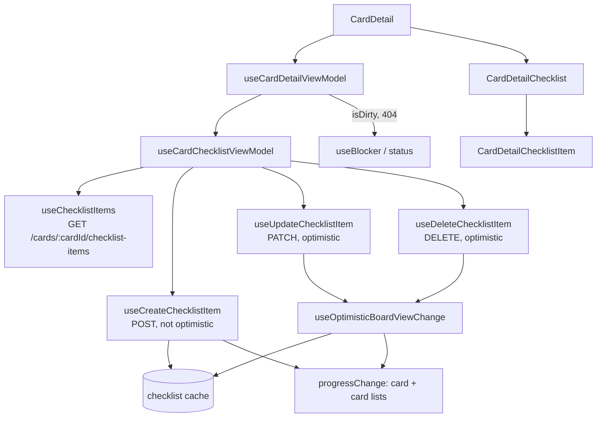

# Card Checklist Design

**Spec**: `front-end/.specs/features/card-checklist/spec.md`
**Status**: Approved

---

## Architecture Overview

The checklist is one more section of the card detail, inside `features/board` (FE-AD-013). It adds one query (the card's items), three mutations (create, update, delete) and a checklist view model that the card detail view model composes, so the detail keeps a single discard blocker and a single "not found" state.

Chosen approach: **a checklist view model composed by the detail view model**. Alternatives considered: (b) grow `useCardDetailViewModel` directly; rejected because it is already ~300 lines and the checklist adds its own drafts, errors and create state. (c) a self-contained checklist component with its own view model that reports `isDirty` up through a callback; rejected because the blocker would then depend on an effect firing in a child, and the `404` → "Esta tarefa não existe mais" rule would need a second channel.



---

## Code Reuse Analysis

### Existing Components to Leverage

| Component | Location | How to Use |
| --------- | -------- | ---------- |
| `useOptimisticBoardViewChange`, `removal`, `ItemVariables`, `usePendingItemIds` | `src/features/board/api/mutations.ts` | Update and delete go through the same pipeline: cancel the board queries, apply `{ key, apply, revert }`, revert only this change, refetch the board once nothing is pending (FE-AD-009, FE-AD-010). `ItemVariables.id` is the item id, so `usePendingItemIds` already tells which item has a change in flight (FCL-17) |
| `fieldsPatch`, `inList` | `src/features/board/api/card-mutations.ts:133-153` | Made generic over `{ id: string }` items (today typed to `Card`) and reused for the item fields `text` and `done` |
| `appendThenInvalidate` pattern | `src/features/board/api/create-mutations.ts:61-68` | Create appends the server item to the checklist cache and refetches the checklist, like columns and cards |
| `useSaveFailureNotifier` (`notify`, `runChange`) | `src/shared/ui/toast/use-save-failure-notifier.ts` | Toasts of FCL-34–FCL-36 and FCL-38; its `reload` invalidates `boardViewKeys.all(boardId)`, which now includes the checklist key |
| `byPosition` | `src/features/board/model/columns.ts:4` | Sorts the items by `position` (FCL-01) |
| `CardDetailTitle` field pattern | `src/features/board/components/card-detail-title.tsx` | Same `AriaTextField` + `Input` with Enter / blur / Esc (Esc stops propagation so the modal stays, FCL-30) and `validationBehavior="aria"` |
| `Checkbox` | `src/shared/ui/checkbox.tsx` | Item done checkbox; `label` is the item text (sr-only); `isDisabled` already dims with `opacity-45` |
| `Button` (ghost, sm) | `src/shared/ui/button.tsx` | Delete "X" button, as the detail's close button |
| `LoadError` | `src/shared/ui/load-error.tsx` | Section load error with **Tentar novamente** (FCL-03) |
| `cardDetailMode` | `src/features/board/model/card-detail.ts:11` | `mode !== 'editable'` disables the section (FCL-31–FCL-33) |
| `ItemFieldError` + `board.fieldErrors.*` | `src/features/board/model/types.ts:27`, i18n locales | Two new codes: `checklistItemRequired`, `checklistItemTooLong` |

### Integration Points

| System | Integration Method |
| ------ | ------------------ |
| API `GET /cards/{cardId}/checklist-items` | `useChecklistItems`, key `boardViewKeys.checklist(boardId, cardId)`, `gcTime: 0` like the card query |
| API `POST /cards/{cardId}/checklist-items` | `useCreateChecklistItem`, `CreateChecklistItemDto { text }` |
| API `PATCH /checklist-items/{id}` | `useUpdateChecklistItem`, `UpdateChecklistItemDto { text?, done? }` |
| API `DELETE /checklist-items/{id}` | `useDeleteChecklistItem` |
| Board cache (`card`, `cards` active/archived) | `progressChange` patches `card.checklist` by a delta so the tile badge stays current (FCL-39) |
| Card detail discard blocker | `isDirty` of the detail view model ORs in the checklist's `isDirty` (FCL-27, FCL-28) |
| Card detail status | A `404` on the checklist query sets `status = 'notFound'` (FCL-04); other checklist errors stay inside the section (FCL-03) |

---

## Components

### Model — `model/checklist.ts` (new) and `model/validation.ts`

- **Purpose**: Framework-free rules for the checklist.
- **Location**: `src/features/board/model/checklist.ts`, `src/features/board/model/validation.ts`
- **Interfaces**:
  - `checklistProgress(items: ChecklistItem[]): ChecklistProgress` - `{ done, total, percent, isComplete }`; `percent = Math.round(done / total * 100)`, `0` when empty; `isComplete = total > 0 && done === total` (FCL-05–FCL-07)
  - `sortItems(items: ChecklistItem[]): ChecklistItem[]` - ascending `position` via `byPosition` (FCL-01)
  - `isChecklistDirty(items: ChecklistItem[], drafts: ItemDrafts): boolean` - a draft whose trimmed text differs from the saved text of its item (FCL-27); the add field is not part of `drafts` (FCL-29)
  - `validateChecklistItemText(raw: string): ItemFieldError | null` - trimmed 1–200 → `checklistItemRequired` / `checklistItemTooLong` (FCL-13, FCL-14, FCL-20, FCL-21, FCL-40); shares `validateTitle` with a `max` parameter
- **Dependencies**: `model/types.ts`, `model/columns.ts`
- **Reuses**: `byPosition`, `validateTitle`

### API — `api/keys.ts`, `api/checklist-queries.ts`, `api/checklist-mutations.ts` (new)

- **Purpose**: The only code that calls the checklist endpoints and patches the cache.
- **Location**: `src/features/board/api/`
- **Interfaces**:
  - `boardViewKeys.checklist(boardId, cardId)` → `['board', boardId, 'checklist', cardId]` - under `all(boardId)`, so the pipeline cancels and refetches it with the board
  - `useChecklistItems(boardId, cardId): UseQueryResult<ChecklistItem[], ApiError>` - `select: sortItems`, `gcTime: 0`
  - `useCreateChecklistItem(boardId, cardId)` - `useMutation<ChecklistItem, ApiError, CreateChecklistItemDto>`; on success appends the item to the checklist cache, applies `progressChange(+1 total)` and invalidates the checklist key (FCL-10, FCL-12, FCL-39)
  - `useUpdateChecklistItem(boardId, cardId)` - `useOptimisticBoardViewChange<UpdateChecklistItemVariables>`; patches the item's fields in the checklist cache and, when `body.done` is set, `progressChange(done ±1)` (FCL-16, FCL-18)
  - `useDeleteChecklistItem(boardId, cardId)` - `useOptimisticBoardViewChange<ItemVariables>`; `removal` on the checklist cache, then `progressChange(total −1, done −1 if the removed item was done)` (FCL-24)
  - `progressChange(boardId, cardId, delta: () => ProgressDelta): CacheChange[]` - three changes (card query, active cards, archived cards) that add the delta on `apply` and subtract the same delta on `revert`, so overlapping toggles never overwrite each other (FE-AD-010)
- **Dependencies**: `useApi`, `call`, `boardViewKeys`
- **Reuses**: `useOptimisticBoardViewChange`, `removal`, generic `fieldsPatch` / `inList`

### View model — `view-models/use-card-checklist-view-model.ts` (new)

- **Purpose**: Drafts, errors and actions of the checklist section.
- **Location**: `src/features/board/view-models/use-card-checklist-view-model.ts`
- **Interfaces**:
  - `useCardChecklistViewModel(boardId: string, cardId: string): { query, isDirty, state, actions }`
  - `state`: `status: 'loading' | 'error' | 'ready'`, `items`, `progress`, `drafts: ItemDrafts` (`Record<itemId, string>`, absent = saved text), `error: { target: 'new' | string; code: ItemFieldError } | null`, `newText`, `isCreating`, `pendingIds: Set<string>`
  - `actions`: `setDraft(id, text)`, `submitDraft(id)`, `cancelDraft(id)`, `toggle(id)`, `remove(id)`, `setNewText(text)`, `add()`, `retryLoad()`
  - `submitDraft` follows `submitTitle`: validate → set error and keep the draft, or clear the draft and send only when the trimmed text changed; on failure put the typed text back as the draft (FCL-37) and notify
  - `add` ignores the call while `isCreating` (FCL-11); on `201` clears `newText` (FCL-12); on failure keeps `newText` and notifies with a retry (FCL-38)
  - Typing in a field clears the error of that target (FCL-15)
- **Dependencies**: the three mutation hooks, `useChecklistItems`, `usePendingItemIds`, `useSaveFailureNotifier`
- **Reuses**: the `saveDraft` / `runChange` flow of `useCardDetailViewModel`

### Card detail view model — `view-models/use-card-detail-view-model.ts` (changed)

- **Purpose**: Compose the checklist.
- **Changes**: calls `useCardChecklistViewModel(boardId, cardId)`; `status = 'notFound'` also when the checklist query fails with `404`; `isDirty` ORs `checklist.isDirty`; returns `state.checklist` and `actions.checklist`. `retryLoad` stays for the detail queries only; the section has its own retry.

### `CardDetailChecklist` (new)

- **Purpose**: The section: heading with the `SquareCheck` icon, count, progress bar, item list, add field, error alert, section skeleton and section load error.
- **Location**: `src/features/board/components/card-detail-checklist.tsx`
- **Interfaces**: `CardDetailChecklistProps = { state, actions, isDisabled: boolean }`
- **Behavior**: progress bar `role="progressbar"`, `aria-label="Checklist"`, `aria-valuetext="{done}/{total}"`, inline width `{percent}%`, `bg-green-500` / `bg-brand` (FCL-05, FCL-06); count `text-green-700` when complete. Hidden when `total === 0` (FCL-07). Holds a ref to the add input and focuses it after `remove` (FCL-25). No add field and no delete buttons when `isDisabled` (FCL-32). One `role="alert"` under the list with the current error (FCL-23).
- **Reuses**: `LoadError`, prototype markup `design/Task List.dc.html:698-722`

### `CardDetailChecklistItem` (new)

- **Purpose**: One row: checkbox, text field, delete button.
- **Location**: `src/features/board/components/card-detail-checklist-item.tsx`
- **Interfaces**: `{ item, draft: string | undefined, isInvalid, isPending, isDisabled, onToggle, onChange, onSubmit, onCancel, onDelete }`
- **Behavior**: checkbox `label = item.text` (FCL-08); text field `aria-label` "Editar item “{text}”", Enter / blur submit, Esc cancels and stops propagation (FCL-22, FCL-30); delete `aria-label` "Excluir item “{text}”"; done → `line-through text-text-tertiary` (FCL-09); `isPending` disables checkbox and delete (FCL-17); `isDisabled` disables checkbox and text (`disabled:text-text-disabled`) and hides delete (FCL-31, FCL-32).
- **Reuses**: `Checkbox`, `Button`, `CardDetailTitle` field pattern

### i18n (EN + PT-BR, same keys)

- `board.cardDetail.checklist.title` "Checklist" / "Checklist"
- `board.cardDetail.checklist.addItem` "Add an item and press Enter" / "Adicionar item e apertar Enter"
- `board.cardDetail.checklist.editItem` "Edit item “{{text}}”" / "Editar item “{{text}}”"
- `board.cardDetail.checklist.deleteItem` "Delete item “{{text}}”" / "Excluir item “{{text}}”"
- `board.fieldErrors.checklistItemRequired` "Write the item" / "Escreva o item"
- `board.fieldErrors.checklistItemTooLong` "Use up to 200 characters" / "Use até 200 caracteres"

---

## Data Models

```typescript
// model/types.ts — contract aliases, no parallel model (FE-AD-006)
export type ChecklistItem = Schemas['ChecklistItemResponseDto']; // id, cardId, text, done, position, createdAt, updatedAt
export type CreateChecklistItemDto = Schemas['CreateChecklistItemDto']; // { text }
export type UpdateChecklistItemDto = Schemas['UpdateChecklistItemDto']; // { text?, done? }

// model/checklist.ts
export type ChecklistProgress = { done: number; total: number; percent: number; isComplete: boolean };
export type ItemDrafts = Record<string, string>; // item id → typed text
export type ProgressDelta = { total: number; done: number };

// api/checklist-mutations.ts
export type UpdateChecklistItemVariables = ItemVariables & { body: UpdateChecklistItemDto };
```

**Relationships**: `Card.checklist` (`ChecklistProgressDto { total, done }`) is the server's summary of the items; the client keeps it in step through `progressChange` and the settle refetch corrects any drift.

---

## Error Handling Strategy

| Error Scenario | Handling | User Impact |
| -------------- | -------- | ----------- |
| Items load: network / `5xx` | Section shows `LoadError`; `retryLoad` refetches the checklist query | Rest of the detail stays usable (FCL-03) |
| Items load: `404` | Detail `status = 'notFound'` | "Esta tarefa não existe mais" (FCL-04) |
| Update / delete: network / `5xx` | Pipeline reverts this change; `notify` with retry | "Não foi possível salvar. Tente novamente." + **Tentar novamente** (FCL-34) |
| Any checklist save: `409` | Revert (create has nothing to revert); `notify` conflict | "Este item foi arquivado…" + **Recarregar** (FCL-35) |
| Update / delete: `404` | Revert; `notify` notFound → `reload` invalidates `boardViewKeys.all` (includes the checklist) | Plain save-fail toast; the item disappears after the refetch (FCL-36) |
| Text save fails | Typed text goes back into `drafts[id]` | Nothing typed is lost; still counts as unsaved (FCL-37) |
| Create fails | `newText` kept; `notify` with a retry that resends the same text | Toast + text still in the add field (FCL-38) |
| Create / edit `400` | Not reachable through the UI (client validation is the same rule); treated as a save failure | Save-fail toast |
| `401` | FE-AD-002 session expiry; `notify` stays silent | Redirect to log in |

---

## Risks & Concerns

| Concern | Location (file:line) | Impact | Mitigation |
| ------- | -------------------- | ------ | ---------- |
| Existing detail tests do not answer `GET /cards/{id}/checklist-items` | `test/unit/features/board/components/card-detail.spec.tsx:64-74`, `view-models/use-card-detail-view-model.spec.tsx`, `test/unit/pages/card-detail-page.spec.tsx`, `components/board-screen.spec.tsx` | MSW passes the unhandled request through: warnings, a network error in the section, and a possible `404`-path flake | The task that composes the checklist into the detail adds a `checklist-items` handler (`[]` by default) to every detail test setup in the same commit |
| `fieldsPatch` / `inList` are typed to `Card` | `src/features/board/api/card-mutations.ts:126-153` | Item patches would duplicate them | A refactor-only commit makes them generic over `{ id: string }` and moves them next to `removal` in `mutations.ts` before the checklist mutations use them |
| `card.checklist` progress patched by a fixed value would undo another pending toggle on revert | `card-mutations.ts:133` (`fieldsPatch` restores old values) | Two quick toggles, first fails → the count of the second is lost until the refetch | `progressChange` adds and subtracts a delta instead of restoring a snapshot |
| A slow items request on every open | `api/card-detail-queries.ts:31` (the card seeds from the board, the items cannot) | Section skeleton flash | Accepted: section-level skeleton only (spec FCL-02); the rest of the detail opens at once |
| Detail view model size | `view-models/use-card-detail-view-model.ts` (~300 lines) | Hard to review | The checklist logic lives in its own view model; the detail only composes it |
| Lesson L-001 (composition not tested through the rendered screen) | `front-end/.specs/LESSONS.md` | A prop of the section (e.g. `isDisabled`, pending ids) can be dropped with every unit test green | `card-detail.spec.tsx` asserts the checklist through the rendered detail: read-only mode, `404` → not found, section error, dirty → discard dialog |

---

## Tech Decisions

| Decision | Choice | Rationale |
| -------- | ------ | --------- |
| Checklist cache key | `['board', boardId, 'checklist', cardId]` | Under `all(boardId)` so the optimistic pipeline cancels and refetches it; not under `card(…)` so writes to the card query never touch it by prefix |
| Item drafts | A map `item id → text`, not a single "editing item" | A failed save restores its draft (FCL-37) even when the user already moved to another item |
| One error slot | `{ target, code }`, shown once below the list | Prototype shows one `itemErr`; the field with the error gets `aria-invalid` |
| Create while one is in flight | Enter ignored, field stays enabled | Keeps focus in the field (FCL-12) and stops double Enter (FCL-11); FE-AD-009 create rule |
| Progress patch | Delta on `card.checklist` in the card query and both card lists | FE-AD-010 per-change revert; the tile badge updates without a reload (FCL-39) |

No project-level decision is added; the design conforms to FE-AD-002, -004, -006, -008, -009, -010, -011, -013.
