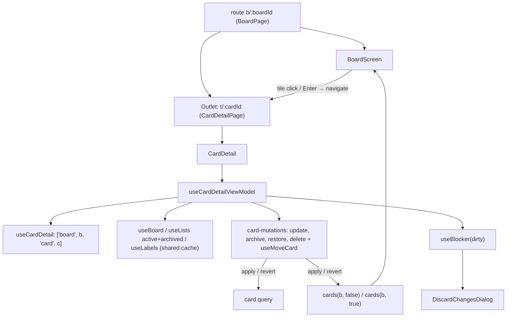

# Card Detail Design

**Spec**: `front-end/.specs/features/card-detail/spec.md`
**Status**: Approved

---

## Architecture Overview

The card detail is a nested route of the board. `b/:boardId` renders `BoardPage`, which keeps `BoardScreen` mounted and adds an `<Outlet />`. The child `t/:cardId` renders `CardDetailPage`, which renders the board feature's `CardDetail`. Opening and closing a card only changes the child route, so the board keeps its filters, "Mostrar arquivadas" and scroll position (FCD-05, FCD-07).

All the code lives in `features/board` (FE-AD-013). The detail reads its card through its own query under the board key prefix. Every change goes through the board's existing optimistic pipeline (`useOptimisticBoardViewChange`, FE-AD-009/010). That pipeline patches the detail's card query and the board's card lists together, so the tile and the detail always agree (FCD-52). Close paths only navigate. A React Router blocker turns any navigation away from a dirty detail into the "Descartar alterações?" dialog (FCD-42).



### Approaches considered

| Approach | Summary | Verdict |
| -------- | ------- | ------- |
| **A. Inside `features/board`** | New `card-detail-*` files in the board feature, reusing its cache keys, optimistic pipeline, `LabelChip`, `MoveToDialog`, `isOverdue`, `validateCardTitle` | **Chosen** (user choice). No refactor; one mutation key, so the settle refetch waits for every board and card change |
| B. New `features/card-detail` + move shared parts to `shared/` | Extract keys, pipeline, types, chip, dialog into `shared/` first | Rejected: several refactor PRs before any behavior; board domain leaks into `shared` |
| C. Isolated `features/card-detail` | Own query; only invalidates `['board', id]` | Rejected: the tile updates only after a refetch (breaks FE-AD-009 "appears at once"), duplicates the chip and dialog, and two mutation keys race on settle |

---

## Code Reuse Analysis

### Existing Components to Leverage

| Component | Location | How to Use |
| --------- | -------- | ---------- |
| `boardViewKeys` | `src/features/board/api/keys.ts` | Add `card(boardId, cardId)` under `all(boardId)`, so board invalidations refetch the detail too |
| `useOptimisticBoardViewChange`, `removal`, `CacheChange` | `src/features/board/api/mutations.ts:301-345` | Export them; every card-detail mutation is built on them |
| `useMoveCard` | `src/features/board/api/mutations.ts:180` | Reused for "Mover para…"; gains one extra `CacheChange` on the card query (`listId`) |
| `usePendingItemIds` | `src/features/board/api/mutations.ts:279` | Disables **Arquivar**/**Restaurar**/**Excluir** while a change on the card is in flight |
| `useBoard`, `useLists`, `useLabels` | `src/features/board/api/queries.ts` | Board archived state, column names (active + archived), label chips |
| `MoveToDialog` | `src/features/board/components/move-to-dialog.tsx` | Rendered by the detail over itself (FCD-31) |
| `LabelChip` | `src/features/board/components/label-chip.tsx` | Applied labels (FCD-29) |
| `isOverdue`, `todayParts` | `src/features/board/model/due-date.ts` | "Atrasada" badge (FCD-15) |
| `validateCardTitle`, `mapTitleServerError` | `src/features/board/model/validation.ts`, `model/errors.ts` | Title errors (FCD-18, FCD-19) and `400` mapping |
| `useSaveFailureNotifier` | `src/shared/ui/toast/use-save-failure-notifier.ts` | Every failure toast (FCD-47–FCD-49); gains `conflictMessage` for FCD-51 |
| `Checkbox`, `Button`, `TextAreaField`, `Alert`, `LoadError` | `src/shared/ui/` | Done flag, footer, description with counter, notices, load error |
| `Dialog` | `src/shared/ui/dialog.tsx` | Delete and discard confirmations (FCD-37, FCD-42) |
| `formatShortDate` | `src/shared/i18n/format-date.ts` | "Criada em 3 out, 2026" (FCD-30) |
| `useShortcut` aria-modal guard | `src/shared/keyboard/use-shortcut.ts:11` | FCD-12 is free: the detail renders `aria-modal="true"` |
| `renderApp`, MSW handlers | `test/support/` | Component tests with the real router (nested route) |

### Integration Points

| System | Integration Method |
| ------ | ------------------ |
| Router | `routes.tsx`: `b/:boardId` gets `children: [{ path: 't/:cardId', element: <CardDetailPage /> }]`; `BoardPage` renders `<Outlet />` after `BoardScreen` |
| Board screen | `CardTile` gains `onOpen`; `BoardScreen` passes `navigate('/b/{boardId}/t/{cardId}')` down through `BoardColumns` → `BoardColumn` / `ArchivedCardsColumn` |
| API | `GET/PATCH/DELETE /api/v1/cards/{id}`, `POST /cards/{id}/archive`, `/unarchive`, `/move` (existing contract) |
| i18n | New `board.cardDetail.*` keys and `board.toast.cardArchived/cardRestored/cardDeleted`, `board.errors.columnArchived`, EN + PT-BR (FE-AD-004) |

---

## Components

### `app/routes.tsx` and `pages/` (changed / new)

- **Purpose**: Nest the detail under the board route so the board stays mounted.
- **Location**: `src/app/routes.tsx`, `src/pages/board-page.tsx` (adds `<Outlet />`), `src/pages/card-detail-page.tsx` (new: reads `boardId`, `cardId`, renders `<CardDetail key={cardId} … />`)
- **Reuses**: `BoardScreen key={boardId}` stays as is (FBV-33).

### `api/keys.ts` (changed)

- `card: (boardId, cardId) => ['board', boardId, 'card', cardId]`.

### `api/card-detail-queries.ts` (new)

- **Purpose**: Load one card for the detail.
- **Interfaces**:
  - `useCardDetail(boardId: string, cardId: string): UseQueryResult<Card, ApiError>` — `GET /api/v1/cards/{id}`. `initialData` comes from `cards(boardId, false)` or `cards(boardId, true)` when the card is there (instant open from the board), with `initialDataUpdatedAt` from that query, so it still refetches. `gcTime: 0`: a closed detail leaves no stale copy for the next open; it always seeds from the board cache.

### `api/card-mutations.ts` (new)

- **Purpose**: The optimistic card changes of the detail (FE-AD-009/010).
- **Interfaces** (all `ItemVariables = { id }` first, so `usePendingItemIds` sees them):
  - `useUpdateCard(boardId)` — variables `{ id, body: UpdateCardDto }`; `PATCH /cards/{id}`. Patches the fields of `body` on the card query, `cards(b, false)` and `cards(b, true)`; `revert` puts back only those fields' old values.
  - `useArchiveCard(boardId)` — `POST /cards/{id}/archive`. Card query: `archivedAt = now`. `cards(b, false)`: `removal`. `cards(b, true)`: prepend the removed card with `archivedAt`.
  - `useRestoreCard(boardId)` — `POST /cards/{id}/unarchive`. Card query: `archivedAt = null`. `cards(b, true)`: `removal`. `cards(b, false)`: append with `position` = max position of its list + 1 (end of column, FCD-36).
  - `useDeleteCard(boardId)` — `DELETE /cards/{id}`. `cards(b, true)`: `removal`. The card query is removed by the view-model after navigating away, not patched (a patch to `undefined` would flash "não existe mais").
- **Reuses**: exported `useOptimisticBoardViewChange`, `removal` from `mutations.ts`.

### `api/mutations.ts` (changed)

- Export `useOptimisticBoardViewChange`, `removal`, `CacheChange`, `ItemVariables`.
- `useMoveCard`: add a `CacheChange` on `card(boardId, id)` that sets `listId` (and reverts it), so the detail header follows the move at once (FCD-32).

### `model/card-detail.ts` (new)

- **Purpose**: Framework-free rules of the detail.
- **Interfaces**:
  - `cardDetailMode(card: Card, board: Board): CardDetailMode` — board archived wins (FCD-41). `CardDetailMode` is exported from this module.
  - `findCardList(card: Card, lists: List[]): List | undefined` — `undefined` means the card is not of this board (FCD-11).
  - `isDescriptionTooLong(draft: string): boolean` — `> 5000` (FCD-27, FCD-53).
  - `descriptionBody(draft: string): string | null` — empty → `null`, otherwise the draft untrimmed (FCD-26).
  - `isDirty(card: Card, drafts: Drafts): boolean` — trimmed title draft ≠ title, or description draft ≠ `description ?? ''` (FCD-42).
  - `nextPosition(cards: Card[], listId: string): number` — used by the restore patch.

### `view-models/use-card-detail-view-model.ts` (new)

- **Purpose**: State and actions of the detail screen.
- **Interfaces**: `useCardDetailViewModel(boardId, cardId)` returns
  - `state`: `status: 'loading' | 'ready' | 'error' | 'notFound'`, `card`, `list` (current column), `mode`, `isColumnArchived`, `labels` (applied, in board order), `today`, `titleDraft`, `titleError`, `descriptionDraft`, `descriptionError`, `isDirty`, `isPending`, `isMoveOpen`, `isDeleteOpen`, `isDiscardOpen`, `activeLists`.
  - `actions`: `toggleDone`, `setTitleDraft`, `submitTitle`, `cancelTitle`, `setDueDate(value: string)`, `removeDueDate`, `setDescriptionDraft`, `saveDescription`, `cancelDescription`, `openMove`, `closeMove`, `moveTo(listId)`, `archive`, `restore`, `askDelete`, `cancelDelete`, `confirmDelete`, `close`, `keepEditing`, `discard`, `retryLoad`.
- **Status**: `notFound` when the card query answers `404`, or when `findCardList` finds no list in the active and archived lists of `boardId` once both loaded. `error` when a query failed with no data. `loading` while the card, board or either list query is pending.
- **Drafts**: `titleDraft: string | null` and `descriptionDraft: string | null`; `null` shows the saved value. Title submit clears the draft before the request (the patch shows the new title); on failure it restores the draft to the typed text (FCD-50) and maps a `400` to the field error. Description works the same on **Salvar**.
- **Close**: `close()` calls `navigate('/b/{boardId}')`. `useBlocker` blocks while `isDirty && mode === 'editable'` and the next path differs; `isDiscardOpen = blocker.state === 'blocked'`; `discard` = `blocker.proceed()`, `keepEditing` = `blocker.reset()` (FCD-42–FCD-45). `confirmDelete` runs the delete, then navigates (the card is archived, so never dirty) and removes the card query.
- **Failures**: `useSaveFailureNotifier` with `reload` = invalidate `all(boardId)`. Restore and delete pass `conflictMessage: t('board.errors.columnArchived')` (FCD-51). Move passes `retryMessage: t('board.toast.moveFailed')` as the board does.
- **Toasts**: archive, restore, delete, move (`board.toast.cardMoved`); done, title, due and description save silently (FBV-31 rule).

### `components/card-detail.tsx` (new)

- **Purpose**: The modal / full-screen shell. React Aria `ModalOverlay` + `Modal` + `Dialog` (`aria-modal`), `isDismissable` (backdrop, FCD-07), `onOpenChange(false)` → `actions.close`.
- **Layout**: `fixed inset-0` on phone; from `md` (768 px) a centered panel `max-w-[640px] max-h-[calc(100vh-48px)]` with the overlay color over the board (FCD-03, FCD-04). The header holds the column name, an X ("Fechar", `hidden md:flex`) and a back arrow ("Voltar", `md:hidden`).
- Renders by `status`: `CardDetailSkeleton`, `LoadError`, `CardDetailNotFound`, or the body. Mounts `MoveToDialog`, `DeleteCardDialog`, `DiscardChangesDialog`.
- On close, focuses `[data-card-id="{cardId}"]` on the board when present (FCD-08); React Aria's focus restore covers the opened-by-click case, the explicit focus covers the direct-URL case.

### `components/card-detail-title.tsx` (new)

- Done `Checkbox` ("Concluída"), the title input, badges "Concluída" / "Atrasada", the field error. Enter / blur → `submitTitle`; Esc → `cancelTitle` with `preventDefault` + `stopPropagation`, so the modal does not close (FCD-20, FCD-46).

### `components/card-detail-due-date.tsx` (new)

- `<input type="date">` with the label "Prazo"; `onChange` with a non-empty value → `setDueDate`; "Remover prazo" button while a due date is set (FCD-21–FCD-23).

### `components/card-detail-description.tsx` (new)

- `TextAreaField` with `counter="{n} / 5000"` and the error; **Salvar** (disabled when too long) and **Cancelar** while dirty (FCD-24–FCD-28).

### `components/card-detail-footer.tsx` (new)

- "Criada em …"; by mode: **Mover para…** + **Arquivar** (editable), **Restaurar** + **Excluir definitivamente** (archived card, disabled when the column is archived or a change is pending), nothing (archived board) (FCD-30, FCD-31, FCD-33–FCD-40).

### `components/card-detail-notices.tsx`, `card-detail-skeleton.tsx`, `card-detail-not-found.tsx`, `delete-card-dialog.tsx`, `discard-changes-dialog.tsx` (new)

- Notices "Tarefa arquivada · somente leitura", "Quadro arquivado · somente leitura", "A coluna de origem está arquivada…" (`Alert`); skeleton; "Esta tarefa não existe mais" + **Fechar**; the two confirmations on `shared/ui/dialog` with `role="alertdialog"`.

### `components/card-tile.tsx` (changed)

- New prop `onOpen?: (cardId: string) => void`. With `onOpen`, the tile is always `role="button"`, `tabIndex={0}` and carries `data-card-id`, also when archived or on a read-only board (FCD-02). Click opens unless the target is inside the checkbox or the "Mover para…" menu (`closest('button, input, [role="menu"]')` below the tile). Enter on the tile itself opens, except while the card is lifted (Enter then drops, FDND).

### `components/board-screen.tsx`, `board-columns.tsx`, `board-column.tsx`, `archived-cards-column.tsx` (changed)

- Thread `onOpenCard` from `BoardScreen` (`useNavigate`) to every `CardTile`.

### `shared/ui/toast/use-save-failure-notifier.ts` (changed)

- `NotifyOptions.conflictMessage?: string`: a `409` shows that message instead of the generic conflict text, still with **Recarregar**.

---

## Data Models

No new server model; the detail uses `CardResponseDto`, `ListResponseDto`, `BoardResponseDto`, `LabelResponseDto` from the contract (FE-AD-006).

```typescript
// view-model local state
type Drafts = { title: string | null; description: string | null };
type CardDetailMode = 'editable' | 'archivedCard' | 'archivedBoard';
type CardDetailStatus = 'loading' | 'ready' | 'error' | 'notFound';
```

### i18n keys (`board.cardDetail.*`, EN + PT-BR)

`close` (Fechar), `back` (Voltar), `done` (Concluída), `doneBadge` (Concluída), `overdue` (Atrasada), `title` (Título), `due` (Prazo), `removeDue` (Remover prazo), `description` (Descrição), `counter` ({{n}} / 5000), `save` (Salvar), `cancel` (Cancelar), `created` (Criada em {{d}}), `moveTo` (Mover para…), `archive` (Arquivar), `restore` (Restaurar), `deleteForever` (Excluir definitivamente), `archivedNotice` (Tarefa arquivada · somente leitura), `boardArchivedNotice` (Quadro arquivado · somente leitura), `notFound` (Esta tarefa não existe mais), `delete.title`, `delete.description`, `discard.title`, `discard.description`, `discard.keepEditing`, `discard.confirm`, `errors.descriptionTooLong` (Use até 5000 caracteres). Plus `board.toast.cardArchived`, `cardRestored`, `cardDeleted`, `board.errors.columnArchived`. Texts come from the prototype `i18n.js` (EN and PT).

---

## Error Handling Strategy

| Error Scenario | Handling | User Impact |
| -------------- | -------- | ----------- |
| Load: network / `5xx` (after the query retries) | `status = 'error'` | "Não foi possível carregar" + **Tentar novamente** (FCD-10) |
| Load: `404`, or card of another board | `status = 'notFound'` | "Esta tarefa não existe mais" + **Fechar** (FCD-11) |
| Save: network / `5xx` | Pipeline reverts the patch; notifier toast with retry | "Não foi possível salvar…" + **Tentar novamente** (FCD-47) |
| Save: `409` | Revert; conflict toast; restore/delete use `conflictMessage` | **Recarregar**, or the column-archived text (FCD-48, FCD-51) |
| Save: `404` | Revert; save-fail toast; invalidate `all(boardId)` → card query `404` | Detail turns into "não existe mais" (FCD-49) |
| Title / description save fails | Draft restored to the typed text | Text stays in the field, counted as unsaved (FCD-50) |
| Title `400` with `errors[].field === 'title'` | `mapTitleServerError` → field error, no toast | Same message as client validation |
| `401` | FE-AD-002 session expiry | Redirect to login |

---

## Risks & Concerns

| Concern | Location (file:line) | Impact | Mitigation |
| ------- | -------------------- | ------ | ---------- |
| Read-only and archived tiles are not focusable | `card-tile.tsx:105-118` (`movable` gates `role`/`tabIndex`) | FCD-02 and opening cards of an archived board are impossible by keyboard | `onOpen` makes the tile a button on its own; `movable` keeps gating only drag and pick |
| Click inside the tile reaches the open handler | `card-tile.tsx` checkbox and `ActionMenu` | Ticking done or opening "Mover para…" would also open the detail | Ignore clicks whose target is inside a nested control; tests for both |
| Esc in the title input may close the modal | React Aria `ModalOverlay` keyboard dismiss | Esc would close instead of restoring the title (FCD-46) | Input handles Esc and stops propagation; component test asserts the dialog stays |
| `useBlocker` in React Router 8.5 | `package.json:30` | Discard dialog depends on it | Verified: `useBlocker(shouldBlock: boolean \| BlockerFunction): Blocker` is exported (`node_modules/react-router/dist/production/index.d.ts`); unit test with the real data router |
| Nested modals (move/delete/discard over the detail) | `shared/ui/dialog.tsx` | Esc or backdrop could close both layers | React Aria closes only the top overlay; tests press Esc in each nested dialog and assert the detail stays |
| `mutations.ts` keeps growing | `src/features/board/api/mutations.ts` (379 lines) | Harder review | New card mutations go in `card-mutations.ts`; only exports change in `mutations.ts` |
| Board feature size | `src/features/board/` | One large feature | Accepted (FE-AD-013); files keep the `card-detail-` prefix so the area is easy to find |
| Open item P1 (boards snapshot rollback) | `src/features/boards/api/mutations.ts` | Not touched by this feature | Unchanged; stays open |
| Media query behavior is not testable in jsdom | FCD-03, FCD-04 | Unit tests cannot prove the layout switch | Unit tests assert both buttons and their classes; Playwright checks desktop and phone viewports |

---

## Testing Strategy

- **Model** (`test/unit/features/board/model/card-detail.spec.ts`): mode precedence, list lookup, dirty rule, description bounds (4999/5000/5001), `descriptionBody`.
- **Mutations** (`test/unit/features/board/api/card-mutations.spec.tsx`): each mutation patches the card query and the board lists at once, and on failure reverts only its own fields/item (FE-AD-010), including two overlapping updates.
- **View-model and components**: through the rendered route with `renderApp` and MSW (lesson L-001: assert what the screen passes to each child, not only the view-model state). One spec per component plus `card-detail.spec.tsx` for the composed screen: open from tile, close paths, discard dialog via browser back, nested dialogs.
- **E2E** (`test/e2e/card-detail.e2e-spec.ts`): open from the seed board, rename, due date, description, archive → restore → archive → delete, phone viewport full screen, direct URL of a deleted card.

---

## Tech Decisions (only non-obvious ones)

| Decision | Choice | Rationale |
| -------- | ------ | --------- |
| Route shape | `t/:cardId` as a child of `b/:boardId` with `<Outlet />` | Board stays mounted, so its filters survive opening a card; direct URL shows the board behind (FCD-05) |
| Card source | Own query `card(b, c)` seeded from the board lists, `gcTime: 0` | Archived cards are not in the board cache unless "Mostrar arquivadas" is on; seeding keeps the open instant; `gcTime: 0` avoids a stale copy on reopen |
| One pipeline for board and detail | Card mutations built on `useOptimisticBoardViewChange` with `BOARD_VIEW_CHANGE_KEY` | One settle refetch after the last change of either screen (FE-AD-009) |
| Discard via `useBlocker` | Every close path is a navigation | One rule covers X, back arrow, Esc, backdrop and browser Back (FCD-42) |
| Shell built on React Aria directly | Not `shared/ui/dialog` | The detail needs its own size, full-screen phone layout and header; the shared dialog stays the 480 px confirmation |
| Due date input | Native `type="date"` | Doc §7 "só data"; built-in phone picker, value is already `YYYY-MM-DD` |

Project-level decision recorded as **FE-AD-013** in `front-end/.specs/STATE.md`: features that share one cache stay in one feature (card detail, checklist and card labels live in `board`). Everything else conforms to FE-AD-001, -002, -004, -006, -009, -010, -011.
