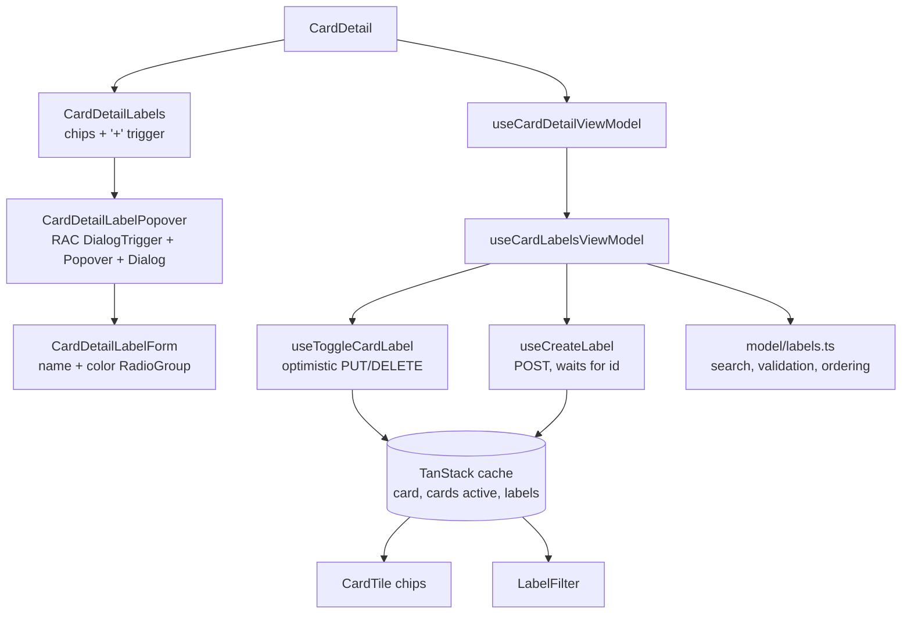

# Card Labels Design

**Spec**: `.specs/features/card-labels/spec.md`
**Status**: Approved

---

## Architecture Overview

The popover follows the card checklist (4b) shape: a sub view-model (`useCardLabelsViewModel`) owned by `useCardDetailViewModel` and exposed as `state.labels` / `actions.labels`, two mutation hooks in `api/`, pure helpers in `model/`, and Views that take plain props. Everything lives in `features/board` (FE-AD-013) and reuses the board's optimistic pipeline (`useOptimisticBoardViewChange`, FE-AD-009/010), so the detail chips, the board tile and the label filter read one cache.



Flow of a check: click → `toggle(label)` → `runChange(toggle.mutateAsync, { id: label.id, cardId, applied: true }, null)` → `onMutate` puts the label id into `labelIds` of the card query and of the active card list, in board label order → `PUT` → on error `revert` removes only that id and `notify` shows the doc §10 toast → on settle the board view refetches once no other board change is pending.

Flow of a create: **Criar** → `validateLabelName` → `createLabel.mutateAsync({ name, color })` → `201` appends the label to the labels cache → form closes, search clears, toast "Etiqueta criada" → `toggle` applies it (FCLB-14, FCLB-25).

---

## Code Reuse Analysis

### Existing Components to Leverage

| Component | Location | How to Use |
| --------- | -------- | ---------- |
| `useOptimisticBoardViewChange`, `CacheChange`, `fieldsPatch`-style patches | `src/features/board/api/mutations.ts:387` | Apply/remove is one optimistic board change with per-item revert |
| `usePendingItemIds` | `src/features/board/api/mutations.ts:305` | Toggle variables carry `id: labelId`, so `pendingIds.has(label.id)` disables only that label (FCLB-06) and never blocks the card's own controls |
| `appendThenInvalidate` | `src/features/board/api/create-mutations.ts:61` | Create appends the new label to `boardViewKeys.labels` and refetches |
| `useLabels`, `boardViewKeys.labels` | `src/features/board/api/queries.ts:66`, `api/keys.ts:13` | Board label list; already loaded by the detail, so no popover loading state |
| `useSaveFailureNotifier` (`notify`, `runChange`) | `src/shared/ui/toast/use-save-failure-notifier.ts` | Toasts of FCLB-17–FCLB-19, FCLB-22, FCLB-24; **Recarregar** invalidates `boardViewKeys.all(boardId)` like the checklist |
| `normalizeText` | `src/features/board/model/filters.ts:22` | Case- and accent-insensitive search (FCLB-09), same as the board search |
| `LabelChip`, `LABEL_CLASSES` | `src/features/board/components/label-chip.tsx` | Chips in the list and in the detail; export `LABEL_CLASSES` (dot class) for the color swatches |
| Drawn checkbox box | `src/features/board/components/label-filter.tsx:62-71`, `src/shared/ui/checkbox.tsx` | Same box styles; the popover rows use RAC `Checkbox` with the chip as visible label |
| `Button`, `inputClasses` | `src/shared/ui/button.tsx`, `src/shared/ui/text-field.tsx:10` | "+" icon button, **Criar**, "Cancelar", search and name inputs |
| `AriaRouterProvider` | `src/app/app.tsx:26` | RAC `Link href` for **Gerenciar etiquetas** navigates through the data router, so the detail's `useBlocker` asks before dropping drafts (FCLB-20) |
| `cardDetailMode` | `src/features/board/model/card-detail.ts:11` | `mode === 'editable'` decides whether "+" renders (FCLB-01, FCLB-21) |

### Integration Points

| System | Integration Method |
| ------ | ------------------ |
| `PUT` / `DELETE /api/v1/cards/{id}/labels/{labelId}` | `useToggleCardLabel`, `204` with no body; idempotent on the server |
| `POST /api/v1/boards/{boardId}/labels` | `useCreateLabel`, `201` `LabelResponseDto` |
| Card detail view-model | `useCardDetailViewModel` calls `useCardLabelsViewModel(boardId, card, labels)` and exposes it; `appliedLabels` stays where it is (FCD-29) |
| Board tile | Reads `card.labelIds` in array order (`card-tile.tsx:76`), so the patch keeps board label order |

---

## Components

### `model/labels.ts` (new)

- **Purpose**: Framework-free label rules for the popover.
- **Location**: `src/features/board/model/labels.ts`
- **Interfaces**:
  - `LABEL_COLORS: readonly Label['color'][]` - doc §8 order: `purple, blue, sky, green, lime, yellow, orange, red, pink, black`.
  - `DEFAULT_LABEL_COLOR: Label['color']` - `'blue'` (FCLB-12).
  - `searchLabels(labels: Label[], query: string): Label[]` - labels whose `normalizeText(name)` contains `normalizeText(query.trim())`; empty query returns all, order kept (FCLB-09).
  - `validateLabelName(raw: string, labels: Label[]): ItemFieldError | null` - `labelNameRequired` (empty after trim), `labelNameTooLong` (> 50), `labelNameTaken` (equal ignoring case to a board label name) (FCLB-15, FCLB-26).
  - `withLabelId(labelIds: string[], id: string, labels: Label[]): string[]` - adds `id` once and returns the ids sorted by their index in `labels`; ids missing from `labels` keep their relative order at the end.
  - `withoutLabelId(labelIds: string[], id: string): string[]`.
  - `isLabelNameTaken(err: ApiError): boolean` - `status === 409` and `type` ends with `/problems/label-name-taken` (FCLB-23).
- **Dependencies**: `model/filters.ts` (`normalizeText`), `model/types.ts`.
- **Reuses**: the `validateTitle` shape of `model/validation.ts`.

### `model/types.ts` (change)

- `ItemFieldError` gains `labelNameRequired | labelNameTooLong | labelNameTaken`.
- `CreateLabelDto = Schemas['CreateLabelDto']`.

### `api/label-mutations.ts` (new)

- **Purpose**: The two server writes of the popover.
- **Location**: `src/features/board/api/label-mutations.ts`
- **Interfaces**:
  - `type ToggleCardLabelVariables = ItemVariables & { cardId: string; applied: boolean }` - `id` is the **label** id; `applied` is the state to reach.
  - `useToggleCardLabel(boardId)` - `useOptimisticBoardViewChange`; `applied ? PUT : DELETE`; cache changes on `boardViewKeys.card(boardId, cardId)` and `boardViewKeys.cards(boardId, false)` (inside `inList(cardId, …)`). `apply` reads the board labels from `queryClient.getQueryData(boardViewKeys.labels(boardId))` and uses `withLabelId` / `withoutLabelId`; it remembers whether the id was already there, so `revert` undoes only a change it made.
  - `useCreateLabel(boardId)` - plain `useMutation<Label, ApiError, CreateLabelDto>`; `onSuccess` → `appendThenInvalidate(queryClient, boardViewKeys.labels(boardId), label)`.
- **Dependencies**: `useApi`, `call`, `api/mutations.ts`, `api/create-mutations.ts`, `model/labels.ts`.
- **Reuses**: the checklist create/toggle hooks as templates.

### `view-models/use-card-labels-view-model.ts` (new)

- **Purpose**: Popover state and actions for one card.
- **Location**: `src/features/board/view-models/use-card-labels-view-model.ts`
- **Interfaces**: `useCardLabelsViewModel(boardId: string, card: Card | undefined, labels: Label[])` returns:
  - `state`: `isOpen`, `query`, `options: { label: Label; isChecked: boolean; isPending: boolean }[]` (search applied), `form: { name: string; color: Label['color']; error: ItemFieldError | null } | null`, `isCreating`.
  - `actions`: `setOpen(open)` (closing clears `query` and `form`, FCLB-08, FCLB-11), `setQuery`, `toggle(label)`, `startCreate()` (name = `query`, color = `DEFAULT_LABEL_COLOR`), `setName` (clears the error, FCLB-27), `setColor`, `submitCreate()`, `cancelCreate()`.
  - `toggle` sends `runChange(toggleMutation.mutateAsync, { id, cardId, applied: !isChecked }, null)` (FCLB-04, FCLB-05, FCLB-07, FCLB-17–FCLB-19).
  - `submitCreate` ignores the call while `isCreating` (FCLB-13); invalid → sets `form.error` (FCLB-15); `201` → `form = null`, `query = ''`, toast `board.toast.labelCreated`, then `toggle` of the new label as applied (FCLB-14, FCLB-25); `isLabelNameTaken` → `form.error = 'labelNameTaken'` and invalidate `boardViewKeys.labels` (FCLB-23); other errors → `notify(err, () => submitCreate(sameVariables))`, form kept (FCLB-22, FCLB-24).
- **Dependencies**: `api/label-mutations.ts`, `usePendingItemIds`, `useSaveFailureNotifier`, `useToast`, `model/labels.ts`.
- **Reuses**: `useCardChecklistViewModel` structure (reload, notify, create).
- Not counted in the detail's `dirty` (FCLB-28).

### `components/card-detail-labels.tsx` (new)

- **Purpose**: The Etiquetas field of the detail: heading, chip list and, when editable, the popover trigger.
- **Location**: `src/features/board/components/card-detail-labels.tsx`
- **Interfaces**: `CardDetailLabels({ applied: Label[]; isEditable: boolean; state; actions })`.
- Renders the field when `isEditable` or `applied.length > 0` (today it renders only with chips). Moves the existing chip `<ul>` out of `card-detail.tsx`.
- **Reuses**: `LabelChip`.

### `components/card-detail-label-popover.tsx` (new)

- **Purpose**: "+" button and the popover content (FCLB-01–FCLB-03, FCLB-08–FCLB-12, FCLB-20).
- **Location**: `src/features/board/components/card-detail-label-popover.tsx`
- **Structure**: RAC `DialogTrigger isOpen onOpenChange={actions.setOpen}` → `Button` (icon `Plus`, `aria-label` "Adicionar etiqueta", pressed state while open) → `Popover placement="bottom start"` → `Dialog aria-label="Etiquetas"` → search `input` (`autoFocus`) → list of RAC `Checkbox` rows (drawn box + `LabelChip`, `isDisabled={isPending}`) or "Nenhuma etiqueta encontrada" → separator → `CardDetailLabelForm` or ghost **Criar etiqueta** → RAC `Link href={/b/{boardId}/labels}` **Gerenciar etiquetas**.
- Esc, click outside and the trigger close it through `onOpenChange(false)`; RAC returns focus to the trigger.
- **Reuses**: `Button`, `inputClasses`, `LabelChip`, label-filter box styles.

### `components/card-detail-label-form.tsx` (new)

- **Purpose**: The create form (FCLB-12, FCLB-13, FCLB-15, FCLB-16).
- **Location**: `src/features/board/components/card-detail-label-form.tsx`
- **Structure**: name `input` (`aria-label` "Nome", placeholder "Ex.: Bug", `autoFocus`, Enter submits, `aria-invalid` with an error) → RAC `RadioGroup aria-label="Cor"` with one `Radio` per `LABEL_COLORS` entry (`aria-label` = color name, swatch with `LABEL_CLASSES[color].dot`, selected ring) → error `role="alert"` → **Criar** (`isDisabled={isCreating}`) and icon button `X` "Cancelar".

### `components/card-detail.tsx` and `view-models/use-card-detail-view-model.ts` (change)

- The detail VM calls `useCardLabelsViewModel(boardId, card.data, labels.data ?? [])` and returns it as `state.labelPopover` / `actions.labelPopover` (`state.labels` stays the applied chips, FCD-29).
- `card-detail.tsx` swaps its inline label block for `<CardDetailLabels … isEditable={mode === 'editable'} />`.

### i18n (change)

`src/shared/i18n/locales/{en,pt-BR}.ts`, under `board.cardDetail.labelPopover`: `add` ("Adicionar etiqueta"), `dialog` ("Etiquetas"), `search` ("Buscar etiquetas…"), `noResults` ("Nenhuma etiqueta encontrada"), `create` ("Criar etiqueta"), `submit` ("Criar"), `cancel` ("Cancelar"), `name` ("Nome"), `namePlaceholder` ("Ex.: Bug"), `color` ("Cor"), `manage` ("Gerenciar etiquetas"); `board.labelColors.{purple…black}` (doc §8 names); `board.toast.labelCreated` ("Etiqueta criada"); field errors `labelNameRequired`, `labelNameTooLong`, `labelNameTaken`. EN text from `design/i18n.js`.

---

## Data Models

No new entity. Contract types already exist:

```typescript
type Label = Schemas['LabelResponseDto']; // id, boardId, name, color, createdAt, updatedAt
type CreateLabelDto = Schemas['CreateLabelDto']; // name, color
// Card.labelIds: string[] — kept in board label order by withLabelId
type ToggleCardLabelVariables = { id: string /* labelId */; cardId: string; applied: boolean };
```

---

## Error Handling Strategy

| Error Scenario | Handling | User Impact |
| -------------- | -------- | ----------- |
| Apply/remove: network or `5xx` | `revert` removes or re-adds only that id; `notify` with retry | Check and chips undo; "Não foi possível salvar. Tente novamente." + **Tentar novamente** (FCLB-17) |
| Apply/remove: `409` (board, list or card archived) | `revert`; `notify` conflict | Toast + **Recarregar** → invalidate `boardViewKeys.all` (FCLB-18, L-017) |
| Apply/remove: `404` (card or label gone) | `revert`; `notify` notFound → invalidate `boardViewKeys.all` | Toast; deleted label leaves the list, deleted card → "Esta tarefa não existe mais" (FCLB-19) |
| Create: client validation | No request; `form.error` | Field message, `aria-invalid` (FCLB-15) |
| Create: `409` label-name-taken | `form.error = 'labelNameTaken'`; invalidate labels | Field message, list updates (FCLB-23) |
| Create: `409` board-archived | `notify` conflict | Toast + **Recarregar** (FCLB-24) |
| Create: network or `5xx` | `notify` with retry of the same body; form kept | Toast + **Tentar novamente** (FCLB-22) |
| Create ok, apply fails | Label already in cache; apply error handled as above | Label listed unchecked + apply toast (FCLB-25) |
| `401` anywhere | `saveFailureKind` → `sessionExpired`, foundation redirect | Login screen |

---

## Risks & Concerns

| Concern | Location (file:line) | Impact | Mitigation |
| ------- | -------------------- | ------ | ---------- |
| The tile renders `labelIds` in array order, the detail in board order | `src/features/board/components/card-tile.tsx:76`, `use-card-detail-view-model.ts:79` | An appended id would show last on the tile until the refetch, breaking FCLB-04 | `withLabelId` sorts by board label order; unit test with a label inserted in the middle |
| `usePendingItemIds` keys every board change by `variables.id` | `src/features/board/api/mutations.ts:305` | Keying the toggle by card id would disable the done checkbox, title and footer while a label saves | Toggle uses `id: labelId`; test that the done checkbox stays enabled during a toggle |
| A popover inside the React Aria `Modal`: Esc and outside click must close only the popover | `src/features/board/components/card-detail.tsx:44` (`isDismissable`) | Esc could close the whole detail (FCLB-08) | RAC stacks overlays; a component test presses Esc in the popover and asserts the detail is still open |
| The toast region must stay reachable while the popover is open over the modal | `.specs/STATE.md` P3 (resolved in PR #393) | A popover adds a second overlay; screen readers could lose the toast action again | The PR #393 fix covers every overlay on the modal; a component test opens the popover, fails a toggle and asserts the toast action is reachable |
| Seed labels on the tile in fixtures are not in board order in some tests | `test/support/fixtures/board.ts` | Order assertions could pass by luck | Build fixtures with three labels and apply the middle one |

---

## Tech Decisions (only non-obvious ones)

| Decision | Choice | Rationale |
| -------- | ------ | --------- |
| Popover primitive | RAC `DialogTrigger` + `Popover` + `Dialog` (non-modal), not `MenuTrigger` | The content holds a text field, a form and a link; a `menu` cannot hold those, and RAC gives Esc/outside-click/focus-return for free |
| Open state | Controlled `isOpen` in the view-model | Closing must clear the search and the form (FCLB-11, FCLB-16); RAC uncontrolled state cannot reset VM state |
| Toggle identity | `variables.id` = label id | Reuses `usePendingItemIds` for the per-label disable without blocking card controls |
| Create then apply | Two mutations chained in the view-model, not one combined hook | Each keeps its own failure path (FCLB-25) and the toggle reuses the same pending and revert rules |
| Colors control | RAC `RadioGroup` with `Radio` swatches | Doc §13 `radiogroup`; arrow keys move between colors |
| Label rows | RAC `Checkbox` with the chip as visible label | Native checkbox semantics (spec assumption); no hidden second control |

No project-level decision: everything conforms to FE-AD-006, FE-AD-009, FE-AD-010 and FE-AD-013.

---

## Testing Notes

- Lessons applied: **L-001** test `CardDetail` rendering `CardDetailLabels` with the props it derives (applied chips, `isEditable`); **L-011** assert the `Plus` icon identity on "Adicionar etiqueta"; **L-017** click **Recarregar** and assert the refetched keys are `boardViewKeys.all(boardId)`; **L-018** assert the pending (disabled) row style, not only the attribute.
- Units: `model/labels.spec.ts` (search, validation bounds 50/51, case-insensitive clash, ordering), `api/label-mutations.spec.tsx` (patches, revert of only its own id, append on create), view-model spec (open/close reset, create chain, error branches), component specs (roles, names, Esc, focus), detail composition spec.
- E2E: one Playwright flow on the seed: open "Buy groceries", create "Errands" in Laranja, see the chip on the tile, uncheck it.
