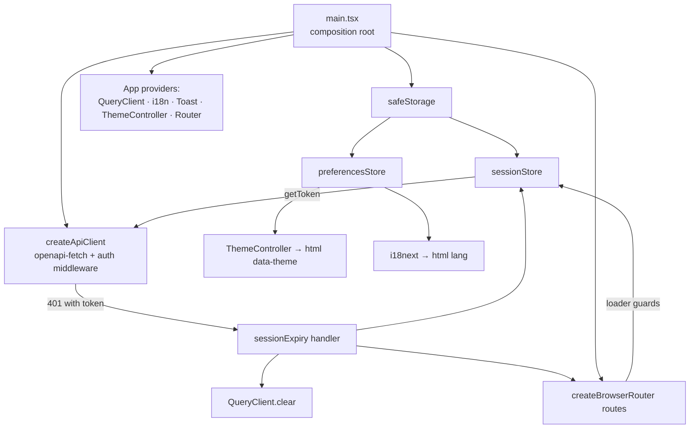

# Foundation Design

**Spec**: `front-end/.specs/features/foundation/spec.md`
**Status**: Approved

---

## Architecture Overview

A Vite SPA with one composition root (`src/main.tsx`). Cross-cutting state (session token, preferences) lives in small framework-free stores over a safe `localStorage` wrapper; React reads them with `useSyncExternalStore`. The typed API client is plain `openapi-fetch` plus one middleware; it knows nothing about React or the router — it reports a session expiry through a callback that the composition root wires to "clear cache + navigate". Route guards are React Router loaders, so a protected page never renders without a token.



### Approaches considered (recommendation first)

| Concern | Chosen | Alternative | Why chosen |
| ------- | ------ | ----------- | ---------- |
| Auth guard | Route **loaders** (`requireSession`, `redirectIfSession`) returning `redirect()` | `<RequireAuth>` wrapper component | Runs before render (no flash of a protected page), testable with `createMemoryRouter`, and screen loaders added later run after the guard |
| Session-expiry detection | `openapi-fetch` **middleware** `onResponse` | TanStack Query `QueryCache`/`MutationCache` `onError` | Covers every call, including ones outside Query; knows whether the request carried a token and which path it hit (FND-14, FND-15) |
| Toasts | Own small `ToastProvider` styled with Púrpura | `sonner` / `react-hot-toast` | Doc §12 fixes exact timings and look; ~80 lines vs a dependency to restyle |

---

## Software Architecture

Foundation builds only `app/`, `pages/` and `shared/`, but it fixes the structure every screen feature (`auth` … `settings`) follows. Recorded as FE-AD-006.

### Layers

```
front-end/src/
├── app/                 composition root, providers, route table, guards
├── pages/               one file per route; reads route/search params and lays out feature components
├── features/<feature>/  one folder per ROADMAP feature (auth, boards, board, card-detail, labels, settings)
│   ├── api/             keys.ts, queries.ts, mutations.ts — the feature's only door to the API
│   ├── model/           Model: framework-free TS — view types, `select` mappers, filters, reorder math
│   ├── view-models/     ViewModel: use-<screen>-view-model.ts (complex screens only)
│   ├── components/      View: feature UI
│   └── index.ts         public API: the only file other layers may import
├── shared/              api, session, preferences, theme, i18n, navigation, storage, config, ui/, lib/
└── styles/

front-end/test/          tests, outside src (FE-AD-007)
├── unit/                mirrors src/: test/unit/<path>/<file>.spec.ts(x)
├── e2e/                 Playwright: <journey>.e2e-spec.ts
└── support/             Vitest setup, renderApp, MSW server and handlers
```

### Modular MVVM

Each feature is a module with a light MVVM split:

- **Model** (`model/`): API data uses the contract types (`Board`, `Card`, …) as is, so there is no parallel domain model and no repository mapping layer. When a screen needs another shape (ISO string → `Date`, sorted by `position`, derived `isOverdue`), a pure function in `model/` does it, applied through `select` in the query options. View types live here too.
- **Repository role** (`api/`): query option factories and mutation hooks are the only code that talks to the API. Components and view-models never call the client directly.
- **ViewModel** (`view-models/use-<screen>-view-model.ts`): a hook that combines queries, mutations, local UI state and handlers, and returns `{ state, actions }` ready to render. Used only for complex screens (`board`, `card-detail`); a simple screen (login, a one-field form) calls feature hooks from its component directly.
- **View** (`components/`): renders `state` and calls `actions`. It holds no fetching and no business rules, so it is tested with plain props.

Dependencies inside a feature point one way: `components → view-models → api → model`, and `components → model` for view types. `model/` imports nothing from the feature.

### Dependency rule

| Layer | May import | Must not import |
| ----- | ---------- | --------------- |
| `app` | `pages`, `features/<f>` (index only), `shared` | — |
| `pages` | `features/<f>` (index only), `shared` | `app`, feature internals (`features/<f>/api/…`) |
| `features/<f>` | its own files, `shared` | another feature, `pages`, `app` |
| `shared` | `shared` | `features`, `pages`, `app` |

- Cross-folder imports use the `@/` alias (`@/shared/api/client`); imports inside one feature are relative.
- Enforced by oxlint `no-restricted-imports` with per-folder overrides in `.oxlintrc.json`: a feature importing another feature, `shared` importing a feature, or a page deep-importing a feature internal fails `lint`. The exact pattern syntax is checked against oxlint 1.89's rule options in T1, not written from memory.
- Two features never talk directly. When a screen needs both (card detail applying board labels), the **page** composes them, passing one feature's component to the other as `children` or a slot prop. A query that two or more features need moves to `shared/api/resources/<resource>.ts`.

### State ownership

| Kind | Lives in | Example |
| ---- | -------- | ------- |
| Server data | TanStack Query cache only, never copied into `useState` or a store (form drafts are the exception) | boards, lists, cards, labels |
| Navigation state | URL path and search params | active/archived tab, board search and filters, open card |
| Local UI state | `useState` / `useReducer` in the component | menu open, inline edit mode, drag preview |
| Global client state | Only `sessionStore` and `preferencesStore` (FE-AD-003) | token, theme, language |

No Redux, Zustand or a context-based global store. State that has to survive reload or be shareable by link goes in the URL.

### Data access inside a feature

- `api/keys.ts`: hierarchical key factory, e.g. `boardKeys.all = ['boards']`, `boardKeys.list(status)`, `boardKeys.detail(id)`, so one `invalidateQueries({ queryKey: boardKeys.all })` covers the whole resource.
- `api/queries.ts`: factories `(api: ApiClient, ...args) => queryOptions({ queryKey, queryFn: () => call(api.GET(...)) })`, used by thin hooks (`useBoards(status)`, which takes `api` from `useApi()`) and by route loaders when a screen prefetches.
- `api/mutations.ts`: one hook per command (`useCreateBoard`, `useMoveCard`), with `onSuccess` invalidating the narrowest key that changed.
- **Optimistic updates** only where the UI must respond instantly: drag and drop, the done toggle, checklist item toggle. Pattern: `onMutate` cancels queries, snapshots and `setQueryData`; `onError` restores the snapshot and shows a toast; `onSettled` invalidates. Every other mutation waits for the server.
- Components never call `api.GET/POST` or `fetch`. They use feature hooks, and errors reach them as `ApiError` (FE-AD-002), checked with `isProblemType`.

### Components

- **`shared/ui/`**: Púrpura primitives (Button, IconButton, TextField, Dialog, Menu, Popover, Tooltip, Tabs, Spinner, EmptyState). Interactive widgets wrap **React Aria Components** (focus management, keyboard, ARIA) and are styled with Tailwind and the tokens. Primitives know no domain types and no i18n keys: text arrives through props. Foundation needs none of them (toasts are custom, per the table above). `react-aria-components` (1.22.1 at Design, peer `react ^19`) is added by the first feature that needs a widget.
- **Feature components** receive contract types (`Board`, `Card`, …) or `model/` view types, and use only their own feature's hooks.
- **Pages** read params, choose the feature components and handle page-level layout. They hold no server state of their own.
- Composition over configuration: compound components and `children`/slot props instead of growing boolean props; a value threaded more than two levels down becomes a feature-scoped context.

### Forms

Controlled inputs with `useState`, no form library. Client-side checks only mirror back-end limits (required, max length) so the user gets feedback before submit; the back-end stays the authority. `ApiError.errors` (`{ field, message }`) maps onto the matching field. The submit button is disabled while the mutation is pending.

### Conventions

- Files kebab-case (`board-card.tsx`), components PascalCase, hooks `use-*.ts`, tests in `test/unit/` mirroring `src/` (`*.spec.ts(x)`, FE-AD-007).
- Named exports only. Lazy routes use `lazy: () => import('…').then((m) => ({ Component: m.BoardsPage }))`.

### Tests per layer

| Layer | Test | Tooling |
| ----- | ---- | ------- |
| `model/` | Pure unit tests, including `select` mappers | Vitest |
| `api/` hooks | Request shape, invalidation, optimistic rollback on error | Vitest + MSW + a `QueryClient` wrapper |
| `view-models/` | `state`/`actions` for each scenario (loading, error, success, after an action) | `renderHook` + MSW + a `QueryClient` wrapper |
| `components/`, `shared/ui/` | Behavior and accessibility (roles, keyboard) with plain props | Testing Library |
| `pages/` | Route params, guards, composition | `renderApp` + memory router + MSW |
| Journeys | One happy path per feature against the real API | Playwright (FE-AD-005) |

---

## Code Reuse Analysis

### Existing Components to Leverage

| Component | Location | How to Use |
| --------- | -------- | ---------- |
| API types (`paths`, `Board`, …) | `packages/api-contract/src/index.ts` | `workspace:*` dependency; `createClient<paths>()` |
| Púrpura tokens | `front-end/design/_ds/*/tokens/*.css` | Copied into `src/styles/tokens/` (design folder stays a reference, never imported) |
| Dark theme + label colors | `front-end/design/Task List.dc.html:24-34` (`[data-theme=dark]` block) | Copied into `src/styles/tokens/dark.css` and `labels.css` |
| Tailwind theme mapping | `front-end/design/Task List.dc.html:38-82` (`@custom-variant dark`, `@theme`, `@theme inline`, `@utility tl-*`) | Copied into `src/styles/app.css`; `tl-*` utilities added only when a screen uses them |
| UI strings PT/EN | `front-end/design/i18n.js` | Keys ported on demand into `src/shared/i18n/locales/{en,pt-BR}.ts` |
| Back-end Dockerfile pattern | `back-end/Dockerfile` | Same base stage, BuildKit cache mounts, `--filter front-end...` |
| CI job pattern | `.github/workflows/ci.yml` `back-end` matrix | Same steps, new `front-end` matrix + `front-end-e2e` job |
| Lint pattern | `back-end/package.json` `lint` (oxlint + prettier) | Same tools, React plugins on |

### Integration Points

| System | Integration Method |
| ------ | ------------------ |
| API | `fetch` to `${VITE_API_URL}/api/v1/...`, `Authorization: Bearer`; CORS already allows `http://localhost:5173` (BE-AD-012, compose) |
| Problem Details (BE-AD-004) | Error bodies `{ type, title, status, detail, instance, requestId, errors? }` (`back-end/src/errors/problem-details.ts:5`); the contract does not type error bodies, so the front-end owns `ProblemDetails` |
| pnpm workspace (GL-AD-001) | Add `front-end` to `pnpm-workspace.yaml`; one lockfile |
| Root compose (GL-AD-003) | New `web` service, `depends_on: api` |
| CI (GL-AD-004) | New jobs; `protect-main` required checks updated after merge (manual, GitHub UI) |

---

## Components

All paths under `front-end/`.

### safeStorage
- **Purpose**: `localStorage` access that never throws (FND-37).
- **Location**: `src/shared/storage/safe-storage.ts`
- **Interfaces**:
  - `createSafeStorage(getBackend?: () => Storage): SafeStorage` — probes the backend once; on any throw falls back to an in-memory `Map`.
  - `SafeStorage = { get(key): string | null; set(key, value): void; remove(key): void }`
- **Dependencies**: none

### sessionStore
- **Purpose**: Holds the JWT and notifies subscribers.
- **Location**: `src/shared/session/session-store.ts`
- **Interfaces**:
  - `createSessionStore(storage: SafeStorage): SessionStore` — key `my-trello.token`.
  - `SessionStore = { getToken(): string | null; setToken(t: string): void; clear(): void; subscribe(fn): () => void }`
  - `useHasSession(store): boolean` (hook, `useSyncExternalStore`)
- **Dependencies**: safeStorage

### sessionExpiry
- **Purpose**: One-shot reaction to an expired token (FND-14, FND-36, FND-38).
- **Location**: `src/shared/session/session-expiry.ts`
- **Interfaces**:
  - `createSessionExpiryHandler(deps: { session: SessionStore; clearCache(): void; navigate(to: string): void; currentLocation(): { pathname: string; search: string } }): () => void`
  - Behavior: if the session has no token (already expired by a parallel 401) → no-op. Otherwise `session.clear()`, `clearCache()`, then: on `/login` or `/signup` keep the existing `redirect` param and only set `reason=session-expired`; elsewhere navigate to `/login?redirect=<encodeURIComponent(pathname+search)>&reason=session-expired`.
- **Dependencies**: sessionStore

### apiClient
- **Purpose**: Typed HTTP client with auth header and expiry detection (FND-11–FND-15).
- **Location**: `src/shared/api/client.ts`
- **Interfaces**:
  - `createApiClient(opts: { baseUrl: string; getToken(): string | null; onSessionExpired(): void; fetch?: typeof fetch }): ApiClient` — `ApiClient = ReturnType<typeof createClient<paths>>`.
  - Middleware `onRequest`: sets `Authorization` only when `getToken()` is non-null, and marks the request as authenticated.
  - Middleware `onResponse`: `status === 401` AND request was authenticated AND path not in `PUBLIC_AUTH_PATHS` (`/api/v1/auth/login`, `/api/v1/auth/register`) → `onSessionExpired()`. The response passes through unchanged either way.
- **Dependencies**: `openapi-fetch`, `@my-trello/api-contract`

### ApiError + `call`
- **Purpose**: One typed error for every failure (FND-17, FND-18).
- **Location**: `src/shared/api/api-error.ts`
- **Interfaces**:
  - `class ApiError extends Error { status: number; type: string; title: string; detail: string; errors?: FieldError[]; requestId?: string }`
  - `call<T>(request: Promise<{ data?: T; error?: unknown; response: Response }>): Promise<T>` — resolves `data`; on HTTP error builds `ApiError` from the body when it is Problem Details (has string `type` and numeric `status`), else `{ status: response.status, type: 'about:blank', title: response.statusText }`; on a rejected `fetch` builds `{ status: 0, type: 'about:blank', title: 'Network error' }`.
  - `isProblemType(err, type: string): boolean` — e.g. `isProblemType(e, '/problems/invalid-credentials')`.
- **Dependencies**: none

### queryClient
- **Purpose**: App-wide TanStack Query client (FND-19).
- **Location**: `src/shared/api/query-client.ts`
- **Interfaces**: `createQueryClient(): QueryClient` — queries `retry: (n, e) => !(e instanceof ApiError && e.status >= 400 && e.status < 500) && n < 3`; mutations `retry: false`.

### preferencesStore
- **Purpose**: Theme and language with validation and defaults (FND-23–FND-25, FND-27).
- **Location**: `src/shared/preferences/preferences-store.ts`
- **Interfaces**:
  - `type Theme = 'light' | 'dark' | 'system'`, `type Language = 'en' | 'pt-BR'`
  - `parseTheme(v: string | null): Theme` (invalid → `system`), `parseLanguage(v: string | null): Language` (invalid → `en`)
  - `createPreferencesStore(storage): { get(): Preferences; setTheme(t); setLanguage(l); subscribe(fn) }` — keys `my-trello.theme`, `my-trello.language`.
  - `usePreferences(store)` hook.

### ThemeController
- **Purpose**: Applies the resolved theme to `<html data-theme>` (FND-21, FND-22).
- **Location**: `src/shared/theme/theme-controller.tsx`
- **Interfaces**: `resolveTheme(pref: Theme, prefersDark: boolean): 'light' | 'dark'`; `<ThemeController store={prefs} />` renders nothing, subscribes to `matchMedia('(prefers-color-scheme: dark)')` change events only while `system`.

### i18n
- **Purpose**: PT-BR/EN strings, `<html lang>` (FND-24, FND-26, FND-28).
- **Location**: `src/shared/i18n/` — `i18n.ts`, `locales/en.ts`, `locales/pt-BR.ts`, `i18next.d.ts`
- **Interfaces**:
  - `en.ts` is the source shape (`as const`); `pt-BR.ts` is declared `satisfies Translation` (`DeepStringRecord<typeof en>`), so a missing PT key fails `tsc`; a unit test compares the flattened key sets of both, so an extra/missing key fails `test` too.
  - `createI18n(language: Language): i18n` (`react-i18next`, `fallbackLng: 'en'`); `<LanguageController>` calls `changeLanguage` and sets `document.documentElement.lang` on store change.
  - `CustomTypeOptions` in `i18next.d.ts` types `t('key')` against `en`.

### Toasts
- **Purpose**: Notices per doc §12 (FND-29–FND-31).
- **Location**: `src/shared/ui/toast/` — `toast-provider.tsx`, `use-toast.ts`
- **Interfaces**: `useToast(): { show(t: { message: string; action?: { label: string; onClick(): void } }): void }`; `<ToastProvider>` renders a fixed bottom-center `role="status"` `aria-live="polite"` region; durations `TOAST_MS = 3000`, `TOAST_WITH_ACTION_MS = 7000`.

### Router and pages
- **Purpose**: Route table, guards, placeholders (FND-05–FND-10, FND-16).
- **Location**: `src/app/routes.tsx`, `src/app/guards.ts`, `src/shared/navigation/safe-redirect.ts`, `src/pages/`
- **Interfaces**:
  - `createRoutes(deps: { session: SessionStore }): RouteObject[]` — consumed by `createBrowserRouter` (app) and `createMemoryRouter` (tests).
  - `requireSession(session)` loader → `redirect('/login?redirect=' + encodeURIComponent(pathname + search))` when no token; `redirectIfSession(session)` → `redirect('/boards')`.
  - `safeRedirect(value: string | null): string` — accepts only values starting with `/` and not `//` or `/\`; else `/boards`.
  - Pages: `PlaceholderPage({ titleKey })` for every route; `LoginPlaceholderPage` also shows the `sessionExpired` notice when `reason=session-expired` (kept by feature `auth`); `NotFoundPage` with a link to `/boards`.

### Config
- **Location**: `src/shared/config.ts`
- **Interfaces**: `resolveApiOrigin(env: { VITE_API_URL?: string }): string` → trimmed value without trailing `/`, or `http://localhost:3000` (FND-04).

### Composition root
- **Location**: `src/main.tsx`, `src/app/app.tsx`
- **Wiring**: storage → session + prefs → queryClient → router (`createBrowserRouter(createRoutes(...))`) → expiry handler (`navigate: router.navigate`, `currentLocation: () => router.state.location`) → apiClient (exported through `ApiProvider` context with `useApi()`) → `<App>`.

### Styles
- **Location**: `src/styles/app.css` (`@import "tailwindcss"`, `@custom-variant dark`, `@theme` maps), `src/styles/tokens/*.css`
- **Fonts**: self-hosted `@fontsource-variable/{outfit,onest,jetbrains-mono}` instead of the Google Fonts `@import` in `tokens/fonts.css` (no third-party request; works offline in Docker).

### Test infrastructure
- `vitest` config inside `vite.config.ts` (`environment: 'jsdom'`, `include: ['test/unit/**/*.spec.{ts,tsx}']`, `setupFiles: ['test/support/setup.ts']`).
- `test/support/setup.ts`: `@testing-library/jest-dom/vitest`, MSW `setupServer` started with unhandled requests as errors, `localStorage.clear()` between tests.
- `test/support/render-app.tsx`: `renderApp({ route, token?, prefs? })` builds the real providers around `createMemoryRouter(createRoutes(...))`, returns `{ router, session, user }`.
- `test/support/msw/handlers.ts`: typed helpers built on the contract paths.
- `test/e2e/` + `playwright.config.ts`: `webServer` = [`docker compose up --wait postgres api` (reused if `http://localhost:3000/api/v1/health` answers), `vite preview --port 5173 --strictPort`]; Chromium only.

### Docker
- `front-end/Dockerfile`: `base` (node 24.17.0-alpine, corepack, workspace manifests incl. `packages/api-contract`) → `build` (`pnpm install --filter front-end...`, `ARG VITE_API_URL=http://localhost:3000`, `pnpm --filter front-end build`) → `runtime` `nginxinc/nginx-unprivileged:1.31.7-alpine` serving `dist/` on `8080` (non-root) with `front-end/nginx.conf` (`try_files $uri /index.html`, FND-02).
- Compose: `web` service, `ports: "5173:8080"`, `depends_on: api`.

### CI
- `front-end` matrix job: `script: [lint, typecheck, test, build]`, `fail-fast: false`, check names `front-end (lint)` etc.
- `front-end-e2e` job named `front-end (test:e2e)`: install, `pnpm --filter front-end exec playwright install --with-deps chromium`, `pnpm --filter front-end run test:e2e` (compose on the runner's Docker).

---

## Data Models

```typescript
// src/shared/api/api-error.ts — mirrors back-end/src/errors/problem-details.ts
type FieldError = { field: string; message: string };
type ProblemDetails = {
  type: string; title: string; status: number; detail: string;
  instance: string; requestId: string; errors?: FieldError[];
};

// src/shared/preferences/preferences-store.ts
type Preferences = { theme: Theme; language: Language };
```

Storage keys: `my-trello.token`, `my-trello.theme`, `my-trello.language`.

---

## Error Handling Strategy

| Error Scenario | Handling | User Impact |
| -------------- | -------- | ----------- |
| `401` on an authenticated call | middleware → expiry handler (once) | Sent to `/login` with "Sua sessão expirou…", returns to the same screen after login |
| `401` on login/register | passes through as `ApiError` | Feature `auth` shows "E-mail ou senha inválidos" |
| `4xx` Problem Details | `call` throws typed `ApiError`; Query does not retry | Screen feature decides the message |
| `5xx` / non-Problem body | `ApiError` with HTTP status, `about:blank`; Query retries up to 3 | Screen shows "Não foi possível carregar" (later features) |
| Network failure | `ApiError` `status: 0` | Same as above |
| `localStorage` throws | memory fallback | Works for the tab; nothing persists |
| Unknown route | `*` route → `NotFoundPage` | "Page not found" + link to My boards |

---

## Risks & Concerns

| Concern | Location (file:line) | Impact | Mitigation |
| ------- | -------------------- | ------ | ---------- |
| Error responses are untyped in the contract (`content?: never`) | `packages/api-contract/src/schema.d.ts:680` | `openapi-fetch` types `error` as `never`; drift between BE and FE error shape goes unnoticed | FE owns `ProblemDetails` mirroring `back-end/src/errors/problem-details.ts:5`; `call` validates the shape at runtime. Typing errors in the OpenAPI doc is a back-end follow-up, not this feature |
| Token in `localStorage` is readable by injected script (XSS) | `src/shared/session/session-store.ts` | Token theft if XSS lands | React escapes text; no `dangerouslySetInnerHTML`; nginx sends a CSP (`default-src 'self'; connect-src 'self' <api origin>`); token expires in 1 h (BE `JWT_EXPIRES_IN`) |
| Open redirect through `?redirect=` | `src/shared/navigation/safe-redirect.ts` | Phishing via crafted login link | `safeRedirect` rejects `//`, `/\`, absolute URLs and empty values; unit tests per case |
| Major versions new to the codebase (React Router 8, Vitest 5, MSW 3, Vite 8) | `front-end/package.json` | APIs from older docs may not apply (e.g. MSW 3 renamed `onUnhandledRequest` → `onUnhandledFrame`; Vitest 5 no longer reads parent configs) | Each task verifies the API against the installed package's own docs/types before use; no API is written from memory |
| `VITE_API_URL` is baked at build time | `front-end/Dockerfile` | A different API origin needs a rebuild | Acceptable: no public deploy (Out of Scope); documented in the README |
| Playwright `webServer` drives `docker compose` | `front-end/playwright.config.ts` | Slow first run (image build), compose left running if the process is killed | `reuseExistingServer: true` against the health URL; 180 s timeout; README says how to stop it |
| New CI checks are not required on `main` until the ruleset is updated | `protect-main` ruleset (GitHub) | A red front-end job would not block merge | Manual ruleset update listed in the PR description after the first green run |

---

## Tech Decisions (only non-obvious ones)

| Decision | Choice | Rationale |
| -------- | ------ | --------- |
| TypeScript version | `~6.0.3` (not 7.0) | Aligned with back-end and api-contract (GL-AD-001 shared tooling); `react-i18next` peer accepts ^6 |
| Library versions (at Design, 2026-10-22) | react/react-dom 19.3.1, vite 8.3.5, @vitejs/plugin-react 6.1.2, react-router 8.5.0, tailwindcss + @tailwindcss/vite 4.3.3, @tanstack/react-query 5.104.5, openapi-fetch 0.17.0, i18next 26.5.5, react-i18next 17.1.1, vitest 5.0.5, @testing-library/react 16.3.3, @testing-library/dom 10.4.2, @testing-library/user-event 14.6.8, @testing-library/jest-dom 7.0.1, msw 3.0.3, @playwright/test 1.64.1, jsdom 30.1.3, oxlint 1.89.0, prettier 3.9.10 | Latest stable on npm; peer ranges checked (`plugin-react` needs vite ^8; `react-router` needs node ≥22.22, repo pins 24.17.0) |
| Folder layout | `src/app`, `src/pages`, `src/features/<feature>`, `src/shared` with a lint-enforced dependency rule | See Software Architecture (FE-AD-006) |
| Lint | oxlint (`react`, `react-hooks`, `jsx-a11y` plugins) + prettier, same as back-end | One lint toolchain in the repo |
| Docker runtime | `nginx-unprivileged` on 8080, host 5173 | Non-root container; one CORS origin for dev and Docker |

> Project-level decisions are recorded in `front-end/.specs/STATE.md` as FE-AD-001…FE-AD-007.
