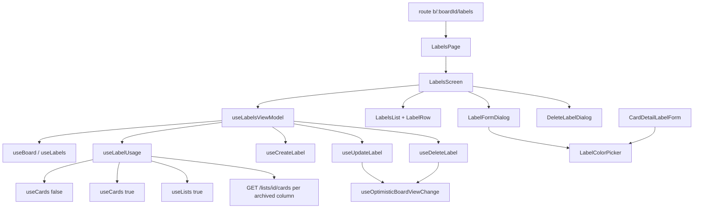

# Labels Design

**Spec**: `front-end/.specs/features/labels/spec.md`
**Status**: Approved

Conforms to FE-AD-004 (i18n), FE-AD-005/007 (tests), FE-AD-006 (layers), FE-AD-009/010 (optimistic changes with per-item revert), FE-AD-013 (the files live in `features/board`; the scope line of FE-AD-013 gains `labels`). No decision is superseded.

---

## Architecture Overview

The page is one screen in `features/board`, composed by a thin page under `pages/`. A view-model owns the data, the dialog state and the three write flows; the Views get plain props. Reads reuse the board's queries; usage counts come from three card sources merged in `api/`. Create reuses `useCreateLabel`; edit and delete are new optimistic hooks on the shared pipeline.

Approaches considered (all deliver the same scope):

- **A (chosen): one view-model, usage counted in an `api/` hook that composes the existing card queries.** Reuses every cache key, so a board visit after the page shows fresh data after the settle refetch.
- B: add `cardCount` to the API label. Rejected by the user (back-end change).
- C: count inside the view-model from raw queries. Mixes data fetching into the view-model and breaks the FE-AD-006 split (`api/` is the only code that calls the API).



---

## Code Reuse Analysis

### Existing Components to Leverage

| Component | Location | How to Use |
| --------- | -------- | ---------- |
| `useBoard`, `useLabels`, `useLists`, `useCards` | `features/board/api/queries.ts` | Same cache keys as the board screen |
| `boardViewKeys.listCards` | `features/board/api/keys.ts` | Key of the per-column active cards, shared with `useArchivedListCounts` |
| `useCreateLabel` | `features/board/api/label-mutations.ts` | Create as is (not optimistic, appends then refetches) |
| `useOptimisticBoardViewChange`, `fieldsPatch`, `inList`, `removal`, `usePendingItemIds` | `features/board/api/mutations.ts` | Edit and delete patches; pending ids block a second change per row |
| `validateLabelName`, `isLabelNameTaken`, `LABEL_COLORS`, `DEFAULT_LABEL_COLOR` | `features/board/model/labels.ts` | Validation and palette; edit passes the other labels only |
| `LabelChip`, `LABEL_CLASSES` | `features/board/components/label-chip.tsx` | Row chip, preview chip, color dots |
| `CardDetailLabelForm` radio group | `features/board/components/card-detail-label-form.tsx` | Extracted into `LabelColorPicker`, used by both forms |
| `Dialog`, `TextField`, `Button`, `LoadError` | `shared/ui/` | Modal shells, name field, buttons, load error |
| `DeleteColumnDialog` | `features/board/components/delete-column-dialog.tsx` | Pattern for the confirm dialog (`alertdialog`, danger button) |
| `BoardNotFound`, `BoardBreadcrumb` | `features/board/components/` | Not-found screen; breadcrumb gains a third crumb |
| `useSaveFailureNotifier` | `shared/ui/toast/use-save-failure-notifier.ts` | `runChange` for toasts and retry; reload refetches the board view |

### Integration Points

| System | Integration Method |
| ------ | ------------------ |
| `POST /boards/{boardId}/labels`, `PATCH /labels/{id}`, `DELETE /labels/{id}` | Typed `openapi-fetch` client through `call()` |
| `GET /boards/{boardId}/cards[?archived=true]`, `GET /boards/{boardId}/lists?archived=true`, `GET /lists/{listId}/cards` | Same hooks and keys as the board; no new endpoint |
| Router | Route `b/:boardId/labels` swaps `PlaceholderPage` for `LabelsPage` |
| Header menu | Entry **Etiquetas do quadro** already links to the route (`board-header.tsx`); no change |

---

## Components

### `model/label-usage.ts`

- **Purpose**: Pure helpers for usage counts, usage text kind and edit diffs.
- **Interfaces**:
  - `countLabelUsage(sources: Card[][]): Map<string, number>` - cards counted once per label id across all sources.
  - `usageText(count: number): { key: 'unused' | 'one' | 'many'; count: number }` - picks the i18n form (FLP-03).
  - `labelChanges(label: Label, name: string, color: Label['color']): UpdateLabelDto | null` - only changed fields, trimmed name; `null` when nothing changed (FLP-21).
  - `withoutLabel(labels: Label[], id: string): Label[]`.
- **Dependencies**: `Label`, `Card` types.
- **Reuses**: `model/labels.ts` types and palette.

### `api/label-usage.ts` - `useLabelUsage(boardId)`

- **Purpose**: Merge the three card sources into usage counts.
- **Interfaces**: `useLabelUsage(boardId): { counts: Map<string, number> | undefined; isLoading: boolean; isError: boolean; refetch: () => void }`.
- **Dependencies**: `useCards(boardId, false)`, `useCards(boardId, true)`, `useLists(boardId, true)`, `useQueries` for `GET /lists/{listId}/cards` of each archived column under `boardViewKeys.listCards`.
- **Reuses**: the key and request of `useArchivedListCounts` (`archived-counts.ts`), so both share one cached response per column. `counts` is `undefined` until every source has data.

### `api/label-mutations.ts` - `useUpdateLabel(boardId)`, `useDeleteLabel(boardId)`

- **Purpose**: Optimistic edit and delete of a label.
- **Interfaces**:
  - `UpdateLabelVariables = ItemVariables & { body: UpdateLabelDto }`; patches `boardViewKeys.labels(boardId)` with `inList(id, fieldsPatch(body))`; `PATCH /api/v1/labels/{id}`.
  - `useDeleteLabel`: `ItemVariables`; `removal<Label>` on `labels(boardId)` and, on `cards(boardId, false)` and `cards(boardId, true)`, a per-card patch that drops the id from `labelIds` and, on revert, puts it back only on the cards that had it (the `changed` flag pattern of `labelIdsPatch`); `DELETE /api/v1/labels/{id}`.
- **Dependencies**: `useOptimisticBoardViewChange` (cancels board queries, applies patches, reverts only this change, refetches once when the last change settles - FE-AD-010).
- **Reuses**: `fieldsPatch`, `inList`, `removal`, `withoutLabelId`.

### `view-models/use-labels-view-model.ts`

- **Purpose**: State and actions of the labels screen.
- **Interfaces** (`{ state, actions }`):
  - `state.status: 'loading' | 'ready' | 'error' | 'notFound'`; `state.board`; `state.readOnly`; `state.rows: { label, usage: ReturnType<typeof usageText>, isPending }[]`; `state.form: { mode: 'create' | 'edit'; id?: string; name; color; error: ItemFieldError | null; isSubmitting } | null`; `state.confirmDelete: { label; count } | null`.
  - `actions`: `retry()`, `openCreate()`, `openEdit(id)`, `closeForm()`, `setName(name)`, `setColor(color)`, `submit()`, `openDelete(id)`, `closeDelete()`, `confirmDelete()`.
- **Dependencies**: queries above, `useCreateLabel`, `useUpdateLabel`, `useDeleteLabel`, `usePendingItemIds`, `useSaveFailureNotifier`, `useToast`.
- **Reuses**: `validateLabelName` (edit passes `labels` without the label being edited, FLP-19), `isLabelNameTaken` (FLP-30), the failure mapping of `use-card-labels-view-model.ts` (`saveFailureKind`).
- **Failure rules**: create failure keeps the form (`runChange` is not used for create; the form owns the retry message path as in `useCardLabelsViewModel`); edit and delete use `runChange` with `null`-free success messages `labelSaved` and `labelDeleted`. A `409 label-name-taken` on edit reopens the form with the text and the error, after the optimistic revert.

### Views in `components/`

| Component | File | Purpose |
| --------- | ---- | ------- |
| `LabelColorPicker` | `label-color-picker.tsx` | `RadioGroup` "Cor" of the 10 swatches, extracted from `CardDetailLabelForm` (FLP-10, FLP-11) |
| `LabelFormDialog` | `label-form-dialog.tsx` | Modal create/edit form: name field, picker, color name, preview chip, **Cancelar** + primary (FLP-10–FLP-14, FLP-17, FLP-18) |
| `DeleteLabelDialog` | `delete-label-dialog.tsx` | `alertdialog` with the count text (FLP-23, FLP-26) |
| `LabelRow` / `LabelsList` | `label-row.tsx`, `labels-list.tsx` | Chip, usage text, **Editar** / **Excluir** icon buttons, disabled while pending (FLP-02, FLP-22) |
| `LabelsEmpty`, `LabelsSkeleton` | `labels-empty.tsx`, `labels-skeleton.tsx` | Empty state and loading rows (FLP-04, FLP-05) |
| `LabelsScreen` | `labels-screen.tsx` | Header (back arrow on phone, heading, subtitle, **Nova etiqueta**), read-only notice, states, dialogs (FLP-01, FLP-06, FLP-07, FLP-09, FLP-27, FLP-36) |

`LabelsPage` (`pages/labels-page.tsx`) reads `boardId`, renders `LabelsScreen` in the same container as `BoardPage`, keyed by board. `index.ts` exports `LabelsScreen`.

`BoardBreadcrumb` takes `section?: 'labels'`: with it the board title becomes a link to `/b/{boardId}` and a third crumb "Etiquetas" carries `aria-current="page"` (FLP-09). `ProtectedLayout` passes it when `useMatch('/b/:boardId/labels')` matches.

---

## Data Models

```typescript
// Contract types, no new model (FE-AD-006). Added aliases in model/types.ts:
type UpdateLabelDto = Schemas['UpdateLabelDto']; // { name?: string; color?: LabelColor }
type CreateLabelDto = Schemas['CreateLabelDto']; // exists

type LabelUsage = { key: 'unused' | 'one' | 'many'; count: number };
```

Counts are derived per render from the cached card lists; nothing is stored.

---

## i18n

New keys, same commit as the UI that uses them, in `en.ts` and `pt-BR.ts` (texts from `design/i18n.js`):

- `board.labelsPage.*`: `title`, `subtitle`, `newLabel`, `editLabel`, `used.unused|one|many`, `emptyTitle`, `emptyDetail`, `edit` ("Editar etiqueta {{name}}"), `delete` ("Excluir etiqueta {{name}}"), `form.create`, `form.save`, `form.cancel`, `form.name`, `form.namePlaceholder`, `form.color`, `form.colorName`, `deleteTitle`, `delete.textNone|textOne|textMany`, `delete.cancel`, `delete.confirm`, `back`.
- `board.toast.labelSaved`, `board.toast.labelDeleted`; `labelCreated` exists.
- `board.breadcrumbLabels` ("Etiquetas"); the read-only notice reuses `board.cardDetail.boardArchivedNotice`.

---

## Error Handling Strategy

| Error Scenario | Handling | User Impact |
| -------------- | -------- | ----------- |
| Network/`5xx` on edit or delete | Revert only this change (FE-AD-010); `runChange` toast with **Tentar novamente** | Row returns; retry repeats the request |
| Network/`5xx` on create | Form kept; toast with **Tentar novamente** | Dialog stays with the text |
| `409 label-name-taken` on create/edit | Field error, refetch labels; edit also reverts the row and reopens the form | Message under the name field |
| `409 board-archived` | Revert; conflict toast with **Recarregar** (refetches the board view) | Page turns read-only after reload |
| `404` on edit/delete | Revert; save-fail toast; refetch labels and cards | Label deleted elsewhere leaves the list |
| Load failure of any read | `LoadError` with **Tentar novamente** (refetch of the failed queries) | Block replaces the list |
| Board missing/foreign/malformed id | `BoardNotFound` | Existing screen |

---

## Risks & Concerns

| Concern | Location (file:line) | Impact | Mitigation |
| ------- | -------------------- | ------ | ---------- |
| The count needs one extra request per archived column (N+1) | `api/label-usage.ts` (new) | A board with many archived columns loads more requests before the list shows | Personal scale (no limits but few archived columns); responses share the cache with the board's archived counts; the list waits for all sources so the number is never wrong. Accepted trade-off. |
| The count is a snapshot: a card changed on another device shows after the next refetch | `api/label-usage.ts` (new) | Delete dialog may say 2 where the server removes 3 | Same staleness as every other screen (FE-AD-009 settle refetch, window-focus refetch); the dialog text says what the screen knows. Covered by FLP-32 and FLP-37. |
| A failed delete could restore a label over a card patch already reverted | `api/label-mutations.ts` (new) | Card `labelIds` and the label list disagree until the settle refetch | Per-card `changed` flag as in `labelIdsPatch`; revert tests cover an overlapping toggle. |
| Extracting the color radios touches the shipped popover form | `card-detail-label-form.tsx:76` | Regression in the card popover | Extraction is its own refactor task; `card-detail-label-form` and popover specs run unchanged. |
| `useOptimisticBoardViewChange` cancels every board query on mutate | `api/mutations.ts:395` | The usage sources refetch after each change | Intended: the settle refetch refreshes counts after a delete. |

---

## Tech Decisions (only non-obvious ones)

| Decision | Choice | Rationale |
| -------- | ------ | --------- |
| Usage count source | Three card sources merged in `useLabelUsage` | The board's active card call hides cards of archived columns (verified in `CardsRepository.listInBoard`); skipping them would under-count the delete warning |
| Card detail and filter caches on delete | Not patched; the settle refetch refreshes them | Neither is mounted on this route, and the filter state resets with the board screen |
| Edit without change | No request, no toast | Back-end `{}` is a no-op; avoids noise (spec assumption) |
| Where the color radios live | Extracted to `LabelColorPicker` | Two forms need the same group; copying it would double the a11y tests |
