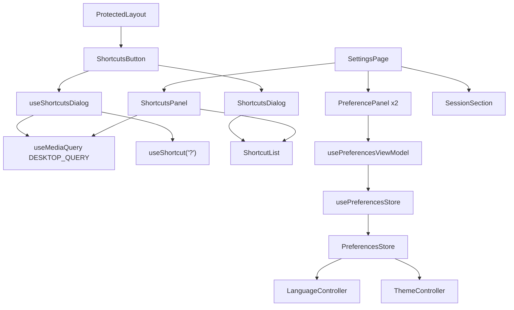

# Settings Design

**Spec**: `front-end/.specs/features/settings/spec.md`
**Status**: Approved

Conforms to FE-AD-003 (preferences in `localStorage` behind `SafeStorage`), FE-AD-004 (i18n and tokens), FE-AD-005/007 (tests), FE-AD-006 (layers: `app` → `pages` → `features/<feature>` → `shared`, no imports between features), FE-AD-008 (`lucide-react` icons by name), FE-AD-011 (`useShortcut` guards). No decision is superseded.

---

## Architecture Overview

Almost everything the screen needs exists: the store, the two controllers, `SegmentedTabs`, `Dialog`, `useShortcut`, `SessionSection`. Three gaps stand in the way:

1. No React context exposes the `PreferencesStore` to components (only the two controllers receive it as a prop). A `PreferencesProvider` + `usePreferencesStore()` in `shared/preferences/`, the twin of `SessionProvider`, closes it.
2. No shared "is this a desktop viewport" hook. The board calls `matchMedia('(min-width: 48rem)')` inline. A `useMediaQuery` hook in `shared/responsive/` plus a `DESKTOP_QUERY` constant gives the settings feature a reactive answer (it must close the dialog on resize, FSET-22).
3. The shared `Dialog` does not mark itself `aria-modal`. `useShortcut` ignores keys while `[aria-modal="true"]` exists, and only the card detail sets that attribute by hand (`card-detail.tsx:56`). Without the attribute, `?` would open the shortcuts dialog on top of any other dialog, and `n` and `/` would fire under the shortcuts dialog. The shared `Dialog` renders its section with `aria-modal="true"` the same way the card detail does.

A new `features/settings` module owns the panels, the dialog and the top-bar button. `pages/settings-page.tsx` composes the panels with `SessionSection` from `features/auth`; `ProtectedLayout` renders the button. The button also owns the `?` hook, so it lives on every protected screen without a second mount point.

Approaches considered (all deliver the same scope):

- **A (chosen): `features/settings` + a provider and a media hook in `shared/`.** Small, follows the existing pattern of `SessionProvider`, and each helper is reusable by later features.
- B: read the store from `services` through a prop drilled by the router. Rejected: routes are plain objects, the store would have to travel through `pages/`.
- C: put the shortcuts dialog in `features/board`. Rejected: the dialog must work on `/boards`, `/settings` and `/labels`, and FE-AD-006 forbids `pages/` and the layout from depending on a feature for something that is not its own.



---

## Code Reuse Analysis

### Existing Components to Leverage

| Component | Location | How to Use |
| --------- | -------- | ---------- |
| `createPreferencesStore`, `usePreferences`, `parseTheme`, `parseLanguage` | `src/shared/preferences/preferences-store.ts` | The panels read and write through it; fallback for unknown values already lives here (FSET-24) |
| `LanguageController`, `ThemeController` | `src/shared/i18n/language-controller.tsx`, `src/shared/theme/theme-controller.tsx` | Unchanged: react to the store, set `lang` / `data-theme`, follow the device for `system` (FSET-03, 06, 08) |
| `SafeStorage` memory fallback | `src/shared/storage/safe-storage.ts` | Unchanged: covers FSET-10 |
| `SegmentedTabs` | `src/shared/ui/tabs.tsx` | Both controls |
| `Dialog` | `src/shared/ui/dialog.tsx` | The shortcuts dialog; gains `aria-modal` (T1) |
| `Button` | `src/shared/ui/button.tsx` | **Fechar** |
| `useShortcut` | `src/shared/keyboard/use-shortcut.ts` | `?`, with its guards (FSET-18) |
| `SessionProvider` / `useSession` | `src/shared/session/session-context.tsx` | Template for `PreferencesProvider` |
| `SessionSection` | `src/features/auth` | Rendered last by the page, unchanged |
| `ProtectedLayout` icon link | `src/pages/protected-layout.tsx` | Same classes for the keyboard icon |
| `renderApp`, `server` (MSW), theme-controller `mockDevice` | `test/support/`, `test/unit/shared/theme/` | Test setup; `mockDevice` shape is the model for the viewport helper |

### Integration Points

| System | Integration Method |
| ------ | ------------------ |
| `app.tsx` | Wraps the tree in `PreferencesProvider store={preferences}` next to `SessionProvider` |
| `ProtectedLayout` | Renders `<ShortcutsButton />` before the Settings link |
| i18n | New keys under `settings.language.*`, `settings.theme.*`, `settings.shortcuts.*` and `nav.shortcuts`, in `en.ts` and `pt-BR.ts` (the parity test in `locales.spec.ts` guards them) |
| API | None; no request is added |

---

## Components

### PreferencesProvider / usePreferencesStore

- **Purpose**: Expose the `PreferencesStore` to components.
- **Location**: `src/shared/preferences/preferences-context.tsx`
- **Interfaces**:
  - `PreferencesProvider({ store, children })`
  - `usePreferencesStore(): PreferencesStore` - throws outside the provider, like `useSession`
- **Dependencies**: `PreferencesStore`
- **Reuses**: `session-context.tsx` shape

### useMediaQuery / DESKTOP_QUERY

- **Purpose**: A reactive `matchMedia` answer for the viewport.
- **Location**: `src/shared/responsive/use-media-query.ts`
- **Interfaces**:
  - `DESKTOP_QUERY = '(min-width: 48rem)'`
  - `useMediaQuery(query: string): boolean` - `useSyncExternalStore` over `matchMedia(query)` with a `change` listener
- **Dependencies**: `window.matchMedia`
- **Reuses**: the query string the board already uses (`SIDE_BY_SIDE`); the board file is not touched in this feature

### Shortcut rows

- **Purpose**: One source for the five rows used by the panel and the dialog.
- **Location**: `src/features/settings/model/shortcuts.ts`
- **Interfaces**:
  - `SHORTCUTS: readonly { id: 'new' | 'search' | 'escape' | 'move' | 'help'; keyLabel: string | { i18nKey: string } }[]` - keys `N`, `/`, `Esc`, `?` are literal; the move key is translated (`Space` / `Espaço`)
- **Dependencies**: none (framework-free)

### usePreferencesViewModel

- **Purpose**: Current language and theme plus their setters, for the two panels.
- **Location**: `src/features/settings/view-models/use-preferences-view-model.ts`
- **Interfaces**:
  - `usePreferencesViewModel(): { language: Language; theme: Theme; setLanguage(l: Language): void; setTheme(t: Theme): void }`
- **Dependencies**: `usePreferencesStore`, `usePreferences`

### PreferencePanel

- **Purpose**: A titled panel with a `SegmentedTabs` and an optional subtitle; used for Idioma and Tema.
- **Location**: `src/features/settings/components/preference-panel.tsx`
- **Interfaces**:
  - `PreferencePanel({ title, subtitle?, options, selected, onChange })`
- **Dependencies**: `SegmentedTabs`
- **Reuses**: panel classes of `SessionSection` (`rounded-lg border border-border-subtle bg-surface-card px-4.5 py-4`)

### ShortcutList / ShortcutsPanel

- **Purpose**: `ShortcutList` renders the five rows (`kbd` + text); `ShortcutsPanel` is the settings panel around it and renders nothing below 48rem.
- **Location**: `src/features/settings/components/shortcut-list.tsx`, `shortcuts-panel.tsx`
- **Interfaces**:
  - `ShortcutList()` - no props, reads `SHORTCUTS` and `useTranslation`
  - `ShortcutsPanel()` - returns `null` when `!useMediaQuery(DESKTOP_QUERY)`
- **Dependencies**: `SHORTCUTS`, `useMediaQuery`

### useShortcutsDialog

- **Purpose**: Open state of the dialog, the `?` shortcut and the desktop gate.
- **Location**: `src/features/settings/view-models/use-shortcuts-dialog.ts`
- **Interfaces**:
  - `useShortcutsDialog(): { isDesktop: boolean; isOpen: boolean; open(): void; close(): void }`
  - `?` is registered with `useShortcut('?', open, { enabled: isDesktop })`; an effect closes the dialog when `isDesktop` turns false
- **Dependencies**: `useShortcut`, `useMediaQuery`

### ShortcutsDialog / ShortcutsButton

- **Purpose**: `ShortcutsDialog` is the View (`Dialog` titled **Atalhos de teclado**, `ShortcutList`, the hint line, **Fechar**); `ShortcutsButton` is the icon button (`Keyboard` icon) that renders the dialog and calls `useShortcutsDialog`. It renders nothing visible below 48rem but keeps no `?` listener (the hook gates it).
- **Location**: `src/features/settings/components/shortcuts-dialog.tsx`, `shortcuts-button.tsx`
- **Interfaces**:
  - `ShortcutsDialog({ isOpen, onClose })`
  - `ShortcutsButton()` - no props
- **Dependencies**: `Dialog`, `Button`, `ShortcutList`, `useShortcutsDialog`
- **Reuses**: icon link classes of `ProtectedLayout`; `Dialog` restores focus to the previously focused element on close (React Aria), which covers the `?` path (FSET-21)

### SettingsPage (changed)

- **Purpose**: Compose the four panels in order: Idioma, Tema, Atalhos, Sessão (FSET-01).
- **Location**: `src/pages/settings-page.tsx`
- **Dependencies**: `features/settings`, `SessionSection`

---

## Data Models

No API data. Two local types already exist (`Theme`, `Language` in `preferences-store.ts`). New texts:

```text
nav.shortcuts                    Keyboard shortcuts / Atalhos de teclado
settings.language.title          Language / Idioma
settings.language.options.*      Português (Brasil) / English (same in both locales)
settings.theme.title             Theme / Tema
settings.theme.subtitle          System follows your device. / Sistema segue o aparelho.
settings.theme.options.*         Light, Dark, System / Claro, Escuro, Sistema
settings.shortcuts.title         Keyboard shortcuts / Atalhos de teclado
settings.shortcuts.hint          prototype kbdHelp
settings.shortcuts.close         Close / Fechar
settings.shortcuts.keys.space    Space / Espaço
settings.shortcuts.rows.{new,search,escape,move,help}   prototype scNew, scSearch, scEsc, scMove, scHelp
```

---

## Error Handling Strategy

| Error Scenario | Handling | User Impact |
| -------------- | -------- | ----------- |
| `localStorage` unavailable or full | `SafeStorage` falls back to memory; the store still notifies | The choice holds until reload |
| Stored language or theme is unknown | `parseLanguage` / `parseTheme` return `en` / `system` | The controls show those defaults |
| `matchMedia` missing (old browser, jsdom) | `useMediaQuery` is only called where `matchMedia` already exists (the board and `ThemeController` already require it); tests stub it | None in supported browsers |
| `usePreferencesStore` outside the provider | Throws a clear error | A programming error shows in tests, never in the app |

---

## Risks & Concerns

| Concern | Location (file:line) | Impact | Mitigation |
| ------- | -------------------- | ------ | ---------- |
| The shared `Dialog` has no `aria-modal`, so `useShortcut` does not see it | `src/shared/ui/dialog.tsx:34`, `src/shared/keyboard/use-shortcut.ts:11` | `?` could stack a second dialog; `n` and `/` fire under any dialog | T1 renders the dialog section with `aria-modal="true"` before anything uses it; its test fails first |
| The same `(min-width: 48rem)` literal now lives in two places | `src/features/board/components/board-columns.tsx:42` | A future breakpoint change could miss one | `DESKTOP_QUERY` documents the link; moving the board to it is a separate refactor, not part of this feature |
| jsdom's default `matchMedia` answers `false`, so every existing layout test sees "phone" | `test/support/setup.ts:7` | New desktop-only UI needs a stub in each test that wants it; existing tests stay unchanged because the icon is hidden by default | T2 adds `test/support/match-media.ts` with a `mockViewport` helper |
| `SegmentedTabs` is built on `Tabs`, so the semantics are `tablist`/`tab`, not `radiogroup` | `src/shared/ui/tabs.tsx:24` | A screen reader hears "tab" for a setting | Accepted (spec assumption, unconfirmed). If review rejects it, a follow-up swaps the shared control for a `RadioGroup` in one place |
| `ThemeController` and `LanguageController` have no test through the settings screen | `test/unit/shared/theme/`, `test/unit/shared/i18n/` | The wiring screen → store → controller could break unseen | T4's tests render the real app (`renderApp`) and assert `data-theme`, `lang` and the stored value after a click |

---

## Tech Decisions (only non-obvious ones)

| Decision | Choice | Rationale |
| -------- | ------ | --------- |
| Where `?` is registered | In `ShortcutsButton`, mounted by `ProtectedLayout` | One mount per protected screen, no shared global state, no extra provider |
| Resize behavior | An effect closes the dialog when the viewport turns narrow | Spec FSET-22; the open flag stays plain state |
| Focus return | Rely on React Aria `Modal` focus restore, test it for both openers | No custom focus code (FSET-21) |
| Move key label | A translated key (`Space` / `Espaço`) | Prototype `shortcutRows` |
| `aria-modal` on shared `Dialog` | Always on | A shared dialog is modal by definition; it matches the card detail and makes FE-AD-011 hold for every dialog |

> **Project-level decision to record at T1:** FE-AD-011 gains a line: the shared `Dialog` sets `aria-modal="true"`, so single-key shortcuts stay quiet under every dialog. Appended as `FE-AD-014` in `front-end/.specs/STATE.md` with T1.
